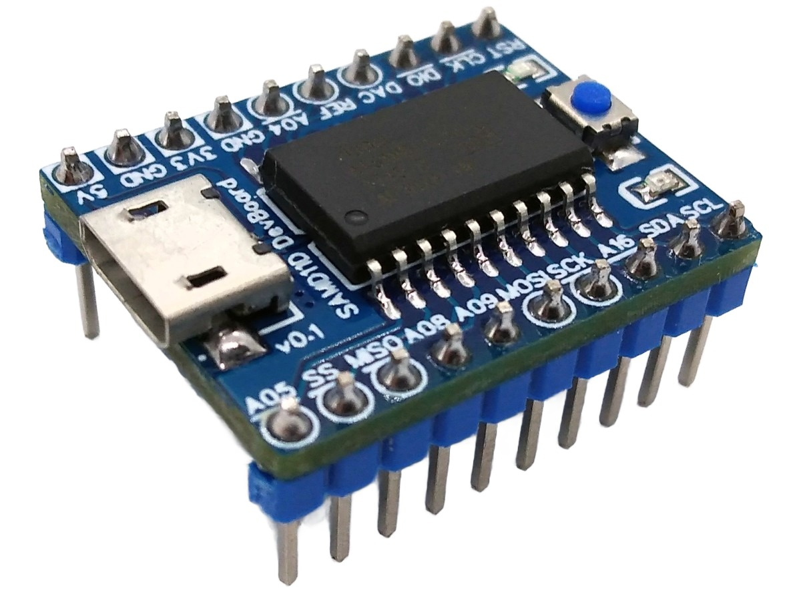
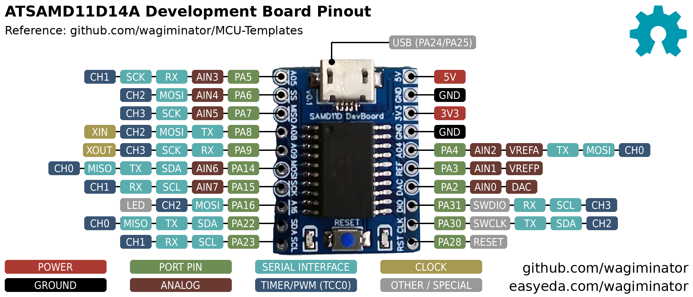
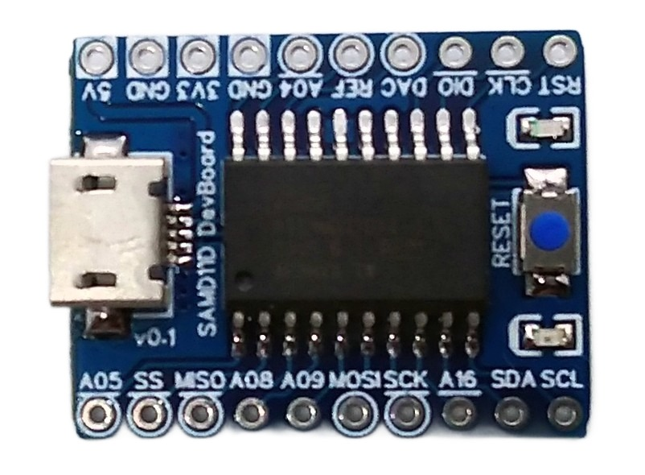
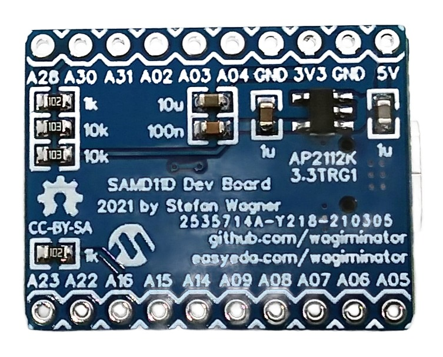

# ATSAMD11D14A Development Board
Development board for the ATSAMD11D14A (20-pin SOIC) low-cost 32-bit ARM Cortex-M0+ microcontroller with native USB, 3.3V voltage regulator, and support for USB bootloader and Arduino IDE.



# Pinout


The built-in LED is connected to pin PA16.

# The ATSAMD11D14A 32-bit ARM Cortex-M0+ USB Microcontroller
## Overview
The ATSAMD11D14A is a low-power microcontroller using the 32-bit ARM® Cortex®-M0+ processor with 16KB flash and 4KB of SRAM. It operates at a maximum frequency of 48MHz and reaches 2.46 Coremark/MHz. It includes intelligent and flexible peripherals, an event system for inter-peripheral signaling, a full-speed USB 2.0 device interface that works without an external crystal, and support for capacitive touch buttons, sliders and wheels. Compared to the 14-pin SAMD11C, the 20-pin SAMD11D offers more GPIOs, a third serial communication interface and more ADC channels.

## Features
- ARM Cortex-M0+ CPU running at up to 48MHz
- 16KB of flash memory and 4KB of SRAM
- Single-cycle hardware multiplier
- Idle and standby sleep modes, SleepWalking peripherals
- External Interrupt Controller (EIC) with 8 external interrupts and one Non-maskable Interrupt (NMI)
- 6-channel Direct Memory Access Controller (DMAC)
- 6-channel Event System
- Two 16-bit configurable Timer/Counters (TC)
- One 24-bit Timer/Counter for Control (TCC), with extended functions
- 32-bit Real Time Counter (RTC) with clock/calendar function
- Watchdog Timer (WDT)
- One full-speed (12Mbps) Universal Serial Bus (USB) 2.0 interface with embedded device function
- Three Serial Communication Interfaces (SERCOM), each configurable to operate as USART, I²C (up to 3.4MHz), SPI, SMBUS/PMBUS or LIN slave
- 12-bit, 350ksps Analog-to-Digital Converter (ADC) with up to 10 channels, differential and single-ended input, 1/2x to 16x programmable gain, oversampling in hardware up to 16-bit
- 10-bit, 350ksps Digital-to-Analog Converter (DAC)
- Two Analog Comparators (AC) with window compare function
- Peripheral Touch Controller (PTC): capacitive touch and proximity sensing
- Two-pin Serial Wire Debug (SWD) programming, test and debugging interface
- 18 GPIO pins
- Operating Voltage: 1.62V – 3.63V
- I/O Pin Current: max 7mA

# Compiling, Programming and Debugging
## GCC Toolchain
For compiling install the [ARM GNU toolchain](https://developer.arm.com/downloads/-/arm-gnu-toolchain-downloads). On Linux (Debian-based), this can be done with the following command:
```
sudo apt install build-essential gcc-arm-none-eabi
```

The [example software](https://github.com/wagiminator/Development-Boards/tree/main/ATSAMD11D14A_DevBoard/software) is based on the [ATSAMD11 MCU Template](https://github.com/wagiminator/MCU-Templates/tree/main/ATSAMD11). Go into the folder of an example and run `make flash` to compile and upload the firmware via SWD. Type `make help` to see all options.

## Serial Wire Debug Interface (SWD)
The MCU has no factory built-in bootloader. Firmware is uploaded via the Serial Wire Debug (SWD) interface using an SWD programmer (e.g. DAPLink/CMSIS-DAP, Raspberry Pi Debug Probe, WCH-LinkE in DAP mode, ST-Link V2 or J-Link). The SWD pins (CLK = PA30, DIO = PA31, RST = PA28) are available on the pin header of the board and on the optional 10-pin SWD connector on the bottom side.

The platform-independent open-source Python tool [tinyocd](https://pypi.org/project/tinyocd/) is used by the makefiles for this purpose. In order for this tool to work, Python3 must be installed on your system. On Linux (Debian-based), all of this can be done with the following commands:

```
sudo apt install python3 python3-pip
pip install tinyocd
```

Connect the SWD programmer to the board and run the following command to upload your firmware (example):

```
tinyocd -f firmware.bin
```

Alternatively, the [SWD Programmer web app](https://wagiminator.github.io/apps/swdprog/) (Chrome, Edge or Opera on a desktop computer), [pyOCD](https://pyocd.io/) (`pyocd load firmware.bin -t atsamd11d14am`), [edbg](https://github.com/ataradov/edbg) or [OpenOCD](https://openocd.org/) can be used.

## USB Bootloader
A 4KB SAM-BA USB bootloader can be found in the [bootloader](https://github.com/wagiminator/Development-Boards/tree/main/ATSAMD11D14A_DevBoard/software/bootloader) folder. It can be installed via SWD with OpenOCD (refer to the *readme.txt* in that folder) or via the Arduino IDE (see below). The OpenOCD scripts also set the BOOTPROT fuse, so that the bootloader is protected against being overwritten.

Afterwards, the firmware can be uploaded via USB using [BOSSA](https://github.com/shumatech/BOSSA) (`bossac`). The firmware must then start at address 0x1000. To do this, set `LDSCRIPT = ld/samd11_boot4k.ld` and `ISPTOOL = $(BOOTTOOL)` in the makefile of the example, or run:

```
bossac -i -U true -e -w -v -R --offset=0x1000 firmware.bin
```

The bootloader is activated by double-tapping the RESET button or by pressing and holding the RESET button while connecting the board to the USB port of your PC. The activated bootloader mode can be recognized by the fading of the built-in LED. An application can also call `BOOT_now()` to jump to the bootloader. To upload firmware via SWD again, the BOOTPROT fuse must first be cleared (e.g. with *samd_bootprot_clear.mot* in the bootloader folder).

## Arduino IDE Support
- [Install SAMD Core](https://github.com/wagiminator/SAMD-Development-Boards/tree/main/ArduinoCore-samd).
- Open the Arduino IDE.
- Go to **Tools -> Board -> SAMD DevBoards** and select the board.
- Go to **Tools -> Bootloader** and select the 4KB Bootloader.
- Go to **Tools -> Programmer** and select your programmer.
- Connect your programmer to the SWD pins of the board and power the board.
- Go to **Tools** and select **Burn bootloader**.
- Disconnect the programmer and connect the board via USB to your PC.

If a sketch with CDC support is installed on the board, the bootloader is activated automatically when a sketch is uploaded via the Arduino IDE. Otherwise you have to enter the bootloader manually as described above.

# Example Software
The following examples are included. They all use the [MCU Templates](https://github.com/wagiminator/MCU-Templates) and their libraries. The USB examples use shared VID/PID pairs for testing purposes only.

| Example | Description |
|:-|:-|
| [blink](https://github.com/wagiminator/Development-Boards/tree/main/ATSAMD11D14A_DevBoard/software/blink) | Blink built-in LED. |
| [millis](https://github.com/wagiminator/Development-Boards/tree/main/ATSAMD11D14A_DevBoard/software/millis) | Blink built-in LED using millis counter. |
| [pwm_fade](https://github.com/wagiminator/Development-Boards/tree/main/ATSAMD11D14A_DevBoard/software/pwm_fade) | Fades the built-in LED in and out using hardware PWM (TCC0). |
| [sleep](https://github.com/wagiminator/Development-Boards/tree/main/ATSAMD11D14A_DevBoard/software/sleep) | Blinks the built-in LED. Between the flashes the MCU is put into STANDBY sleep mode, the low-power timer (LPT) is used as wake-up source. |
| [watchdog](https://github.com/wagiminator/Development-Boards/tree/main/ATSAMD11D14A_DevBoard/software/watchdog) | Blink built-in LED using watchdog resets. |
| [reset](https://github.com/wagiminator/Development-Boards/tree/main/ATSAMD11D14A_DevBoard/software/reset) | Blink built-in LED using software resets. |
| [debug](https://github.com/wagiminator/Development-Boards/tree/main/ATSAMD11D14A_DevBoard/software/debug) | Sends a message via UART once a second. Connect pin PA8 (TX) to RX of a USB-to-serial converter (115200 BAUD, 8N1). |
| [serial](https://github.com/wagiminator/Development-Boards/tree/main/ATSAMD11D14A_DevBoard/software/serial) | Echoes data sent via UART (115200 BAUD, 8N1). Connect pins PA8 (TX) and PA9 (RX) to a USB-to-serial converter. |
| [adc](https://github.com/wagiminator/Development-Boards/tree/main/ATSAMD11D14A_DevBoard/software/adc) | Reads the supply voltage, the internal temperature sensor and the analog value on pin PA2 once a second and sends the results via USB CDC (virtual serial port). |
| [cdc_echo](https://github.com/wagiminator/Development-Boards/tree/main/ATSAMD11D14A_DevBoard/software/cdc_echo) | The MCU builds a USB communication device class (CDC) for serial communication via USB. Any character received is sent back (echo). |
| [capsblock](https://github.com/wagiminator/Development-Boards/tree/main/ATSAMD11D14A_DevBoard/software/capsblock) | Tired of accidentally hitting the CAPS-LOCK key? It doesn't have to be. CAPS bLOCK identifies itself as a USB HID keyboard and constantly monitors the state of CAPS LOCK. It immediately deactivates it if it has been activated. |
| [mousewiggler](https://github.com/wagiminator/Development-Boards/tree/main/ATSAMD11D14A_DevBoard/software/mousewiggler) | Keeps the PC awake: the device identifies itself as a USB HID mouse and moves the mouse pointer a tiny bit every 30 seconds. |
| [usb2serial](https://github.com/wagiminator/Development-Boards/tree/main/ATSAMD11D14A_DevBoard/software/usb2serial) | Simple USB-to-serial converter. The MCU builds a USB communication device class (CDC) and forwards the data between USB and UART (TX: PA8, RX: PA9). The BAUD rate, the parity and the number of stop bits are set by the PC. The built-in LED shows the state of the RTS line. |
| [usb2oled](https://github.com/wagiminator/Development-Boards/tree/main/ATSAMD11D14A_DevBoard/software/usb2oled) | This code implements a simple USB controlled 128x64 pixels I2C OLED display. The MCU builds a USB communication device class (CDC) for serial communication via USB. Text messages of all kinds can be sent via the USB interface and shown on the OLED display. Connect an SSD1306 128x64 pixels I2C OLED to PA22 (SDA) and PA23 (SCL). |
| [neopixel_spi](https://github.com/wagiminator/Development-Boards/tree/main/ATSAMD11D14A_DevBoard/software/neopixel_spi) | Shows a colorful animation on a string of NeoPixels (WS2812) using the hardware SPI (SERCOM). The number of pixels can be changed in neo_spi.h. Connect pin PA4 (MOSI) to DIN of the pixels string. |

# References, Links and Notes
- [EasyEDA Design Files](https://easyeda.com/wagiminator/samd11d-development-board)
- [SAMD11 Datasheet](https://ww1.microchip.com/downloads/en/DeviceDoc/Atmel-42363-SAM-D11_Datasheet.pdf)
- [ATSAMD11D14A Product Page](https://www.microchip.com/en-us/product/ATSAMD11D14A)
- [MCU Templates](https://github.com/wagiminator/MCU-Templates)
- [MCU Flash Tools](https://github.com/wagiminator/MCU-Flash-Tools)
- [SAMD Development Boards and Programmers](https://github.com/wagiminator/SAMD-Development-Boards)
- [Arduino SAMD Core](https://github.com/arduino/ArduinoCore-samd)
- [MattairTech SAMD Core](https://github.com/mattairtech/ArduinoCore-samd)




# License


This work is licensed under Creative Commons Attribution-ShareAlike 3.0 Unported License.
(http://creativecommons.org/licenses/by-sa/3.0/)
