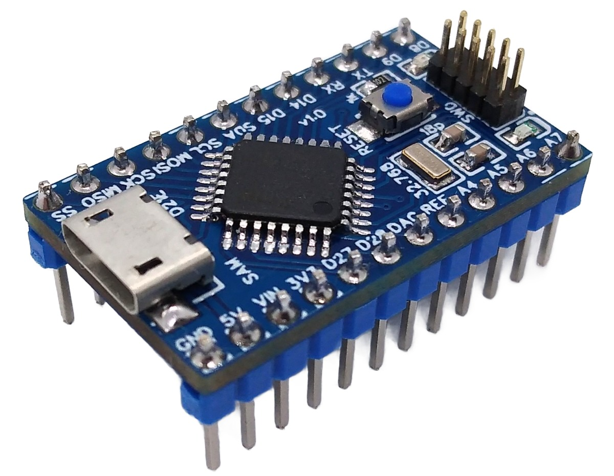
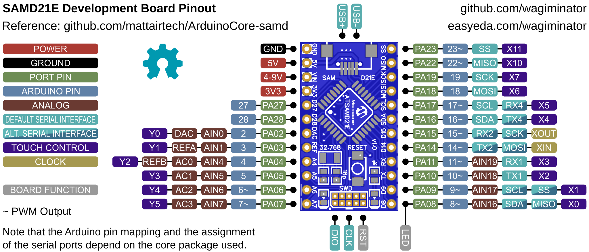
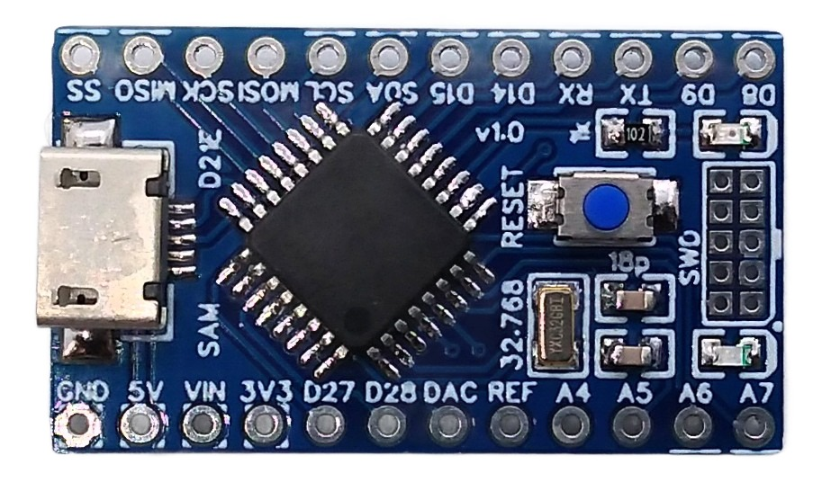
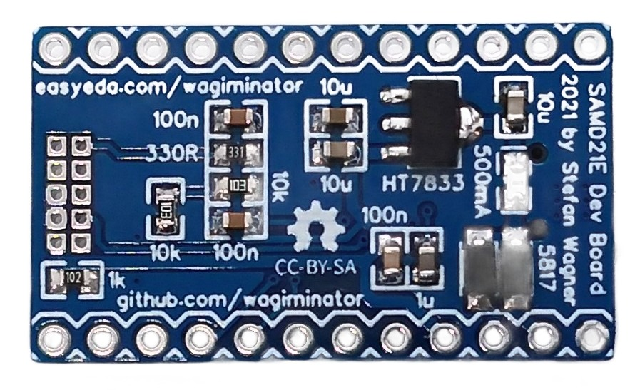

# ATSAMD21E Development Board
Development board for the ATSAMD21E (32-pin TQFP) 32-bit ARM Cortex-M0+ microcontroller with native USB, 32.768kHz crystal, 3.3V voltage regulator, and support for USB bootloader and Arduino IDE.



# Pinout


The built-in LED is connected to pin PA8. Note that the Arduino pin numbers and serial port assignments in the pinout refer to the Arduino core used and are not relevant for the example software.

# The ATSAMD21E 32-bit ARM Cortex-M0+ USB Microcontroller
## Overview
The ATSAMD21E is a low-power microcontroller using the 32-bit ARM® Cortex®-M0+ processor with up to 256KB flash and 32KB of SRAM. It operates at a maximum frequency of 48MHz and reaches 2.46 Coremark/MHz. It includes intelligent and flexible peripherals, an event system for inter-peripheral signaling, a 12-channel DMA controller, a full-speed USB 2.0 device/host interface that works without an external crystal, an I²S interface, and support for capacitive touch buttons, sliders and wheels. The board can be equipped with the ATSAMD21E15/16/17/18 (32/64/128/256KB flash).

## Features
- ARM Cortex-M0+ CPU running at up to 48MHz
- Up to 256KB of flash memory and 32KB of SRAM
- Single-cycle hardware multiplier, micro trace buffer
- Idle and standby sleep modes, SleepWalking peripherals
- External Interrupt Controller (EIC) with 16 external interrupts and one Non-maskable Interrupt (NMI)
- 12-channel Direct Memory Access Controller (DMAC)
- 12-channel Event System
- Three 16-bit Timer/Counters (TC), three 24/16-bit Timer/Counters for Control (TCC)
- 32-bit Real Time Counter (RTC) with clock/calendar function
- Watchdog Timer (WDT)
- One full-speed (12Mbps) Universal Serial Bus (USB) 2.0 interface with embedded host and device function
- Four Serial Communication Interfaces (SERCOM), each configurable to operate as USART, I²C (up to 3.4MHz), SPI, SMBUS/PMBUS or LIN slave
- One two-channel Inter-IC Sound (I²S) interface
- 12-bit, 350ksps Analog-to-Digital Converter (ADC) with up to 10 channels, differential and single-ended input, 1/2x to 16x programmable gain, oversampling in hardware up to 16-bit
- 10-bit, 350ksps Digital-to-Analog Converter (DAC)
- Two Analog Comparators (AC) with window compare function
- Peripheral Touch Controller (PTC): capacitive touch and proximity sensing
- 32.768kHz crystal oscillator, internal 8MHz and 32.768kHz oscillators, 48MHz DFLL, 96MHz fractional DPLL
- Two-pin Serial Wire Debug (SWD) programming, test and debugging interface
- 26 GPIO pins
- Operating Voltage: 1.62V – 3.63V

# Programming and Debugging
The MCU has no factory built-in bootloader. Firmware is uploaded via the serial wire debug interface (SWD) using an SWD programmer. Optionally, a USB bootloader can be installed via SWD, so that firmware can afterwards be uploaded via USB.

## Serial Wire Debug Interface (SWD)
The MCU can also be programmed and debugged via the SWD interface using an SWD programmer such as DAPLink/CMSIS-DAP, ST-Link V2, J-Link or the Raspberry Pi Debug Probe. Connect the programmer to the SWD connector (SWCLK, SWDIO, RST) pins of the board.

Suitable SWD programmers (CMSIS-DAP) can be found on my GitHub page:
- [CH552 DAPLink](https://github.com/wagiminator/CH552-DAPLink) - CMSIS-DAP compliant debug probe with SWD/JTAG and virtual COM port
- [CH552 picoDAP](https://github.com/wagiminator/CH552-picoDAP) - tiny CMSIS-DAP compliant debug probe with SWD
- [SWD Programmer Stick](https://github.com/wagiminator/SAMD-Development-Boards/tree/main/SWD_Programmer_Stick) - CMSIS-DAP programmer in USB stick format

### Uploading Firmware with tinyocd
The open-source platform-independent Python tool [tinyocd](https://pypi.org/project/tinyocd/) from the [MCU Flash Tools](https://github.com/wagiminator/MCU-Flash-Tools) is used by the makefiles of the example software. In order for this tool to work, [Python3](https://www.python.org/downloads/) with [pip](https://pip.pypa.io/en/stable/getting-started/) must be installed on your system. On Linux (Debian-based), all of this can be done with the following commands:

```
sudo apt install python3 python3-pip
pip install tinyocd
```

Usage example:

```
tinyocd -f firmware.bin
```

Programmer and chip are detected automatically. On Linux, grant access permissions for the programmer as described in the [tinyocd documentation](https://pypi.org/project/tinyocd/).

Alternatively, you can use the [SWD Programmer web app](https://wagiminator.github.io/apps/swdprog/) directly in your web browser (Chrome, Edge or Opera on a desktop computer) without installing any software.

### Alternative Software Tools
- [pyOCD](https://pyocd.io/) (`pyocd load firmware.bin -t atsamd21e18a`)
- [OpenOCD](https://openocd.org/)
- [edbg](https://github.com/ataradov/edbg)

The [SAMD Programmer Adapter](https://github.com/wagiminator/SAMD-Development-Boards/tree/main/SAMD_Programmer_Adapter) simplifies the connection of the programmer to the board.

## USB Bootloader
An 8KB SAM-BA USB bootloader can be found in the [bootloader](https://github.com/wagiminator/Development-Boards/tree/main/ATSAMD21E_DevBoard/software/bootloader) folder. It can be installed via SWD with OpenOCD (refer to the *readme.txt* in that folder) or via the Arduino IDE (see below). The OpenOCD scripts also set the BOOTPROT fuse, so that the bootloader is protected against being overwritten. Alternatively, the [UF2 bootloader](https://github.com/microsoft/uf2-samdx1) (*sam_uf2_samd21e18a.bin*) can be installed, which appears as a USB mass storage device, so that firmware can be uploaded by simply copying a UF2 file onto it.

Afterwards, the firmware can be uploaded via USB using [BOSSA](https://github.com/shumatech/BOSSA) (`bossac`). The firmware must then start at address 0x2000. To do this, set `LDSCRIPT = ld/samd21x18_boot8k.ld` and `ISPTOOL = $(BOOTTOOL)` in the makefile of the example, or run:

```
bossac -i -U true -e -w -v -R --offset=0x2000 firmware.bin
```

The bootloader is activated by double-tapping the RESET button or by pressing and holding the RESET button while connecting the board to the USB port of your PC. The activated bootloader mode can be recognized by the fading of the built-in LED. An application can also call `BOOT_now()` to jump to the bootloader. To upload firmware via SWD again, the BOOTPROT fuse must first be cleared (e.g. with *samd_bootprot_clear.mot* in the bootloader folder).

# Software Development Tools
## Open-Source GCC Toolchain
For compiling install the [ARM GNU toolchain](https://developer.arm.com/downloads/-/arm-gnu-toolchain-downloads). On Linux (Debian-based), this can be done with the following command:

```
sudo apt install build-essential gcc-arm-none-eabi
```

The [example software](#example-software) is based on the [MCU Templates](https://github.com/wagiminator/MCU-Templates/tree/main/ATSAMD21), a lightweight starting point for bare-metal firmware development in C without any IDE. Each example folder contains a makefile. Go into the folder of an example and use one of the following commands:

```
make all       compile and build firmware
make flash     compile and upload firmware to the MCU
make clean     remove all build files
make help      show all options
```

The examples are set up for the ATSAMD21E18A. If another chip is used, change `DEVICE` (e.g. `__SAMD21E17A__`) and `LDSCRIPT` (e.g. `ld/samd21x17.ld`) in the makefile accordingly.

## Arduino IDE Support
- [Install SAMD Core](https://github.com/wagiminator/SAMD-Development-Boards/tree/main/ArduinoCore-samd).
- Open the Arduino IDE.
- Go to **Tools -> Board -> SAMD DevBoards** and select the board.
- Go to **Tools -> Bootloader** and select the 8KB Bootloader.
- Go to **Tools -> Programmer** and select your programmer.
- Connect your programmer to the SWD pins of the board and power the board.
- Go to **Tools** and select **Burn bootloader**.
- Disconnect the programmer and connect the board via USB to your PC.

If a sketch with CDC support is installed on the board, the bootloader is activated automatically when a sketch is uploaded via the Arduino IDE. Otherwise you have to enter the bootloader manually as described above.

# Example Software
The following examples are included. They use the [MCU Templates](https://github.com/wagiminator/MCU-Templates) and their libraries. By default, the firmware is uploaded with `make flash` via SWD (tinyocd). The USB examples use shared VID/PID pairs for testing purposes only.

| Example | Description |
|:-|:-|
| [adc](https://github.com/wagiminator/Development-Boards/tree/main/ATSAMD21E_DevBoard/software/adc) | Reads the supply voltage, the internal temperature sensor and the analog value on pin PA2 once a second and sends the results via USB CDC (virtual serial port). |
| [blink](https://github.com/wagiminator/Development-Boards/tree/main/ATSAMD21E_DevBoard/software/blink) | Blink built-in LED. |
| [capsblock](https://github.com/wagiminator/Development-Boards/tree/main/ATSAMD21E_DevBoard/software/capsblock) | Tired of accidentally hitting the CAPS-LOCK key? It doesn't have to be. CAPS bLOCK identifies itself as a USB HID keyboard and constantly monitors the state of CAPS LOCK. It immediately deactivates it if it has been activated. |
| [cdc_echo](https://github.com/wagiminator/Development-Boards/tree/main/ATSAMD21E_DevBoard/software/cdc_echo) | The MCU builds a USB communication device class (CDC) for serial communication via USB. Any character received is sent back (echo). |
| [debug](https://github.com/wagiminator/Development-Boards/tree/main/ATSAMD21E_DevBoard/software/debug) | Sends a message via UART once a second. Connect pin PA10 (TX) to RX of a USB-to-serial converter (115200 BAUD, 8N1). |
| [millis](https://github.com/wagiminator/Development-Boards/tree/main/ATSAMD21E_DevBoard/software/millis) | Blink built-in LED using millis counter. |
| [mousewiggler](https://github.com/wagiminator/Development-Boards/tree/main/ATSAMD21E_DevBoard/software/mousewiggler) | Keeps the PC awake: the device identifies itself as a USB HID mouse and moves the mouse pointer a tiny bit every 30 seconds. |
| [neopixel_spi](https://github.com/wagiminator/Development-Boards/tree/main/ATSAMD21E_DevBoard/software/neopixel_spi) | Shows a colorful animation on a string of NeoPixels (WS2812) using the hardware SPI (SERCOM). The number of pixels can be changed in neo_spi.h. Connect pin PA18 (MOSI) to DIN of the pixels string. |
| [pwm_fade](https://github.com/wagiminator/Development-Boards/tree/main/ATSAMD21E_DevBoard/software/pwm_fade) | Fades the built-in LED in and out using hardware PWM (TCC0). |
| [reset](https://github.com/wagiminator/Development-Boards/tree/main/ATSAMD21E_DevBoard/software/reset) | Blink built-in LED using software resets. |
| [rtc](https://github.com/wagiminator/Development-Boards/tree/main/ATSAMD21E_DevBoard/software/rtc) | Real-time clock using the RTC in calendar mode clocked by the external 32.768kHz crystal. The time is set to the compile time and sent once a second via USB CDC (virtual serial port). |
| [serial](https://github.com/wagiminator/Development-Boards/tree/main/ATSAMD21E_DevBoard/software/serial) | Echoes data sent via UART (115200 BAUD, 8N1). Connect pins PA10 (TX) and PA11 (RX) to a USB-to-serial converter. |
| [sleep](https://github.com/wagiminator/Development-Boards/tree/main/ATSAMD21E_DevBoard/software/sleep) | Blinks the built-in LED. Between the flashes the MCU is put into STANDBY sleep mode, the low-power timer (LPT) is used as wake-up source. |
| [usb2oled](https://github.com/wagiminator/Development-Boards/tree/main/ATSAMD21E_DevBoard/software/usb2oled) | This code implements a simple USB controlled 128x64 pixels I2C OLED display. The MCU builds a USB communication device class (CDC) for serial communication via USB. |
| [usb2serial](https://github.com/wagiminator/Development-Boards/tree/main/ATSAMD21E_DevBoard/software/usb2serial) | Simple USB-to-serial converter. The MCU builds a USB communication device class (CDC) and forwards the data between USB and UART (TX: PA10, RX: PA11). The BAUD rate, the parity and the number of stop bits are set by the PC. |
| [watchdog](https://github.com/wagiminator/Development-Boards/tree/main/ATSAMD21E_DevBoard/software/watchdog) | Blink built-in LED using watchdog resets. |

# References, Links and Notes
- [EasyEDA Design Files](https://easyeda.com/wagiminator/samd21e-development-board)
- [SAMD21 Datasheet](https://ww1.microchip.com/downloads/en/DeviceDoc/SAM_D21_DA1_Family_DataSheet_DS40001882F.pdf)
- [ATSAMD21E Product Page](https://www.microchip.com/en-us/product/ATSAMD21E18)
- [MCU Templates](https://github.com/wagiminator/MCU-Templates)
- [MCU Flash Tools](https://github.com/wagiminator/MCU-Flash-Tools)
- [SAMD Development Boards and Programmers](https://github.com/wagiminator/SAMD-Development-Boards)
- [Arduino SAMD Core](https://github.com/arduino/ArduinoCore-samd)
- [MattairTech SAMD Core](https://github.com/mattairtech/ArduinoCore-samd)
- [SWD Programmer Web App](https://wagiminator.github.io/apps/swdprog/)




# License


This work is licensed under Creative Commons Attribution-ShareAlike 3.0 Unported License.
(http://creativecommons.org/licenses/by-sa/3.0/)
