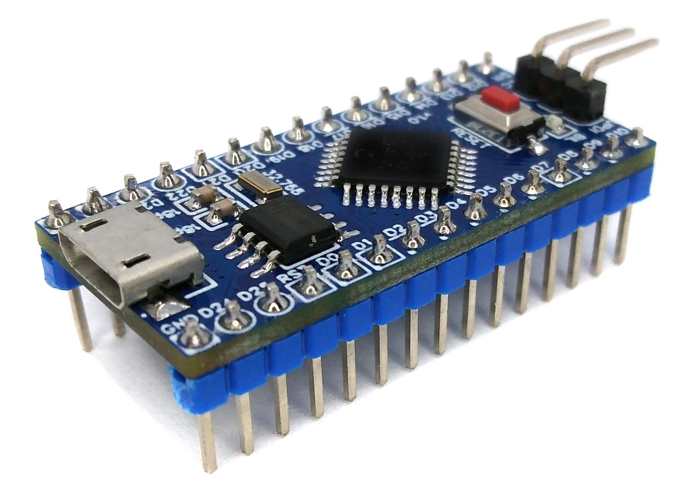
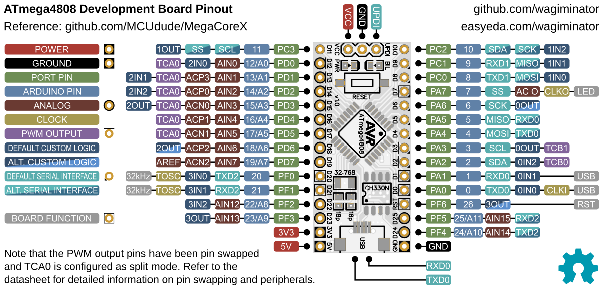
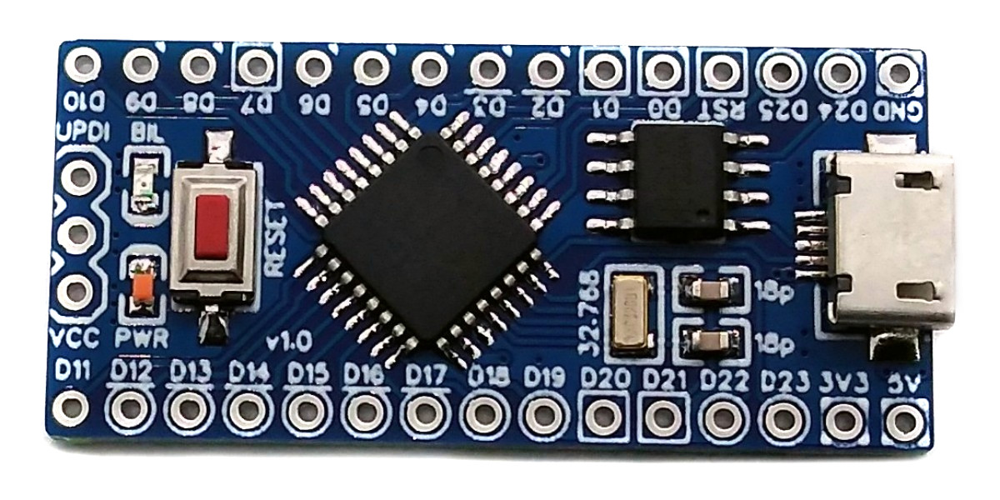
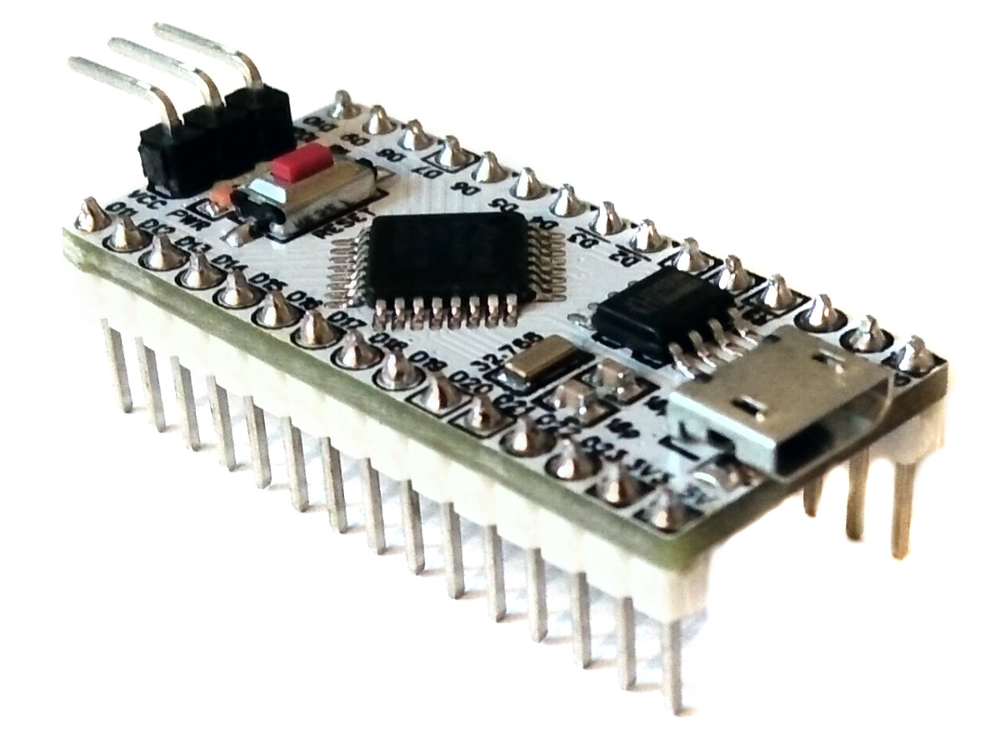

# ATmega4808 Development Board
Development board for the ATmega4808 series microcontrollers with integrated USB-to-serial converter, 32.768kHz crystal for the RTC, 3.3V voltage regulator, and support for bootloader and Arduino IDE. Due to a similar pinout, the board also works with the AVR DA/DB family of microcontrollers.



# Pinout


The built-in LED is connected to pin PA7, the CH330N USB-to-serial converter to the default USART0 pins PA0 (TXD) and PA1 (RXD). The RTS line of the converter is connected to the RESET pin (PF6) for automatic reset when using a bootloader.

# The megaAVR 0-Series Family of 8-bit Microcontrollers
## Overview
The ATmega4808 microcontrollers are part of the megaAVR 0-series, which uses the AVR processor with hardware multiplier running at up to 20MHz from the internal calibrated oscillator. The series uses the latest technologies from Microchip with a flexible and low-power architecture, including Event System and SleepWalking, accurate analog features, and advanced peripherals. The following microcontrollers (TQFP-32 package) can be used with this development board:

| Controller | Flash | SRAM | EEPROM |
|:-|:-|:-|:-|
| ATmega808 | 8 KB | 1 KB | 256 B |
| ATmega1608 | 16 KB | 2 KB | 256 B |
| ATmega3208 | 32 KB | 4 KB | 256 B |
| ATmega4808 | 48 KB | 6 KB | 256 B |

## Features
- 27 general purpose I/O
- One 16-bit Timer/Counter type A (TCA) with a dedicated period register and three compare channels
- Three 16-bit Timer/Counters type B (TCB) with input capture
- One 16-bit Real-Time Counter (RTC) running from an external crystal or an internal RC oscillator
- Three USARTs with fractional baud rate generator, auto-baud, and start-of-frame detection
- Master/slave Serial Peripheral Interface (SPI)
- Master/slave TWI (I²C) with dual address match, standard mode, fast mode and fast mode plus
- Event System for core independent and predictable inter-peripheral signaling
- Configurable Custom Logic (CCL) with up to four programmable Look-up Tables (LUT)
- One Analog Comparator (AC) with a scalable reference input
- One 10-bit 150ksps Analog-to-Digital Converter (ADC) with 12 channels
- Five selectable internal voltage references: 0.55V, 1.1V, 1.5V, 2.5V, and 4.3V
- Watchdog Timer (WDT) with window mode, with a separate on-chip oscillator
- External interrupt on all general purpose pins
- 1-wire UPDI programming and debugging interface

# Compiling, Programming and Debugging
## GCC Toolchain
For compiling install the AVR GCC toolchain. On Linux (Debian-based), this can be done with the following command:
```
sudo apt install build-essential gcc-avr avr-libc
```

The device support files in the *avr* folder of each example allow the use of older avr-gcc versions, which do not support the megaAVR 0-series natively.

## Uploading Firmware via UPDI
Firmware is uploaded via the UPDI header of the board using a SerialUPDI programmer, e.g. a USB-to-serial converter with a 1k resistor between TXD and RXD (see [MCU Templates](https://github.com/wagiminator/MCU-Templates/tree/main/ATmega4808)) or a pre-assembled [SerialUPDI Programmer](https://github.com/wagiminator/AVR-Programmer/tree/master/SerialUPDI_Programmer). The open-source platform-independent Python tool [megaupdi](https://pypi.org/project/megaupdi/) is used by the makefiles for this purpose. In order for this tool to work, Python3 must be installed on your system. On Linux (Debian-based), all of this can be done with the following commands:

```
sudo apt install python3 python3-pip
pip install megaupdi
```

Connect the programmer to the UPDI header and run the following command to upload your firmware (example):

```
megaupdi -d atmega4808 -t 20000000 -f firmware.bin
```

The `-t` option sets the oscillator fuse matching the clock frequency. Alternatively, the [AVR Serial UPDI Programmer web app](https://wagiminator.github.io/apps/serialupdi/) (Chrome, Edge or Opera on a desktop computer) or [AVRDUDE](https://github.com/avrdudes/avrdude) (programmer `serialupdi`) can be used. Do NOT use high voltage programming!

The [example software](https://github.com/wagiminator/Development-Boards/tree/main/ATmega4808_DevBoard/software) is based on the [megaAVR MCU Template](https://github.com/wagiminator/MCU-Templates/tree/main/ATmega4808). Go into the folder of an example and run `make flash` to compile and upload the firmware. If another chip of the family is used, change `DEVICE` in the makefile and copy the corresponding device support files from the template into the *avr* folder.

## Arduino IDE Support
- [Install MegaCoreX](https://github.com/MCUdude/MegaCoreX#how-to-install).
- Open the Arduino IDE.
- Go to **Tools -> Board -> MegaCoreX** and select **ATmega4808**.
- Go to **Tools** and set the following board options:
  - Clock: "Internal 20 MHz"
  - Pinout: "32 pin standard"
  - Reset pin: "Reset"
  - Bootloader: "Optiboot (UART0 default pins)"
  - Programmer: "SerialUPDI"
- Connect the SerialUPDI programmer to the UPDI header of the board.
- Go to **Tools -> Burn Bootloader**.
- Disconnect the programmer and connect the board via USB to your PC. Now you can upload your sketches via the integrated USB-to-serial converter.

## Using the AVR DA/DB Family of Microcontrollers
The even more powerful AVR DA/DB family of microcontrollers (TQFP-32 package) can also be used with this board. Some of their features (depending on the model): up to 128KB flash and 16KB SRAM, up to 24MHz with internal oscillator, 12-bit differential ADC, 10-bit DAC, three analog comparators, two OpAmps, zero-cross detector, peripheral touch controller, multi-voltage I/O, three USARTs, two SPI and two I²C interfaces. In order to be able to use the AVR DA/DB microcontrollers with the Arduino IDE, [DxCore](https://github.com/SpenceKonde/DxCore) must be installed. The example software is written for the megaAVR 0-series only.

# Example Software
The following examples are included. They all use the [MCU Templates](https://github.com/wagiminator/MCU-Templates) and their libraries. Unless otherwise stated, the serial interface (115200 BAUD, 8N1) can be accessed via the integrated USB-to-serial converter.

| Example | Description |
|:-|:-|
| [adc](https://github.com/wagiminator/Development-Boards/tree/main/ATmega4808_DevBoard/software/adc) | ADC example including supply voltage and temperature measurement. Reads the analog value on pin PD0, the supply voltage and the chip temperature once a second and sends the results via UART (115200 BAUD, 8N1). |
| [blink](https://github.com/wagiminator/Development-Boards/tree/main/ATmega4808_DevBoard/software/blink) | Blink built-in LED. |
| [blink_cip](https://github.com/wagiminator/Development-Boards/tree/main/ATmega4808_DevBoard/software/blink_cip) | Blinks the LED with Core Independent Peripherals (CIP). The periodic interrupt timer (PIT) directly toggles pin PA7 (built-in LED) via channel 0 of the event system (EVSYS). Because the CPU isn't needed anymore, it is put into sleep mode POWER-DOWN forever. |
| [blink_pit](https://github.com/wagiminator/Development-Boards/tree/main/ATmega4808_DevBoard/software/blink_pit) | Blink built-in LED using sleep mode with the periodic interrupt timer (PIT) as wake-up source. |
| [debug](https://github.com/wagiminator/Development-Boards/tree/main/ATmega4808_DevBoard/software/debug) | Sends a message via UART once a second. The message can be displayed with a serial monitor (115200 BAUD, 8N1). |
| [eeprom](https://github.com/wagiminator/Development-Boards/tree/main/ATmega4808_DevBoard/software/eeprom) | Writes a value to EEPROM address 0 and transfers the content of the EEPROM via UART (115200 BAUD, 8N1) once a second. |
| [hello_world](https://github.com/wagiminator/Development-Boards/tree/main/ATmega4808_DevBoard/software/hello_world) | Flashes the built-in LED at 1Hz and sends a message once a second via the USB-to-serial converter (115200 BAUD, 8N1). |
| [i2c_oled](https://github.com/wagiminator/Development-Boards/tree/main/ATmega4808_DevBoard/software/i2c_oled) | Displays text sent via UART (115200 BAUD, 8N1) on an SSD1306 128x64 pixels I2C OLED. Connect the OLED to PA2 (SDA) and PA3 (SCL). |
| [millis](https://github.com/wagiminator/Development-Boards/tree/main/ATmega4808_DevBoard/software/millis) | Blink built-in LED using millis counter. |
| [reset](https://github.com/wagiminator/Development-Boards/tree/main/ATmega4808_DevBoard/software/reset) | Blink built-in LED using software resets. |
| [rtc](https://github.com/wagiminator/Development-Boards/tree/main/ATmega4808_DevBoard/software/rtc) | Real-time clock using the RTC with the external 32.768kHz crystal. With a prescaler of 32768 the RTC counts every second. Every five seconds the current time and date are sent via the USB-to-serial converter (115200 BAUD, 8N1). The time is set to the compile time at startup. |
| [serial](https://github.com/wagiminator/Development-Boards/tree/main/ATmega4808_DevBoard/software/serial) | Echoes data sent via UART (115200 BAUD, 8N1). |
| [serial_int](https://github.com/wagiminator/Development-Boards/tree/main/ATmega4808_DevBoard/software/serial_int) | Echoes data sent via UART (115200 BAUD, 8N1). Uses interrupts and a ring buffer for RX. |
| [spi_max7219](https://github.com/wagiminator/Development-Boards/tree/main/ATmega4808_DevBoard/software/spi_max7219) | Prints numbers on a MAX7219 8-digit 7-segment display using hardware SPI. Connect DIN to PA4 (MOSI), CLK to PA6 (SCK) and LOAD/CS to PD1. |
| [watchdog](https://github.com/wagiminator/Development-Boards/tree/main/ATmega4808_DevBoard/software/watchdog) | Blink built-in LED using watchdog resets. |

# References, Links and Notes
- [EasyEDA Design Files](https://oshwlab.com/wagiminator/atmega4808-development-board_copy)
- [MCU Templates](https://github.com/wagiminator/MCU-Templates)
- [MCU Flash Tools](https://github.com/wagiminator/MCU-Flash-Tools)
- [AVR Development Boards](https://github.com/wagiminator/AVR-Development-Boards)
- [MegaCoreX by MCUdude](https://github.com/MCUdude/MegaCoreX)
- [DxCore by Spence Konde](https://github.com/SpenceKonde/DxCore)
- [megaAVR 0-series Family Data Sheet](http://ww1.microchip.com/downloads/en/DeviceDoc/megaAVR0-series-Family-Data-Sheet-DS40002015B.pdf)
- [ATmega4808 Datasheet](http://ww1.microchip.com/downloads/en/DeviceDoc/ATmega4808-09-DataSheet-DS40002173B.pdf)
- [TB3213: Getting Started with RTC](http://ww1.microchip.com/downloads/en/Appnotes/TB3213-Getting-Started-with-RTC-DS90003213B.pdf)
- [AN2451: Getting Started with Core Independent Peripherals](http://ww1.microchip.com/downloads/en/Appnotes/Getting-Started-with-Peripherals-on-AVR-MCU-00002451C.pdf)
- [AN2515: AVR Low-Power Techniques](http://ww1.microchip.com/downloads/en/Appnotes/AN2515-AVR-Low-Power-Techniques-00002515C.pdf)




# License


This work is licensed under Creative Commons Attribution-ShareAlike 3.0 Unported License.
(http://creativecommons.org/licenses/by-sa/3.0/)
