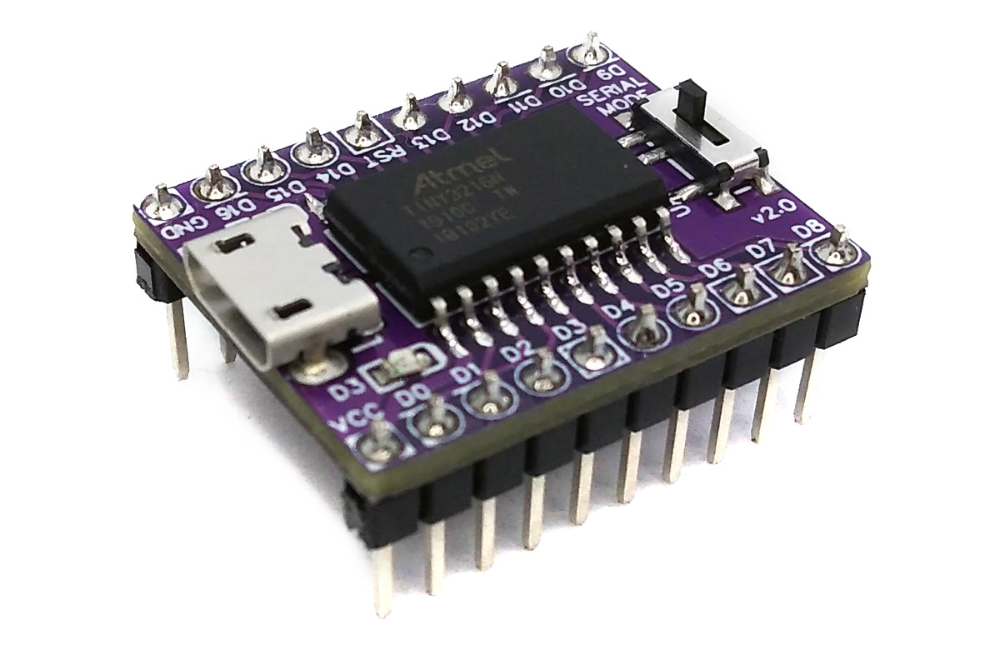
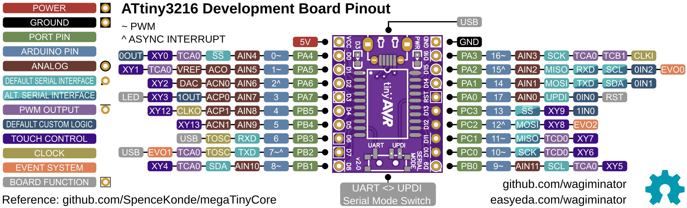
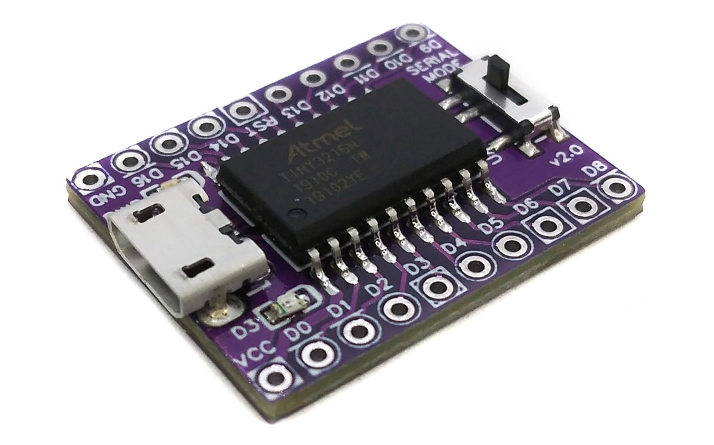
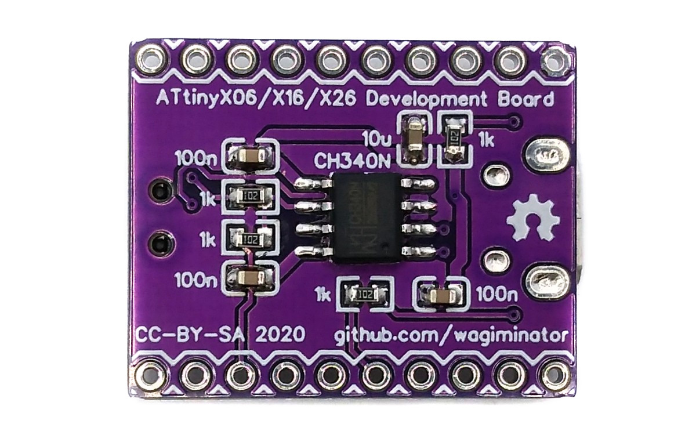
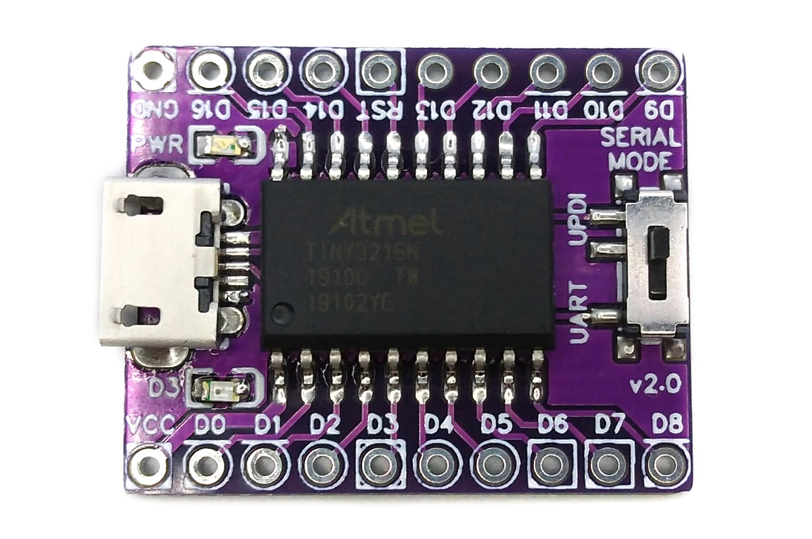

# ATtiny3216 Development Board
Development board for the ATtiny3216 and other tinyAVR x06/x16/x26 (20-pin SOIC) microcontrollers with integrated USB-to-serial converter, which can also be used as a SerialUPDI programmer to upload firmware, and Arduino IDE support.



# Pinout


The built-in LED is connected to pin PA7, the USB-to-serial converter to the default USART0 pins PB2 (TXD) and PB3 (RXD).

# Serial Mode Switch
The integrated CH340N USB-to-serial converter can also be used as a SerialUPDI programmer, so that no additional hardware is required to flash your firmware. Set the Serial Mode Switch on the board to "UPDI" (programming mode) for uploading firmware and to "UART" (serial mode) for UART communication via USB. You do not need to unplug the board for changing the serial mode.

# The tinyAVR Family of 8-bit Microcontrollers
## Overview
The tinyAVR 0-series, 1-series and 2-series from Microchip are low-power, low-cost 8-bit AVR microcontrollers with the modern AVR peripheral set. They run at up to 20MHz from the internal oscillator, operate at a supply voltage of 1.8V to 5.5V and are programmed via the 1-wire UPDI interface. The following microcontrollers can be used with this development board:

| Specifications | ATtiny406 | ATtiny806 | ATtiny1606 |
|:-|:-|:-|:-|
| Flash | 4096 bytes | 8192 bytes | 16384 bytes |
| RAM | 256 bytes | 512 bytes | 1024 bytes |
| EEPROM | 128 bytes | 128 bytes | 256 bytes |
| GPIO Pins | 18 (17 usable) | 18 (17 usable) | 18 (17 usable) |
| ADC Channels | 11 | 11 | 11 |
| DAC | 0 | 0 | 0 |
| Timer/Counter A/B/D | 1/1/0 | 1/1/0 | 1/1/0 |

| Specifications | ATtiny416 | ATtiny816 | ATtiny1616 | ATtiny3216 |
|:-|:-|:-|:-|:-|
| Flash | 4096 bytes | 8192 bytes | 16384 bytes | 32768 bytes |
| RAM | 256 bytes | 512 bytes | 2048 bytes | 2048 bytes |
| EEPROM | 128 bytes | 128 bytes | 256 bytes | 256 bytes |
| GPIO Pins | 18 (17 usable) | 18 (17 usable) | 18 (17 usable) | 18 (17 usable) |
| ADC Channels | 11 | 11 | 11 | 11 |
| DAC | 1 | 1 | 3 | 3 |
| Timer/Counter A/B/D | 1/1/1 | 1/1/1 | 1/2/1 | 1/2/1 |

| Specifications | ATtiny426 | ATtiny826 | ATtiny1626 | ATtiny3226 |
|:-|:-|:-|:-|:-|
| Flash | 4096 bytes | 8192 bytes | 16384 bytes | 32768 bytes |
| RAM | 512 bytes | 1024 bytes | 2048 bytes | 3072 bytes |
| EEPROM | 128 bytes | 128 bytes | 256 bytes | 256 bytes |
| GPIO Pins | 18 (17 usable) | 18 (17 usable) | 18 (17 usable) | 18 (17 usable) |
| ADC Channels | 15 | 15 | 15 | 15 |
| DAC | 0 | 0 | 0 | 0 |
| Timer/Counter A/B/D | 1/2/0 | 1/2/0 | 1/2/0 | 1/2/0 |

All chips have a USART (2-series: two USARTs), SPI and I²C interface and an internal oscillator with 20/16/10/8/5/4/1MHz.

Note: The 0-series and 1-series parts have a 10-bit single-ended ADC with a sampling rate of up to 115 ksps, the 2-series parts have a 12-bit single-ended/differential ADC with a sampling rate of up to 375 ksps. The [tinyAVR MCU Template](https://github.com/wagiminator/MCU-Templates/tree/main/ATtiny814) and the example software support the 0-series and 1-series.

# Compiling, Programming and Debugging
## GCC Toolchain
For compiling install the AVR GCC toolchain. On Linux (Debian-based), this can be done with the following command:
```
sudo apt install build-essential gcc-avr avr-libc
```

The device support files in the *avr* folder of each example allow the use of older avr-gcc versions, which do not support the tinyAVR natively.

## Uploading Firmware via SerialUPDI
The open-source platform-independent Python tool [tinyupdi](https://pypi.org/project/tinyupdi/) is used by the makefiles to upload firmware via the integrated SerialUPDI programmer. In order for this tool to work, Python3 must be installed on your system. On Linux (Debian-based), all of this can be done with the following commands:

```
sudo apt install python3 python3-pip
pip install tinyupdi
```

Set the Serial Mode Switch to "UPDI", connect the board via USB to your PC and run the following command to upload your firmware (example):

```
tinyupdi -d attiny3216 -t 20000000 -f firmware.bin
```

The `-t` option sets the oscillator fuse matching the clock frequency. Alternatively, the [AVR Serial UPDI Programmer web app](https://wagiminator.github.io/apps/serialupdi/) (Chrome, Edge or Opera on a desktop computer), [megaupdi](https://pypi.org/project/megaupdi/) or [AVRDUDE](https://github.com/avrdudes/avrdude) (programmer `serialupdi`) can be used. If necessary, install the driver for the [CH340N](https://www.wch-ic.com/downloads/CH341SER_ZIP.html).

The [example software](https://github.com/wagiminator/Development-Boards/tree/main/ATtiny3216_DevBoard/software) is based on the [tinyAVR MCU Template](https://github.com/wagiminator/MCU-Templates/tree/main/ATtiny814). Go into the folder of an example and run `make flash` to compile and upload the firmware. If another chip of the family is used, change `DEVICE` in the makefile and copy the corresponding device support files from the template into the *avr* folder.

## Arduino IDE Support
- [Install megaTinyCore](https://github.com/SpenceKonde/megaTinyCore/blob/master/Installation.md).
- Open the Arduino IDE.
- Go to **Tools -> Board -> megaTinyCore** and select your chip.
- Go to **Tools** and set the desired board options.
- Go to **Tools -> Programmer** and select **SerialUPDI**.
- Connect the board via USB to your PC.
- Set the Serial Mode Switch on the board to "UPDI".
- Go to **Tools -> Burn Bootloader** (this sets the fuses).
- Now you can upload your sketch.

# Example Software
The following examples are included. They all use the [MCU Templates](https://github.com/wagiminator/MCU-Templates) and their libraries. Unless otherwise stated, the serial interface (115200 BAUD, 8N1) can be accessed via the USB-to-serial converter (set the Serial Mode Switch to "UART").

| Example | Description |
|:-|:-|
| [adc](https://github.com/wagiminator/Development-Boards/tree/main/ATtiny3216_DevBoard/software/adc) | ADC example including supply voltage and temperature measurement. Reads the analog value on pin PA4, the supply voltage and the chip temperature once a second and sends the results via UART (115200 BAUD, 8N1). |
| [blink](https://github.com/wagiminator/Development-Boards/tree/main/ATtiny3216_DevBoard/software/blink) | Blink built-in LED. |
| [debug](https://github.com/wagiminator/Development-Boards/tree/main/ATtiny3216_DevBoard/software/debug) | Sends a message via UART once a second. The message can be displayed with a serial monitor (115200 BAUD, 8N1). |
| [eeprom](https://github.com/wagiminator/Development-Boards/tree/main/ATtiny3216_DevBoard/software/eeprom) | Writes a value to EEPROM address 0 and transfers the content of the EEPROM via UART (115200 BAUD, 8N1) once a second. |
| [i2c_oled](https://github.com/wagiminator/Development-Boards/tree/main/ATtiny3216_DevBoard/software/i2c_oled) | Displays text sent via UART (115200 BAUD, 8N1) on an SSD1306 128x64 pixels I2C OLED. Connect the OLED to PB1 (SDA) and PB0 (SCL). |
| [millis](https://github.com/wagiminator/Development-Boards/tree/main/ATtiny3216_DevBoard/software/millis) | Blink built-in LED using millis counter. |
| [reset](https://github.com/wagiminator/Development-Boards/tree/main/ATtiny3216_DevBoard/software/reset) | Blink built-in LED using software resets. |
| [reset_pin](https://github.com/wagiminator/Development-Boards/tree/main/ATtiny3216_DevBoard/software/reset_pin) | Software-defined reset pin. Pulling pin PA4 to GND resets the MCU. |
| [serial](https://github.com/wagiminator/Development-Boards/tree/main/ATtiny3216_DevBoard/software/serial) | Echoes data sent via UART (115200 BAUD, 8N1). |
| [serial_int](https://github.com/wagiminator/Development-Boards/tree/main/ATtiny3216_DevBoard/software/serial_int) | Echoes data sent via UART (115200 BAUD, 8N1). Uses interrupts and a ring buffer for RX. |
| [sleep](https://github.com/wagiminator/Development-Boards/tree/main/ATtiny3216_DevBoard/software/sleep) | Blink built-in LED using sleep mode with the periodic interrupt timer (PIT) as wake-up source. |
| [spi_max7219](https://github.com/wagiminator/Development-Boards/tree/main/ATtiny3216_DevBoard/software/spi_max7219) | Prints numbers on a MAX7219 8-digit 7-segment display using hardware SPI. Connect DIN to PA1 (MOSI), CLK to PA3 (SCK) and LOAD/CS to PA4. |
| [watchdog](https://github.com/wagiminator/Development-Boards/tree/main/ATtiny3216_DevBoard/software/watchdog) | Blink built-in LED using watchdog resets. |

# References, Links and Notes
- [EasyEDA Design Files](https://oshwlab.com/wagiminator/y-attiny3216-development-board-smd_copy_copy)
- [ATtiny3216 Datasheet / Product Page](https://www.microchip.com/en-us/product/ATtiny3216)
- [MCU Templates](https://github.com/wagiminator/MCU-Templates)
- [MCU Flash Tools](https://github.com/wagiminator/MCU-Flash-Tools)
- [AVR Development Boards](https://github.com/wagiminator/AVR-Development-Boards)
- [Getting started with the new ATtiny chips](http://www.technoblogy.com/show?2OCH)
- [The ATtiny 2-Series](http://www.technoblogy.com/show?3UKF)
- [megaTinyCore](https://github.com/SpenceKonde/megaTinyCore)





# License


This work is licensed under Creative Commons Attribution-ShareAlike 3.0 Unported License.
(http://creativecommons.org/licenses/by-sa/3.0/)
