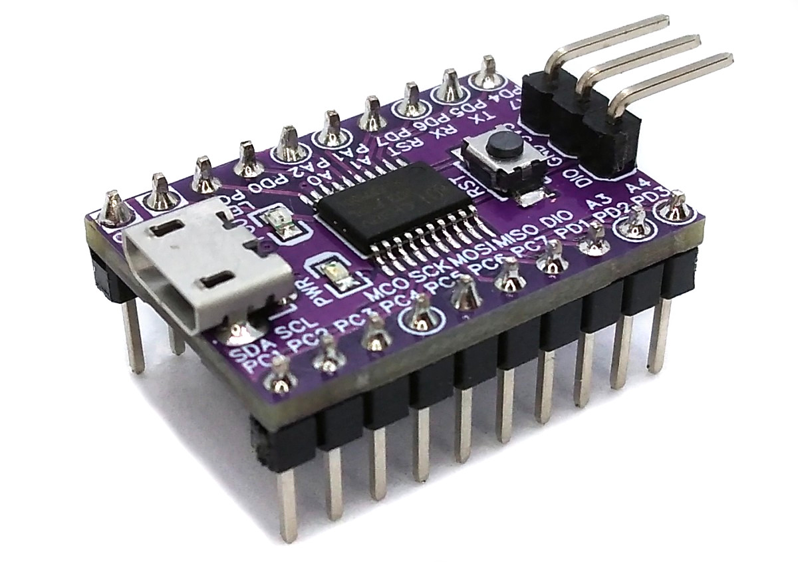
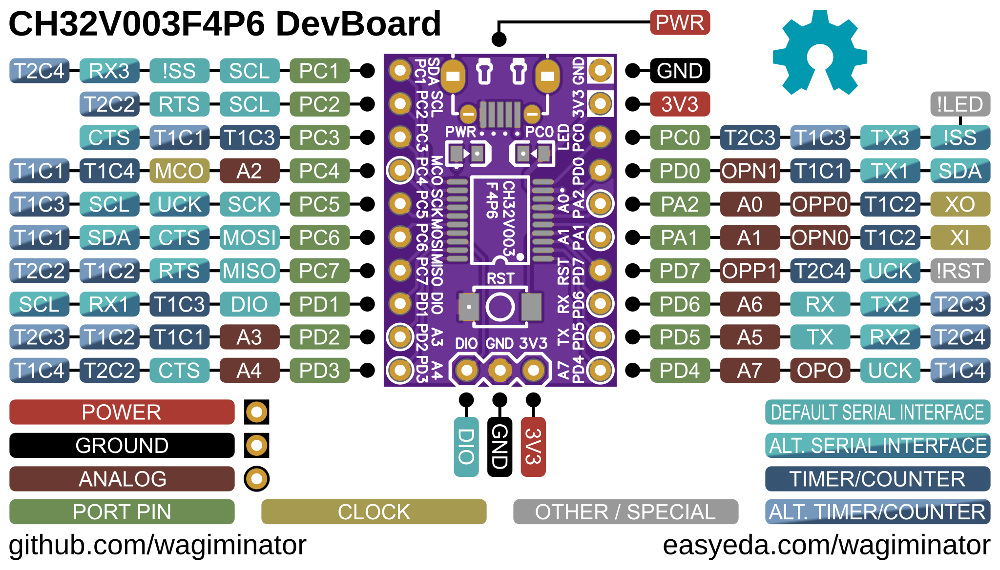
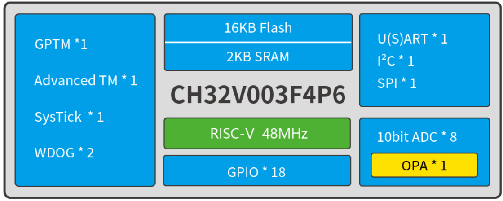
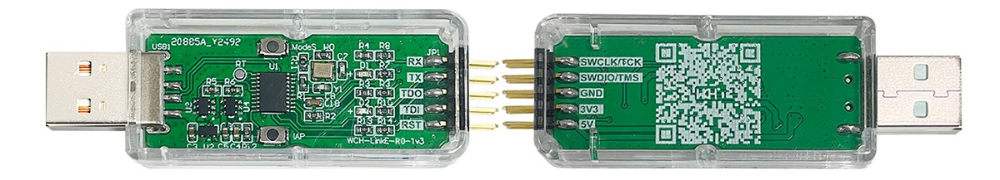
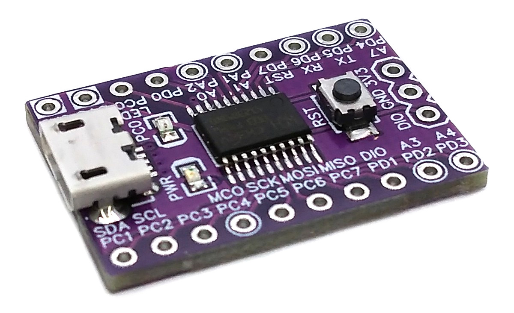
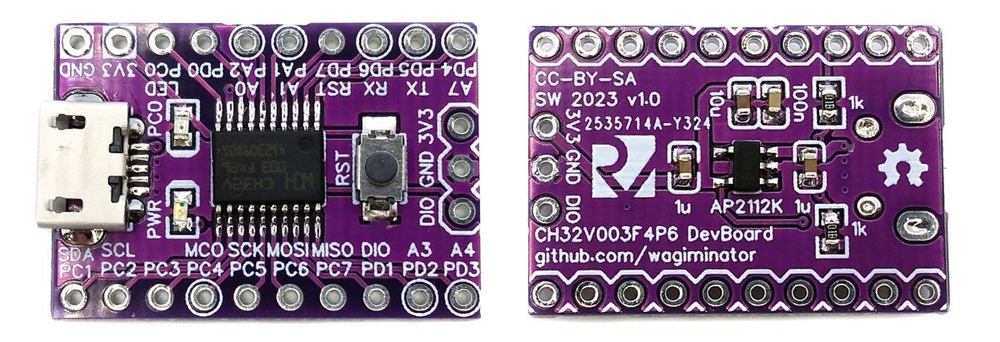

# CH32V003 F4P6 Development Board
Development board for the CH32V003F4P6 ultra-cheap 32-bit RISC-V microcontroller.



# Pinout


# The CH32V003 Family of 32-bit RISC-V Microcontrollers
## Overview
The CH32V003 series is a collection of industrial-grade general-purpose microcontrollers that utilize the QingKe RISC-V2A core design supporting the RV32EC instruction set. These microcontrollers are equipped with various features such as a 48MHz system main frequency, 16KB flash, 2KB SRAM, wide voltage support (2.7V - 5.5V), a single-wire serial debug interface, low power consumption, and an ultra-small package. Additionally, the CH32V003 series includes a built-in set of components including a DMA controller, a 10-bit ADC, op-amp comparators, multiple timers, and standard communication interfaces such as USART, I2C, and SPI.

## Block Diagram


## Features
- QingKe 32-bit RISC-V2A processor, supporting 2 levels of interrupt nesting
- Maximum 48MHz system main frequency
- 2KB SRAM, 16KB Flash
- Operating voltage: 2.7V - 5.5V
- Multiple low-power modes: Sleep, Standby
- Power on/off reset, programmable voltage detector
- 1x 7-channel DMA controller
- 1x op-amp comparator
- 1x 10-bit 10-channel ADC
- 1× 16-bit advanced-control timer
- 1× 16-bit general-purpose timer
- 2x watchdog timer (IWDT, WWDT)
- 1× 32-bit SysTick timer
- 1x USART interface, 1x I2C interface, 1x SPI interface
- 18 I/O ports, mapping an external interrupt
- 64-bit chip unique ID
- Single-wire serial debug interface (SDI)

# Programming and Debugging
The CH32V003 has no built-in bootloader. To program the microcontroller, you will need a special programming device which utilizes the proprietary single-wire serial debug interface (SDI).

## Single-Wire Serial Debug Interface (SDI)
### WCH-LinkE
The SDI only needs one data line (DIO). The [WCH-LinkE](https://www.wch-ic.com/products/WCH-Link.html) (pay attention to the "E" in the name) is a suitable device for this purpose and can be purchased commercially for around $3 - $4, e.g. at the [WCH Official Store on AliExpress](https://wchofficialstore.aliexpress.com). This debugging tool is also compatible with other WCH RISC-V and ARM-based microcontrollers.



To use the WCH-LinkE on Linux, you need to grant access permissions beforehand by executing the following commands:

```
echo 'SUBSYSTEM=="usb", ATTR{idVendor}=="1a86", ATTR{idProduct}=="8010", MODE="666"' | sudo tee /etc/udev/rules.d/99-WCH-LinkE.rules
echo 'SUBSYSTEM=="usb", ATTR{idVendor}=="1a86", ATTR{idProduct}=="8012", MODE="666"' | sudo tee -a /etc/udev/rules.d/99-WCH-LinkE.rules
sudo udevadm control --reload-rules
```

On Windows, if you need to you can install the WinUSB driver over the WCH interface 1 using the [Zadig](https://zadig.akeo.ie/) tool.

To upload firmware, make the following connections to the WCH-LinkE:

```
WCH-LinkE      DevBoard
+-------+      +------+
|  SWDIO| <--> |DIO   |
|    GND| ---> |GND   |
|    3V3| ---> |3V3   |
+-------+      +------+
```

The board can be powered by the WCH-LinkE (3V3) or via its own power supply. In the latter case, do not connect the 3V3 line.

If the blue LED on the WCH-LinkE remains illuminated once it is connected to the USB port, it means that the device is currently in ARM mode and must be switched to RISC-V mode initially. There are a few ways to accomplish this:
- You can use the Python tool [rvprog](https://pypi.org/project/rvprog/) (with -v option) or the [rvprog web app](https://wagiminator.github.io/apps/rvprog/).
- Alternatively, you can select "WCH-LinkRV" in the software provided by WCH, such as MounRiver Studio or WCH-LinkUtility.
- Another option is to hold down the ModeS button on the device while plugging it into the USB port.

More information can be found in the [WCH-Link User Manual](https://www.wch-ic.com/downloads/WCH-LinkUserManual_PDF.html).

### Uploading Firmware with rvprog
The open-source platform-independent Python tool [rvprog](https://pypi.org/project/rvprog/) from the [MCU Flash Tools](https://github.com/wagiminator/MCU-Flash-Tools) is used by the makefiles of the example software. In order for this tool to work, [Python3](https://www.python.org/downloads/) with [pip](https://pip.pypa.io/en/stable/getting-started/) must be installed on your system. On Linux (Debian-based), all of this can be done with the following commands:

```
sudo apt install python3 python3-pip
pip install rvprog
```

Usage example:

```
rvprog -f firmware.bin
```

Alternatively, you can use the [rvprog web app](https://wagiminator.github.io/apps/rvprog/) directly in your web browser (Chrome, Edge or Opera on a desktop computer) without installing any software.

### Alternative Software Tools
- [WCH-LinkUtility](https://www.wch.cn/downloads/WCH-LinkUtility_ZIP.html) - official closed-source tool by WCH (Windows only)
- [MounRiver Studio](https://www.mounriver.com/) - official IDE by WCH
- [minichlink](https://github.com/cnlohr/ch32fun/tree/master/minichlink) by Charles Lohr
- [wlink](https://github.com/ch32-rs/wlink)

### Alternative Debugging Devices
As part of his [ch32fun](https://github.com/cnlohr/ch32fun) project, Charles Lohr has also developed open-source programmers/debuggers based on STM32F042 and ESP32S2. Furthermore, the schematic diagram of the WCH-LinkE is available on the manufacturer's [website](https://www.wch.cn/products/WCH-Link.html).

# Software Development Tools
## Open-Source GCC Toolchain
You can download a complete toolchain (GCC and OpenOCD) for Linux and Mac from the [MounRiver Studio](https://www.mounriver.com/) website. However, on Linux you can also install a GCC-based toolchain by running the following command:

```
sudo apt install build-essential libnewlib-dev gcc-riscv64-unknown-elf
```

The [example software](#example-software) is based on the [MCU Templates](https://github.com/wagiminator/MCU-Templates/tree/main/CH32V003), a lightweight starting point for bare-metal firmware development in C without any IDE. Each example folder contains a makefile. Go into the folder of an example and use one of the following commands:

```
make all       compile and build firmware
make flash     compile and upload firmware to the MCU
make clean     remove all build files
make help      show all options
```

You can also use the [ch32fun SDK](https://github.com/cnlohr/ch32fun) by Charles Lohr (CNLohr). Follow the instructions on the GitHub page to install the toolchain.

## MounRiver Studio IDE
The Eclipse-based closed-source [MounRiver Studio IDE](https://www.mounriver.com/) is the official development environment provided by WCH. It supports Windows, Linux, and Mac. MounRiver Studio can be downloaded for free.

## Arduino IDE and PlatformIO Support
There are projects around to make the CH32V003 compatible with the Arduino IDE ([arduino_core_ch32](https://github.com/openwch/arduino_core_ch32) and [arduino-wch32v003](https://github.com/AlexanderMandera/arduino-wch32v003)) and PlatformIO ([platform-ch32v](https://github.com/Community-PIO-CH32V/platform-ch32v)).

# Example Software
The following examples are included. They use the [MCU Templates](https://github.com/wagiminator/MCU-Templates) and their libraries. Upload the firmware with `make flash` using the WCH-LinkE.

| Example | Description |
|:-|:-|
| [blink](https://github.com/wagiminator/Development-Boards/tree/main/CH32V003F4P6_DevBoard/software/blink) | Blink built-in LED using delay. |
| [bme280](https://github.com/wagiminator/Development-Boards/tree/main/CH32V003F4P6_DevBoard/software/bme280) | Reads temperature, pressure and humidity via I2C BME280 sensor (SDA: PC1, SCL: PC2) and sends data via serial interface (UART BAUD: 115200, 8N1, TX: PD5). |
| [debug](https://github.com/wagiminator/Development-Boards/tree/main/CH32V003F4P6_DevBoard/software/debug) | Sends a message via UART once a second. |
| [encoder](https://github.com/wagiminator/Development-Boards/tree/main/CH32V003F4P6_DevBoard/software/encoder) | Reads rotary encoder utilizing timer and sends value via UART. Pins: PC6 -> ENC_A, PC7 -> ENC_B, PD5 -> RXD USB2Serial. |
| [flash_test](https://github.com/wagiminator/Development-Boards/tree/main/CH32V003F4P6_DevBoard/software/flash_test) | FLASH, Option Bytes (OB) and Electronic Signature (ESIG) demo. |
| [i2c_eeprom](https://github.com/wagiminator/Development-Boards/tree/main/CH32V003F4P6_DevBoard/software/i2c_eeprom) | Transfers content of 24Cxx I2C EEPROM via UART. |
| [max7219_segment](https://github.com/wagiminator/Development-Boards/tree/main/CH32V003F4P6_DevBoard/software/max7219_segment) | Print numbers on a MAX7219 8-digit 8-segment display. Connect PC4 (CS), PC5 (CLK), PC6 (DIN). |
| [millis](https://github.com/wagiminator/Development-Boards/tree/main/CH32V003F4P6_DevBoard/software/millis) | Blink built-in LED using millis counter. |
| [neopixel_dma](https://github.com/wagiminator/Development-Boards/tree/main/CH32V003F4P6_DevBoard/software/neopixel_dma) | Shows a colorful animation on a string of 8 NeoPixels. The number of pixels can be changed in config.h. Connect pin PC6 (MOSI) to DIN of the pixels string. |
| [neopixel_spi](https://github.com/wagiminator/Development-Boards/tree/main/CH32V003F4P6_DevBoard/software/neopixel_spi) | Shows a colorful animation on a string of 8 NeoPixels. The number of pixels can be changed in neo_spi.h. Connect pin PC6 (MOSI) to DIN of the pixels string. |
| [neopixel_sw](https://github.com/wagiminator/Development-Boards/tree/main/CH32V003F4P6_DevBoard/software/neopixel_sw) | Shows a colorful animation on a string of 8 NeoPixels. The number of pixels can be changed in neo_spi.h. Connect pin PC6 (MOSI) to DIN of the pixels string. |
| [oled_conway](https://github.com/wagiminator/Development-Boards/tree/main/CH32V003F4P6_DevBoard/software/oled_conway) | The Game of Life is a cellular automaton, and was invented by Cambridge mathematician John Conway. This game became widely known when it was mentioned in an article published by Scientific American in 1970. |
| [oled_dma](https://github.com/wagiminator/Development-Boards/tree/main/CH32V003F4P6_DevBoard/software/oled_dma) | SSD1306 128x64 Pixels I2C OLED demo with constant screen refresh. This implementation utilizes DMA in circular mode for continuous data transfer of the screen buffer to the OLED. |
| [oled_gfx](https://github.com/wagiminator/Development-Boards/tree/main/CH32V003F4P6_DevBoard/software/oled_gfx) | SSD1306 128x64 Pixels I2C OLED graphics demo. Connect an SSD1306 128x64 Pixels I2C OLED to PC1 (SDA) and PC2 (SCL). |
| [oled_mandelbrot](https://github.com/wagiminator/Development-Boards/tree/main/CH32V003F4P6_DevBoard/software/oled_mandelbrot) | The Mandelbrot set is a complex set of points that forms a fractal, named after mathematician Benoît Mandelbrot. |
| [oled_pic](https://github.com/wagiminator/Development-Boards/tree/main/CH32V003F4P6_DevBoard/software/oled_pic) | Connect an SSD1306 128x64 Pixels I2C OLED to PC1 (SDA) and PC2 (SCL). MCU sends a picture to the OLED via I2C utilizing DMA. |
| [oled_sinewave](https://github.com/wagiminator/Development-Boards/tree/main/CH32V003F4P6_DevBoard/software/oled_sinewave) | Retro-style sine wave animated text scroller for SSD1306 128x32 pixels I2C OLED. Connect the OLED to PC1 (SDA) and PC2 (SCL). |
| [oled_terminal](https://github.com/wagiminator/Development-Boards/tree/main/CH32V003F4P6_DevBoard/software/oled_terminal) | Displays text sent via UART on an SSD1306 128x64 pixels OLED. |
| [oled_txt](https://github.com/wagiminator/Development-Boards/tree/main/CH32V003F4P6_DevBoard/software/oled_txt) | SSD1306 128x64 Pixels I2C OLED text demo. Connect an SSD1306 128x64 Pixels I2C OLED to PC1 (SDA) and PC2 (SCL). |
| [pin_event](https://github.com/wagiminator/Development-Boards/tree/main/CH32V003F4P6_DevBoard/software/pin_event) | Control LED via push button using events. |
| [pin_interrupt](https://github.com/wagiminator/Development-Boards/tree/main/CH32V003F4P6_DevBoard/software/pin_interrupt) | Control LED via push button using interrupts. |
| [pwm](https://github.com/wagiminator/Development-Boards/tree/main/CH32V003F4P6_DevBoard/software/pwm) | Fade built-in LED using PWM. |
| [reset](https://github.com/wagiminator/Development-Boards/tree/main/CH32V003F4P6_DevBoard/software/reset) | Blink built-in LED using continuous software resets. |
| [reset_pin](https://github.com/wagiminator/Development-Boards/tree/main/CH32V003F4P6_DevBoard/software/reset_pin) | Control built-in LED with RST button. |
| [reset_pin_sw](https://github.com/wagiminator/Development-Boards/tree/main/CH32V003F4P6_DevBoard/software/reset_pin_sw) | Software reset pin. |
| [serial](https://github.com/wagiminator/Development-Boards/tree/main/CH32V003F4P6_DevBoard/software/serial) | Echoes data sent via UART. |
| [serial_dma](https://github.com/wagiminator/Development-Boards/tree/main/CH32V003F4P6_DevBoard/software/serial_dma) | Echoes data sent via UART. Uses DMA for UART RX. |
| [sleep](https://github.com/wagiminator/Development-Boards/tree/main/CH32V003F4P6_DevBoard/software/sleep) | Blink built-in LED using deep sleep with automatic wake-up timer (AWU). |
| [st7302_lcd](https://github.com/wagiminator/Development-Boards/tree/main/CH32V003F4P6_DevBoard/software/st7302_lcd) | ST7302 250x122 Pixels Monochrome Low-Power Liquid Crystal Display Graphics Demo. Connect the LCD as follows: MCU - Display GND - GND VCC - VCC (3V3) SCL - PC5 SDA - PC6 RES - VCC (3V3) DC - PC3 CS - PC4 |
| [st7789_tft](https://github.com/wagiminator/Development-Boards/tree/main/CH32V003F4P6_DevBoard/software/st7789_tft) | ST7789 240x135 Pixels Color TFT Display Graphics Demo. Connect the TFT as follows: MCU - Display GND - GND VCC - VCC (3V3) SCL - PC5 SDA - PC6 RES - VCC (3V3) DC - PC3 CS - PC4 BLK - VCC (3V3) |
| [tinybasic](https://github.com/wagiminator/Development-Boards/tree/main/CH32V003F4P6_DevBoard/software/tinybasic) | A simple BASIC interpreter based on TOYOSHIKI Tiny BASIC using a UART terminal. |
| [tm1650_segment](https://github.com/wagiminator/Development-Boards/tree/main/CH32V003F4P6_DevBoard/software/tm1650_segment) | Displays supply voltage on a 4-digit 8-segment LED Display via TM1650 and I2C. Connections: pin PC1 (SDA) and PC2 (SCL). |
| [vdd](https://github.com/wagiminator/Development-Boards/tree/main/CH32V003F4P6_DevBoard/software/vdd) | Measures 1.2V internal voltage reference (Vref) against Vdd with analog to digital converter (ADC), calculates supply voltage in millivolts (mV) and sends value via UART. |
| [watchdog](https://github.com/wagiminator/Development-Boards/tree/main/CH32V003F4P6_DevBoard/software/watchdog) | Blink built-in LED using independent watchdog resets. |

# References, Links and Notes
- [EasyEDA Design Files](https://oshwlab.com/wagiminator)
- [MCU Templates](https://github.com/wagiminator/MCU-Templates)
- [MCU Flash Tools](https://github.com/wagiminator/MCU-Flash-Tools)
- [MounRiver Studio](https://www.mounriver.com/)
- [ch32fun SDK](https://github.com/cnlohr/ch32fun)
- [arduino_core_ch32](https://github.com/openwch/arduino_core_ch32)
- [arduino-wch32v003](https://github.com/AlexanderMandera/arduino-wch32v003)
- [CH32V003 with PlatformIO](https://github.com/Community-PIO-CH32V/platform-ch32v)
- [CH32V003 on openwch](https://github.com/openwch/ch32v003)
- [MuseLab nanoCH32V003](https://github.com/wuxx/nanoCH32V003)
- [CH32V003 datasheets](https://www.wch-ic.com/products/CH32V003.html)
- [WCH-Link user manual](https://www.wch-ic.com/downloads/WCH-LinkUserManual_PDF.html)
- [WCH Official Store on AliExpress](https://wchofficialstore.aliexpress.com)
- [rvprog Web App](https://wagiminator.github.io/apps/rvprog/)




# License


This work is licensed under Creative Commons Attribution-ShareAlike 3.0 Unported License.
(http://creativecommons.org/licenses/by-sa/3.0/)
