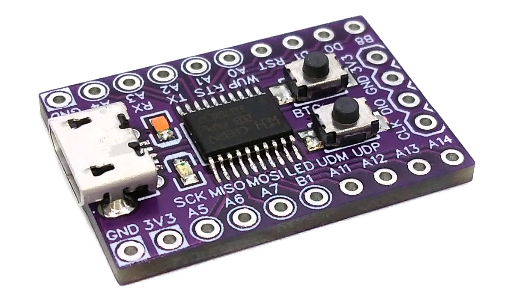
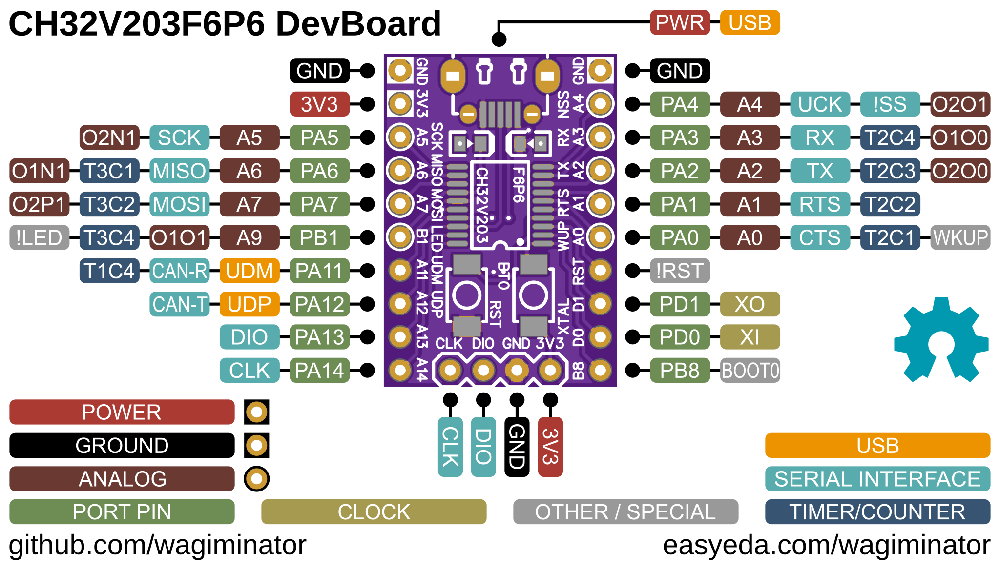
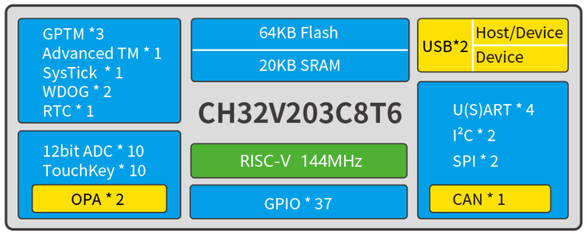
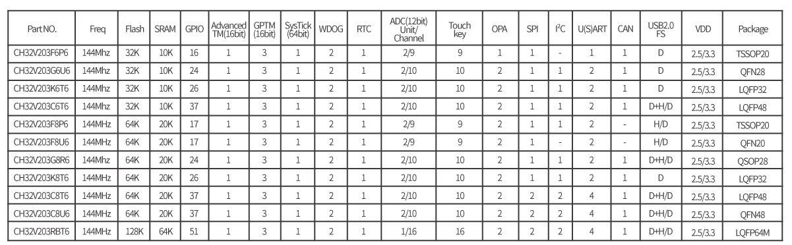
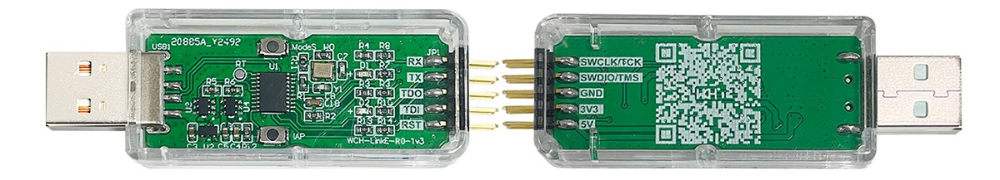
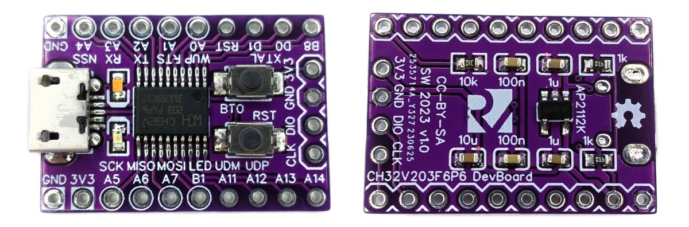

# CH32V203 F6P6 Development Board
Development board for the CH32V203F6P6 low-cost 32-bit RISC-V microcontroller with native USB 2.0 and Arduino IDE support.



# Pinout


# The CH32V203 Family of 32-bit RISC-V USB Microcontrollers
## Overview
The CH32V203 is an industrial-grade microcontroller (MCU) designed for general-purpose use, with low power consumption and enhanced performance. It is based on a 32-bit RISC-V core, supports the RV32IMAC instruction set, and can operate at clock frequencies of up to 144MHz. The MCU's power consumption is highly efficient, reaching as low as 45uA per MHz. Additionally, the CH32V203 integrates a USB interface with two channels, enabling both USB Host and USB Device functionalities. It also provides a CAN interface (2.0B active) with one channel, up to two OPA channels, four UARTs, two I²Cs, a 12-bit ADC, a 10-channel TouchKey, and various other peripheral resources.

## Block Diagram


## Features
- Qingke 32-bit RISC-V4B processor
- Up to 144MHz system clock frequency
- Single-cycle multiplication and hardware division
- Up to 20KB SRAM, 64KB Flash
- Supply voltage: 2.5V/3.3V, GPIO unit is supplied independently
- Multiple low-power modes: sleep/stop/standby
- Down to 44.65uA/MHz in Run mode
- Down to 17.90uA/MHz in Sleep mode
- Power-on/power-down reset (POR/PDR), programmable voltage detector (PVD)
- 1 x 18-channel general DMA controllers
- 2 OPA amplifiers
- 10-channel 12-bit ADC, 10-channel TouchKey
- 4 timers
- One USB2.0 full-speed host/device interface and/or one USB2.0 full-speed device interface
- Up to 4 UARTs
- Up to ne CAN interface (2.0B active)
- Up to 2 I²C interfaces, up to 2 SPI interfaces
- Up to 37 I/O ports, can be mapped to 16 external interrupts
- Up to one CRC calculation unit, 96-bit unique ID
- Serial 2-wire debug interface
- Factory built-in USB bootloader

## Family Members


Note that only the CH32V203F6P6 can be used on this development board. Although the CH32V203F8P6 comes in the same package (TSSOP20), it has a completely different pinout.

# Programming and Debugging
There are two ways to program the microcontroller: via USB using the built-in bootloader and via the serial 2-wire debug interface using a WCH-LinkE programming device.

## Built-in USB Bootloader
### Installing Drivers for the Bootloader
On Linux you do not need to install a driver. However, by default Linux will not expose enough permission to upload your code with the USB bootloader. In order to fix this, open a terminal and run the following commands:

```
echo 'SUBSYSTEM=="usb", ATTR{idVendor}=="4348", ATTR{idProduct}=="55e0", MODE="666"' | sudo tee /etc/udev/rules.d/99-ch55x.rules
echo 'SUBSYSTEM=="usb", ATTR{idVendor}=="1a86", ATTR{idProduct}=="55e0", MODE="666"' | sudo tee -a /etc/udev/rules.d/99-ch55x.rules
sudo udevadm control --reload-rules
```

On Windows, you need the [CH372 driver](https://www.wch-ic.com/downloads/CH372DRV_EXE.html). Alternatively, you can also use the [Zadig](https://zadig.akeo.ie/) tool to install the correct driver. Here, click "Options" -> "List All Devices" and select the USB module. Then install the libusb-win32 driver. To do this, the board must be connected and the CH32V203 must be in bootloader mode.

### Entering Bootloader Mode
The bootloader must be started manually for new uploads. To do this, the board must first be disconnected from the USB port and all voltage sources. Now press the BOOT0 button and keep it pressed while reconnecting the board to the USB port of your PC. The chip now starts in bootloader mode, the BOOT0 button can be released and new firmware can be uploaded via USB within the next couple of seconds. Alternatively, you can leave the board connected to the USB port, press and hold the BOOT0 button, press and release the RESET button and then release the BOOT0 button to enter the bootloader mode.

### Uploading Firmware with chprog
The open-source platform-independent Python tool [chprog](https://pypi.org/project/chprog/) from the [MCU Flash Tools](https://github.com/wagiminator/MCU-Flash-Tools) is used by the makefiles of the example software. In order for this tool to work, [Python3](https://www.python.org/downloads/) with [pip](https://pip.pypa.io/en/stable/getting-started/) must be installed on your system. On Linux (Debian-based), all of this can be done with the following commands:

```
sudo apt install python3 python3-pip
pip install chprog
```

Usage example:

```
chprog firmware.bin
```

Alternatively, you can use the [chprog web app](https://wagiminator.github.io/apps/chprog/) directly in your web browser (Chrome, Edge or Opera on a desktop computer) without installing any software.

### Alternative Software Tools
- [WCHISPTool](https://www.wch.cn/downloads/WCHISPTool_Setup_exe.html) - official closed-source tool by WCH (Windows only)
- [isp55e0](https://github.com/frank-zago/isp55e0)
- [wchisp](https://github.com/ch32-rs/wchisp)

## Serial 2-Wire Debug Interface
### WCH-LinkE
To program the microcontroller via the serial debug interface, you will need a special programming device. The [WCH-LinkE](https://www.wch-ic.com/products/WCH-Link.html) (pay attention to the "E" in the name) is a suitable device for this purpose and can be purchased commercially for around $3 - $4, e.g. at the [WCH Official Store on AliExpress](https://wchofficialstore.aliexpress.com). This debugging tool is also compatible with other WCH RISC-V and ARM-based microcontrollers.



To use the WCH-LinkE on Linux, you need to grant access permissions beforehand by executing the following commands:

```
echo 'SUBSYSTEM=="usb", ATTR{idVendor}=="1a86", ATTR{idProduct}=="8010", MODE="666"' | sudo tee /etc/udev/rules.d/99-WCH-LinkE.rules
echo 'SUBSYSTEM=="usb", ATTR{idVendor}=="1a86", ATTR{idProduct}=="8012", MODE="666"' | sudo tee -a /etc/udev/rules.d/99-WCH-LinkE.rules
sudo udevadm control --reload-rules
```

On Windows, if you need to you can install the WinUSB driver over the WCH interface 1 using the [Zadig](https://zadig.akeo.ie/) tool.

To upload firmware, make the following connections to the WCH-LinkE:

```
WCH-LinkE      DevBoard
+-------+      +------+
|  SWCLK| ---> |CLK   |
|  SWDIO| <--> |DIO   |
|    GND| ---> |GND   |
|    3V3| ---> |3V3   |
+-------+      +------+
```

If the blue LED on the WCH-LinkE remains illuminated once it is connected to the USB port, it means that the device is currently in ARM mode and must be switched to RISC-V mode initially. There are a few ways to accomplish this:
- You can use the Python tool [rvprog](https://pypi.org/project/rvprog/) (with -v option) or the [rvprog web app](https://wagiminator.github.io/apps/rvprog/).
- Alternatively, you can select "WCH-LinkRV" in the software provided by WCH, such as MounRiver Studio or WCH-LinkUtility.
- Another option is to hold down the ModeS button on the device while plugging it into the USB port.

More information can be found in the [WCH-Link User Manual](https://www.wch-ic.com/downloads/WCH-LinkUserManual_PDF.html).

### Uploading Firmware with rvprog
The open-source platform-independent Python tool [rvprog](https://pypi.org/project/rvprog/) from the [MCU Flash Tools](https://github.com/wagiminator/MCU-Flash-Tools) is used by the makefiles of the example software. In order for this tool to work, [Python3](https://www.python.org/downloads/) with [pip](https://pip.pypa.io/en/stable/getting-started/) must be installed on your system. On Linux (Debian-based), all of this can be done with the following commands:

```
sudo apt install python3 python3-pip
pip install rvprog
```

Usage example:

```
rvprog -f firmware.bin
```

Alternatively, you can use the [rvprog web app](https://wagiminator.github.io/apps/rvprog/) directly in your web browser (Chrome, Edge or Opera on a desktop computer) without installing any software.

### Alternative Software Tools
- [WCH-LinkUtility](https://www.wch.cn/downloads/WCH-LinkUtility_ZIP.html) - official closed-source tool by WCH (Windows only)
- [MounRiver Studio](https://www.mounriver.com/) - official IDE by WCH
- [minichlink](https://github.com/cnlohr/ch32fun/tree/master/minichlink) by Charles Lohr
- [wlink](https://github.com/ch32-rs/wlink)

### Alternative Debugging Devices
As part of his [ch32fun](https://github.com/cnlohr/ch32fun) project, Charles Lohr has also developed open-source programmers/debuggers based on STM32F042 and ESP32S2. Furthermore, the schematic diagram of the WCH-LinkE is available on the manufacturer's [website](https://www.wch.cn/products/WCH-Link.html).

# Software Development Tools
## Open-Source GCC Toolchain
You can download a complete toolchain (GCC and OpenOCD) for Linux and Mac from the [MounRiver Studio](https://www.mounriver.com/) website. However, on Linux you can also install a GCC-based toolchain by running the following command:

```
sudo apt install build-essential libnewlib-dev gcc-riscv64-unknown-elf
```

The [example software](#example-software) is based on the [MCU Templates](https://github.com/wagiminator/MCU-Templates/tree/main/CH32V203), a lightweight starting point for bare-metal firmware development in C without any IDE. Each example folder contains a makefile. Go into the folder of an example and use one of the following commands:

```
make all       compile and build firmware
make flash     compile and upload firmware to the MCU
make clean     remove all build files
make help      show all options
```

## MounRiver Studio IDE
The Eclipse-based closed-source [MounRiver Studio IDE](https://www.mounriver.com/) is the official development environment provided by WCH. It supports Windows, Linux, and Mac. MounRiver Studio can be downloaded for free.

## Arduino IDE and PlatformIO Support
There are projects around to make the CH32V203 compatible with the Arduino IDE ([arduino_core_ch32](https://github.com/openwch/arduino_core_ch32)) and PlatformIO ([platform-ch32v](https://github.com/Community-PIO-CH32V/platform-ch32v)).

# Example Software
The following examples are included. They use the [MCU Templates](https://github.com/wagiminator/MCU-Templates) and their libraries. By default, the firmware is uploaded with `make flash` via the USB bootloader (chprog). The USB examples use shared VID/PID pairs for testing purposes only.

| Example | Description |
|:-|:-|
| [adc](https://github.com/wagiminator/Development-Boards/tree/main/CH32V203F6P6_DevBoard/software/adc) | Sends ADC value of PA0, Vdd and chip temperature via UART (TX pin is PA2). |
| [blink](https://github.com/wagiminator/Development-Boards/tree/main/CH32V203F6P6_DevBoard/software/blink) | Blink example. |
| [capsblock](https://github.com/wagiminator/Development-Boards/tree/main/CH32V203F6P6_DevBoard/software/capsblock) | Tired of accidentally hitting the CAPS-LOCK key? It doesn't have to be. CAPS bLOCK identifies itself as a USB HID keyboard and constantly monitors the state of CAPS LOCK. It immediately deactivates it if it has been activated. |
| [cdc_echo](https://github.com/wagiminator/Development-Boards/tree/main/CH32V203F6P6_DevBoard/software/cdc_echo) | Simple USB-CDC serial demo which echoes back all received messages. |
| [debug](https://github.com/wagiminator/Development-Boards/tree/main/CH32V203F6P6_DevBoard/software/debug) | Sends a message via UART once a second. TX pin is PA2. |
| [mediakey](https://github.com/wagiminator/Development-Boards/tree/main/CH32V203F6P6_DevBoard/software/mediakey) | The device identifies itself as a USB HID consumer control device (multimedia keyboard). A short press of the BOOT0 button (PB8) sends PLAY/PAUSE, a long press (more than half a second) sends MUTE. |
| [millis](https://github.com/wagiminator/Development-Boards/tree/main/CH32V203F6P6_DevBoard/software/millis) | Blink built-in LED using millis counter. |
| [mousewiggler](https://github.com/wagiminator/Development-Boards/tree/main/CH32V203F6P6_DevBoard/software/mousewiggler) | Keeps the PC awake: the device identifies itself as a USB HID mouse and moves the mouse pointer a tiny bit every 30 seconds. |
| [neopixel_spi](https://github.com/wagiminator/Development-Boards/tree/main/CH32V203F6P6_DevBoard/software/neopixel_spi) | Shows a colorful animation on a string of NeoPixels (WS2812) using the hardware SPI. The number of pixels can be changed in neo_spi.h. Connect pin PA7 (MOSI) to DIN of the pixels string. |
| [oled_txt](https://github.com/wagiminator/Development-Boards/tree/main/CH32V203F6P6_DevBoard/software/oled_txt) | SSD1306 128x64 pixels I2C OLED text demo (text sizes, segment digits and bitmaps). Connect the OLED to PA6 (SDA) and PA5 (SCL). |
| [reset](https://github.com/wagiminator/Development-Boards/tree/main/CH32V203F6P6_DevBoard/software/reset) | Blink built-in LED using software resets. |
| [serial](https://github.com/wagiminator/Development-Boards/tree/main/CH32V203F6P6_DevBoard/software/serial) | Echoes data sent via UART. TX pin: PA2, RX pin: PA3. |
| [serial_dma](https://github.com/wagiminator/Development-Boards/tree/main/CH32V203F6P6_DevBoard/software/serial_dma) | Echoes data sent via UART. Uses DMA for UART RX. TX pin: PA2, RX pin: PA3. |
| [usb2serial](https://github.com/wagiminator/Development-Boards/tree/main/CH32V203F6P6_DevBoard/software/usb2serial) | Simple USB-to-serial converter. The MCU builds a USB communication device class (CDC) and forwards the data between USB and UART2 (TX: PA2, RX: PA3). The BAUD rate, the parity and the number of stop bits are set by the PC. |
| [watchdog](https://github.com/wagiminator/Development-Boards/tree/main/CH32V203F6P6_DevBoard/software/watchdog) | Blink built-in LED using independent watchdog resets. |

# References, Links and Notes
- [EasyEDA Design Files](https://oshwlab.com/wagiminator)
- [MCU Templates](https://github.com/wagiminator/MCU-Templates)
- [MCU Flash Tools](https://github.com/wagiminator/MCU-Flash-Tools)
- [MounRiver Studio](https://www.mounriver.com/)
- [CH32V203 with Arduino IDE](https://github.com/openwch/arduino_core_ch32)
- [CH32V203 with PlatformIO](https://github.com/Community-PIO-CH32V/platform-ch32v)
- [CH32V203 on openwch](https://github.com/openwch/ch32v203)
- [CH32V203 datasheets](https://www.wch-ic.com/products/CH32V203.html)
- [WCH-Link user manual](https://www.wch-ic.com/downloads/WCH-LinkUserManual_PDF.html)
- [WCH Official Store on AliExpress](https://wchofficialstore.aliexpress.com)
- [chprog Web App](https://wagiminator.github.io/apps/chprog/)
- [rvprog Web App](https://wagiminator.github.io/apps/rvprog/)




# License


This work is licensed under Creative Commons Attribution-ShareAlike 3.0 Unported License.
(http://creativecommons.org/licenses/by-sa/3.0/)
