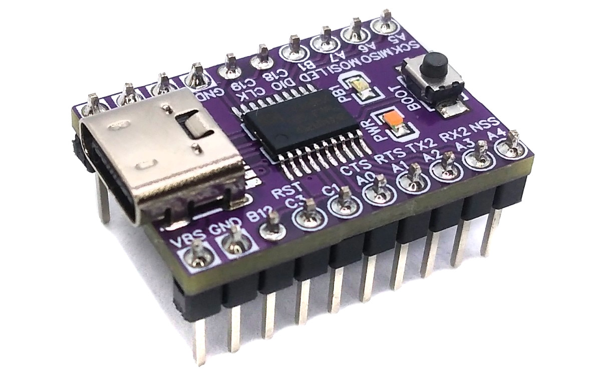
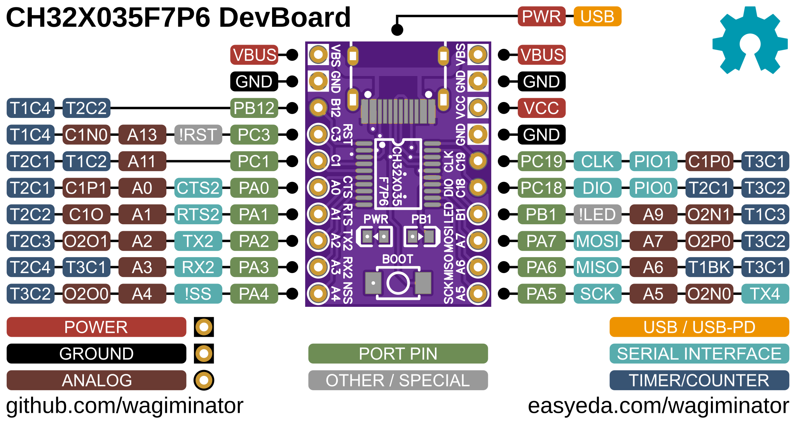
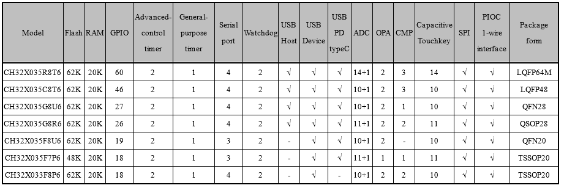
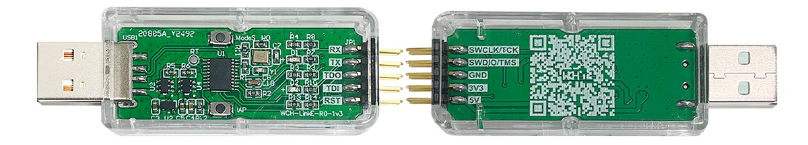
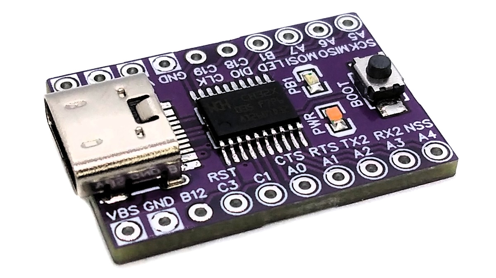
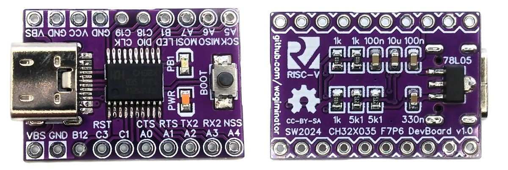

# CH32X035 F7P6 Development Board
Development board for the CH32X035F7P6 low-cost 32-bit RISC-V microcontroller with native USB2.0, USB-PD, and Arduino IDE support.



# Pinout


# The CH32X035 F7P6 32-bit RISC-V USB Microcontroller
## Overview
CH32X035F7P6 is a low-cost microcontroller that utilizes the QingKe 32-bit RISC-V4C core, supporting the RV32IMAC instruction set along with self-extending instructions. This microcontroller comes with a built-in USB PHY, supporting USB2.0 full-speed device functions and a USB PD PHY with source and sink capabilities. It features a programmable protocol I/O controller (PIOC), an operational amplifier (OPA) with programmable gain (PGA), an analog comparator (CMP), a 12-bit analog-to-digital converter (ADC), an 11-channel touch-key controller, 3 groups of USART, I2C, SPI, multiple timers, and various other peripheral resources. The device can operate at clock frequencies of up to 48MHz and is compatible with a supply voltage range of 2.0V to 5.5V. The CH32X035F7P6 includes 48KB of flash, 20KB of SRAM, and an embedded USB bootloader.

## Features
- Qingke 32-bit RISC-V4C processor, RV32IMAC instruction set
- Up to 48MHz system clock frequency
- Single-cycle hardware multiplication, hardware division
- 20KB SRAM, 48KB Flash
- Operating voltage: 2.0V - 5.5V
- Multiple low-power modes: sleep/stop/standby
- Power-on/power-down reset (POR/PDR), programmable voltage detector (PVD)
- 1x Programmable Protocol I/O Controller (PIOC), supports wide range of 1-wire and 2-wire interfaces
- 1x 8-channel general-purpose direct memory access (DMA) controller
- 1x operational amplifier (OPA) with programmable gain (PGA)
- 1x analog comparator (CMP)
- 1x 12-channel 12-bit analog-to-digital converter (ADC)
- 1x 11-channel touch-key detection
- 2x 16-bit advanced-control timer with complementary output and dead time control
- 1x 16-bit general-purpose timer with input capture
- 2x watchdog timers (independent and window)
- 1x 64-bit SysTick counter
- 1x USB2.0 full-speed device interface, 7 two-way endpoints with 64 bytes packet length
- 1x USB-PD and Type-C controller, dual role port (DRP), programmable power supply (PPS)
- 3x USART interface, supports LIN and ISO7816
- 1x I²C interface, supports SMBus/PMBus
- 1x SPI interface
- 18x general-purpose I/O (GPIO) ports, external interrupts
- 96-bit unique chip ID
- Serial 2-wire debug interface
- Factory built-in USB bootloader

## Other Family Members


# Programming and Debugging
There are two ways to program the microcontroller: via USB using the built-in bootloader and via the serial 2-wire debug interface using a WCH-LinkE programming device.

## Built-in USB Bootloader
### Installing Drivers for the Bootloader
On Linux you do not need to install a driver. However, by default Linux will not expose enough permission to upload your code with the USB bootloader. In order to fix this, open a terminal and run the following commands:

```
echo 'SUBSYSTEM=="usb", ATTR{idVendor}=="4348", ATTR{idProduct}=="55e0", MODE="666"' | sudo tee /etc/udev/rules.d/99-ch55x.rules
echo 'SUBSYSTEM=="usb", ATTR{idVendor}=="1a86", ATTR{idProduct}=="55e0", MODE="666"' | sudo tee -a /etc/udev/rules.d/99-ch55x.rules
sudo udevadm control --reload-rules
```

On Windows, you need the [CH372 driver](https://www.wch-ic.com/downloads/CH372DRV_EXE.html). Alternatively, you can also use the [Zadig](https://zadig.akeo.ie/) tool to install the correct driver. Here, click "Options" -> "List All Devices" and select the USB module. Then install the libusb-win32 driver. To do this, the board must be connected and the CH32X035 must be in bootloader mode.

### Entering Bootloader Mode
The bootloader must be started manually for new uploads. To do this, the board must first be disconnected from the USB port and all voltage sources. Now press the BOOT button and keep it pressed while reconnecting the board to the USB port of your PC. The chip now starts in bootloader mode, the BOOT button can be released and new firmware can be uploaded via USB within the next couple of seconds.

### Uploading Firmware with chprog
The open-source platform-independent Python tool [chprog](https://pypi.org/project/chprog/) from the [MCU Flash Tools](https://github.com/wagiminator/MCU-Flash-Tools) is used by the makefiles of the example software. In order for this tool to work, [Python3](https://www.python.org/downloads/) with [pip](https://pip.pypa.io/en/stable/getting-started/) must be installed on your system. On Linux (Debian-based), all of this can be done with the following commands:

```
sudo apt install python3 python3-pip
pip install chprog
```

Usage example:

```
chprog firmware.bin
```

Alternatively, you can use the [chprog web app](https://wagiminator.github.io/apps/chprog/) directly in your web browser (Chrome, Edge or Opera on a desktop computer) without installing any software.

### Alternative Software Tools
- [WCHISPTool](https://www.wch.cn/downloads/WCHISPTool_Setup_exe.html) - official closed-source tool by WCH (Windows only)
- [isp55e0](https://github.com/frank-zago/isp55e0)
- [wchisp](https://github.com/ch32-rs/wchisp)

## Serial 2-Wire Debug Interface
### WCH-LinkE
To program the microcontroller via the serial debug interface, you will need a special programming device. The [WCH-LinkE](https://www.wch-ic.com/products/WCH-Link.html) (pay attention to the "E" in the name) is a suitable device for this purpose and can be purchased commercially for around $3 - $4, e.g. at the [WCH Official Store on AliExpress](https://wchofficialstore.aliexpress.com). This debugging tool is also compatible with other WCH RISC-V and ARM-based microcontrollers.



To use the WCH-LinkE on Linux, you need to grant access permissions beforehand by executing the following commands:

```
echo 'SUBSYSTEM=="usb", ATTR{idVendor}=="1a86", ATTR{idProduct}=="8010", MODE="666"' | sudo tee /etc/udev/rules.d/99-WCH-LinkE.rules
echo 'SUBSYSTEM=="usb", ATTR{idVendor}=="1a86", ATTR{idProduct}=="8012", MODE="666"' | sudo tee -a /etc/udev/rules.d/99-WCH-LinkE.rules
sudo udevadm control --reload-rules
```

On Windows, if you need to you can install the WinUSB driver over the WCH interface 1 using the [Zadig](https://zadig.akeo.ie/) tool.

To upload firmware, make the following connections to the WCH-LinkE:

```
WCH-LinkE      DevBoard
+-------+      +------+
|  SWCLK| ---> |CLK   |
|  SWDIO| <--> |DIO   |
|    GND| ---> |GND   |
|    3V3| ---> |3V3   |
+-------+      +------+
```

If the blue LED on the WCH-LinkE remains illuminated once it is connected to the USB port, it means that the device is currently in ARM mode and must be switched to RISC-V mode initially. There are a few ways to accomplish this:
- You can use the Python tool [rvprog](https://pypi.org/project/rvprog/) (with -v option) or the [rvprog web app](https://wagiminator.github.io/apps/rvprog/).
- Alternatively, you can select "WCH-LinkRV" in the software provided by WCH, such as MounRiver Studio or WCH-LinkUtility.
- Another option is to hold down the ModeS button on the device while plugging it into the USB port.

More information can be found in the [WCH-Link User Manual](https://www.wch-ic.com/downloads/WCH-LinkUserManual_PDF.html).

### Uploading Firmware with rvprog
The open-source platform-independent Python tool [rvprog](https://pypi.org/project/rvprog/) from the [MCU Flash Tools](https://github.com/wagiminator/MCU-Flash-Tools) is used by the makefiles of the example software. In order for this tool to work, [Python3](https://www.python.org/downloads/) with [pip](https://pip.pypa.io/en/stable/getting-started/) must be installed on your system. On Linux (Debian-based), all of this can be done with the following commands:

```
sudo apt install python3 python3-pip
pip install rvprog
```

Usage example:

```
rvprog -f firmware.bin
```

Alternatively, you can use the [rvprog web app](https://wagiminator.github.io/apps/rvprog/) directly in your web browser (Chrome, Edge or Opera on a desktop computer) without installing any software.

### Alternative Software Tools
- [WCH-LinkUtility](https://www.wch.cn/downloads/WCH-LinkUtility_ZIP.html) - official closed-source tool by WCH (Windows only)
- [MounRiver Studio](https://www.mounriver.com/) - official IDE by WCH
- [minichlink](https://github.com/cnlohr/ch32fun/tree/master/minichlink) by Charles Lohr
- [wlink](https://github.com/ch32-rs/wlink)

### Alternative Debugging Devices
As part of his [ch32fun](https://github.com/cnlohr/ch32fun) project, Charles Lohr has also developed open-source programmers/debuggers based on STM32F042 and ESP32S2. Furthermore, the schematic diagram of the WCH-LinkE is available on the manufacturer's [website](https://www.wch.cn/products/WCH-Link.html).

# Software Development Tools
## Open-Source GCC Toolchain
You can download a complete toolchain (GCC and OpenOCD) for Linux and Mac from the [MounRiver Studio](https://www.mounriver.com/) website. However, on Linux you can also install a GCC-based toolchain by running the following command:

```
sudo apt install build-essential libnewlib-dev gcc-riscv64-unknown-elf
```

The [example software](#example-software) is based on the [MCU Templates](https://github.com/wagiminator/MCU-Templates/tree/main/CH32X035), a lightweight starting point for bare-metal firmware development in C without any IDE. Each example folder contains a makefile. Go into the folder of an example and use one of the following commands:

```
make all       compile and build firmware
make flash     compile and upload firmware to the MCU
make clean     remove all build files
make help      show all options
```

## MounRiver Studio IDE
The Eclipse-based closed-source [MounRiver Studio IDE](https://www.mounriver.com/) is the official development environment provided by WCH. It supports Windows, Linux, and Mac. MounRiver Studio can be downloaded for free.

## Arduino IDE and PlatformIO Support
There are projects around to make the CH32X035 compatible with the Arduino IDE ([arduino_core_ch32](https://github.com/openwch/arduino_core_ch32)) and PlatformIO ([platform-ch32v](https://github.com/Community-PIO-CH32V/platform-ch32v)).

# Example Software
The following examples are included. They use the [MCU Templates](https://github.com/wagiminator/MCU-Templates) and their libraries. By default, the firmware is uploaded with `make flash` via the USB bootloader (chprog). The USB examples use shared VID/PID pairs for testing purposes only.

| Example | Description |
|:-|:-|
| [adc](https://github.com/wagiminator/Development-Boards/tree/main/CH32X035F7P6_DevBoard/software/adc) | Samples PA0 and VDD with ADC and sends values via USB CDC. |
| [blink](https://github.com/wagiminator/Development-Boards/tree/main/CH32X035F7P6_DevBoard/software/blink) | Blink example. |
| [capsblock](https://github.com/wagiminator/Development-Boards/tree/main/CH32X035F7P6_DevBoard/software/capsblock) | Tired of accidentally hitting the CAPS-LOCK key? It doesn't have to be. CAPS bLOCK identifies itself as a USB HID keyboard and constantly monitors the state of CAPS LOCK. It immediately deactivates it if it has been activated. |
| [cdc_echo](https://github.com/wagiminator/Development-Boards/tree/main/CH32X035F7P6_DevBoard/software/cdc_echo) | Simple USB-CDC serial demo which echoes back all received messages. |
| [dap_link](https://github.com/wagiminator/Development-Boards/tree/main/CH32X035F7P6_DevBoard/software/dap_link) | CMSIS-DAP v2.1 compatible debug probe for ARM Cortex-M microcontrollers based on the official CMSIS-DAP firmware sources of ARM. Features: - SWD and JTAG (incl. |
| [debug_serial](https://github.com/wagiminator/Development-Boards/tree/main/CH32X035F7P6_DevBoard/software/debug_serial) | Sends a message via UART once a second. |
| [i2c_eeprom](https://github.com/wagiminator/Development-Boards/tree/main/CH32X035F7P6_DevBoard/software/i2c_eeprom) | Transfers content of 24Cxx I2C EEPROM via USB-CDC. |
| [max7219_segment](https://github.com/wagiminator/Development-Boards/tree/main/CH32X035F7P6_DevBoard/software/max7219_segment) | Print numbers on a MAX7219 8-digit 8-segment display. Connect PA4 (CS), PA5 (CLK), PA7 (DIN). |
| [millis](https://github.com/wagiminator/Development-Boards/tree/main/CH32X035F7P6_DevBoard/software/millis) | Blink built-in LED using millis counter. |
| [mousewiggler](https://github.com/wagiminator/Development-Boards/tree/main/CH32X035F7P6_DevBoard/software/mousewiggler) | Mouse Wiggler is a tool that simulates movements of the mouse pointer so that no screen saver is activated and the PC or notebook is not put to sleep. |
| [neopixel_spi](https://github.com/wagiminator/Development-Boards/tree/main/CH32X035F7P6_DevBoard/software/neopixel_spi) | Shows a colorful animation on a string of NeoPixels. The number of pixels can be changed in config.h. Connect pin PA7 (MOSI) to DIN of the pixels string. |
| [neopixel_sw](https://github.com/wagiminator/Development-Boards/tree/main/CH32X035F7P6_DevBoard/software/neopixel_sw) | Shows a colorful animation on a string of NeoPixels. The pin connected to the pixels and the number of pixels can be defined in the config.h. |
| [oled_conway](https://github.com/wagiminator/Development-Boards/tree/main/CH32X035F7P6_DevBoard/software/oled_conway) | The Game of Life is a cellular automaton, and was invented by Cambridge mathematician John Conway. This game became widely known when it was mentioned in an article published by Scientific American in 1970. |
| [oled_gfx](https://github.com/wagiminator/Development-Boards/tree/main/CH32X035F7P6_DevBoard/software/oled_gfx) | SSD1306 128x64 Pixels I2C OLED graphics demo. Connect an SSD1306 128x64 Pixels I2C OLED to the MCU pins according to config.h. |
| [oled_mandelbrot](https://github.com/wagiminator/Development-Boards/tree/main/CH32X035F7P6_DevBoard/software/oled_mandelbrot) | The Mandelbrot set is a complex set of points that forms a fractal, named after mathematician Benoît Mandelbrot. |
| [oled_sinewave](https://github.com/wagiminator/Development-Boards/tree/main/CH32X035F7P6_DevBoard/software/oled_sinewave) | Retro-style sine wave animated text scroller for SSD1306 128x32 pixels I2C OLED. |
| [oled_txt](https://github.com/wagiminator/Development-Boards/tree/main/CH32X035F7P6_DevBoard/software/oled_txt) | SSD1306 128x64 Pixels I2C OLED text demo. Connect an SSD1306 128x64 Pixels I2C OLED to the MCU pins according to config.h. |
| [pin_event](https://github.com/wagiminator/Development-Boards/tree/main/CH32X035F7P6_DevBoard/software/pin_event) | Control LED via push button using events. |
| [pin_interrupt](https://github.com/wagiminator/Development-Boards/tree/main/CH32X035F7P6_DevBoard/software/pin_interrupt) | Control LED via push button using interrupts. |
| [pin_reset_sw](https://github.com/wagiminator/Development-Boards/tree/main/CH32X035F7P6_DevBoard/software/pin_reset_sw) | Software reset pin. |
| [reset](https://github.com/wagiminator/Development-Boards/tree/main/CH32X035F7P6_DevBoard/software/reset) | Blink built-in LED using software resets. |
| [serial](https://github.com/wagiminator/Development-Boards/tree/main/CH32X035F7P6_DevBoard/software/serial) | Echoes data sent via UART. |
| [serial_dma](https://github.com/wagiminator/Development-Boards/tree/main/CH32X035F7P6_DevBoard/software/serial_dma) | Echoes data sent via UART. Uses DMA for RX. |
| [sleep](https://github.com/wagiminator/Development-Boards/tree/main/CH32X035F7P6_DevBoard/software/sleep) | Blink built-in LED using deep sleep with automatic wake-up timer. |
| [st7302_lcd](https://github.com/wagiminator/Development-Boards/tree/main/CH32X035F7P6_DevBoard/software/st7302_lcd) | ST7302 250x122 Pixels Monochrome Low-Power Liquid Crystal Display Graphics Demo. Connect the LCD as follows: MCU - Display GND - GND VCC - VCC (3V3) SCL - PA5 SDA - PA7 RES - VCC (3V3) DC - PA6 CS - PA4 |
| [st7789_tft](https://github.com/wagiminator/Development-Boards/tree/main/CH32X035F7P6_DevBoard/software/st7789_tft) | ST7789 240x135 Pixels Color TFT Display Graphics Demo. Connect the TFT as follows: MCU - Display GND - GND VCC - VCC (3V3) SCL - PA5 SDA - PA7 RES - VCC (3V3) DC - PA6 CS - PA4 BLK - VCC (3V3) |
| [tinybasic](https://github.com/wagiminator/Development-Boards/tree/main/CH32X035F7P6_DevBoard/software/tinybasic) | A simple BASIC interpreter based on TOYOSHIKI Tiny BASIC using USB CDC as terminal. |
| [tm1650_segment](https://github.com/wagiminator/Development-Boards/tree/main/CH32X035F7P6_DevBoard/software/tm1650_segment) | Displays supply voltage on a 4-digit 8-segment LED Display via TM1650 and I2C. |
| [touchkey](https://github.com/wagiminator/Development-Boards/tree/main/CH32X035F7P6_DevBoard/software/touchkey) | Lights up LED when touch key is pressed. |
| [usb2oled](https://github.com/wagiminator/Development-Boards/tree/main/CH32X035F7P6_DevBoard/software/usb2oled) | This code implements a simple USB controlled 128x64 pixels I2C OLED display. The CH32X03x builds a USB communication device class (CDC) for serial communication via USB. |
| [usb2serial](https://github.com/wagiminator/Development-Boards/tree/main/CH32X035F7P6_DevBoard/software/usb2serial) | Simple USB-to-Serial Converter. |
| [usbpd_tester](https://github.com/wagiminator/Development-Boards/tree/main/CH32X035F7P6_DevBoard/software/usbpd_tester) | Displays source capabilities of the connected USB PD power supply on an OLED. |
| [usbpd_vbus](https://github.com/wagiminator/Development-Boards/tree/main/CH32X035F7P6_DevBoard/software/usbpd_vbus) | Request the specified target voltage from a USB PD power supply. |
| [watchdog](https://github.com/wagiminator/Development-Boards/tree/main/CH32X035F7P6_DevBoard/software/watchdog) | Blink built-in LED using independent watchdog resets. |

# References, Links and Notes
- [EasyEDA Design Files](https://oshwlab.com/wagiminator)
- [MCU Templates](https://github.com/wagiminator/MCU-Templates)
- [MCU Flash Tools](https://github.com/wagiminator/MCU-Flash-Tools)
- [MounRiver Studio](https://www.mounriver.com/)
- [CH32X035 with Arduino IDE](https://github.com/openwch/arduino_core_ch32)
- [CH32X035 with PlatformIO](https://github.com/Community-PIO-CH32V/platform-ch32v)
- [CH32X035 on openwch](https://github.com/openwch/ch32x035)
- [CH32X035 datasheets](https://www.wch-ic.com/products/CH32X035.html)
- [WCH-Link user manual](https://www.wch-ic.com/downloads/WCH-LinkUserManual_PDF.html)
- [WCH Official Store on AliExpress](https://wchofficialstore.aliexpress.com)
- [chprog Web App](https://wagiminator.github.io/apps/chprog/)
- [rvprog Web App](https://wagiminator.github.io/apps/rvprog/)




# License


This work is licensed under Creative Commons Attribution-ShareAlike 3.0 Unported License.
(http://creativecommons.org/licenses/by-sa/3.0/)
