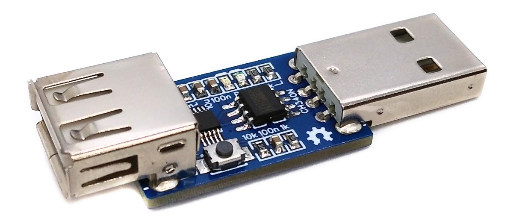
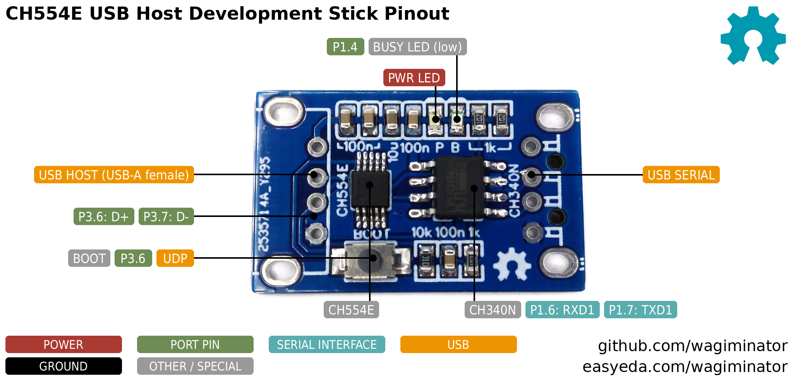
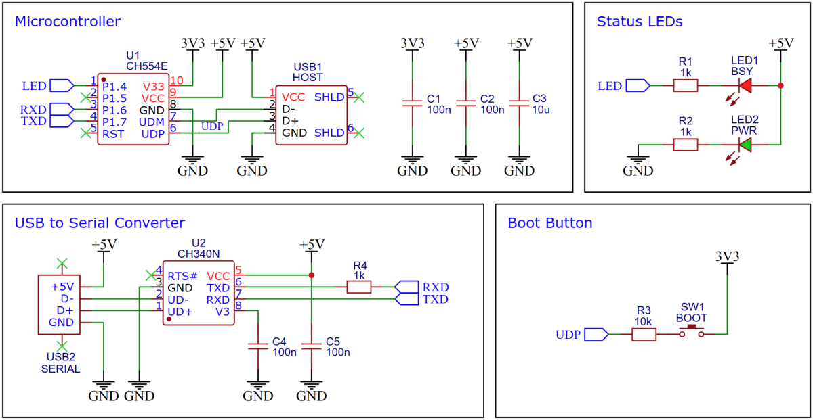
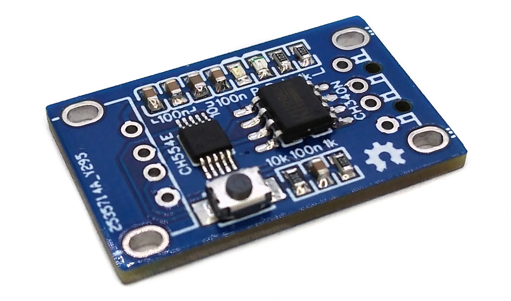
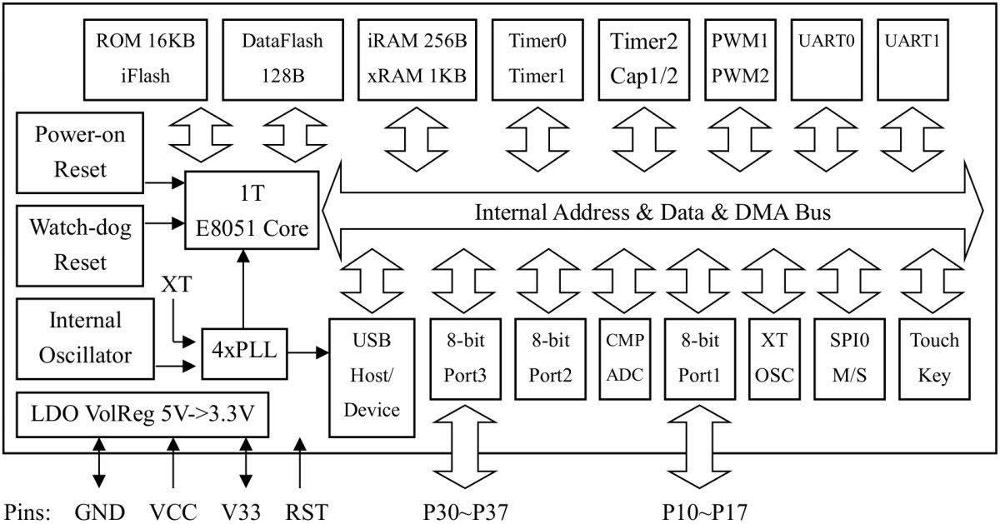
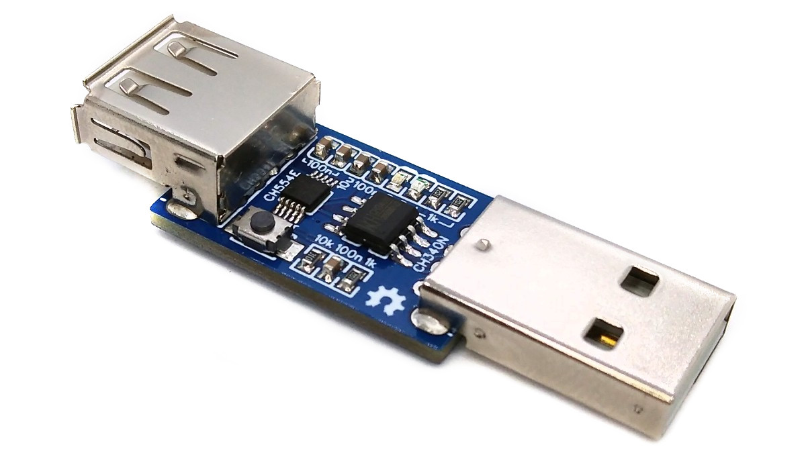
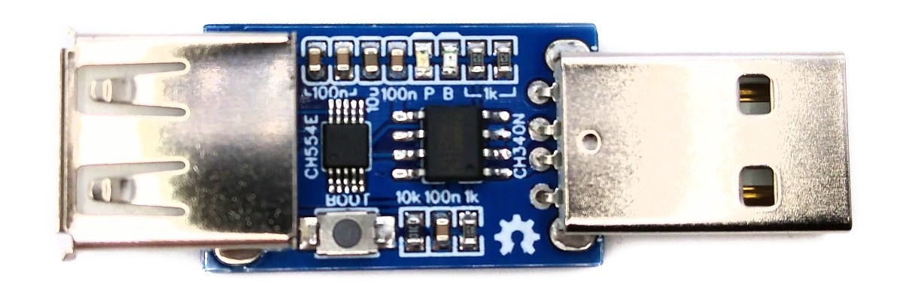
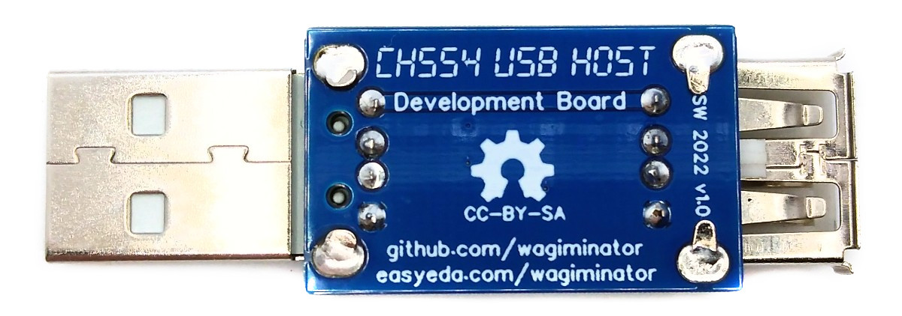

# CH554E USB Host Development Stick
Development board for the USB host capabilities of the CH554E microcontroller with an integrated USB-A female connector for connecting USB devices like keyboards, mice, printers, hubs, etc. and a USB-A male connector for providing a serial interface for analysis and debugging on the PC.



# Pinout


The BUSY LED (active low) is connected to pin P1.4, the CH340N USB-to-serial converter to UART1 (P1.6: RXD1, P1.7: TXD1). The BOOT button pulls the USB D+ line (P3.6) high via a 10k resistor.

## Schematic


## CH340N USB to Serial Converter
Since the USB port of the CH554E is used for host functionality, the CH340N USB to serial converter takes care of the information transfer via USB to the PC. The CH554E provides this information via its UART interface.

## USB Connectors
The USB-A female connector is used to connect USB devices such as keyboard, mouse, printer, hub, etc. to the USB host provided by the CH554E. This port must also be used to upload firmware to the microcontroller, which requires a USB-A male-to-male cable or suitable adapter. The USB-A connector on the board is used to plug into a USB port on your PC and provides serial information for analysis and debugging coming from the CH554E's UART port.



# The CH554E 8-bit USB Host Microcontroller
## Overview
The CH554 is a low-cost, 8-bit enhanced E8051 core microcontroller compatible with the MCS51 instruction set. 79% of its instructions are single-byte single-cycle instructions, and the average instruction speed is 8 - 15 times faster than that of the standard MCS51. The special xRAM supports direct memory access (DMA), data fast copy command, and double DPTR pointers. The CH554 has a built-in USB 2.0 controller and USB transceiver, it supports USB-Host mode and USB-Device mode, USB Type-C master-slave detection, full-speed (12Mbps) and low-speed (1.5Mbps) traffic, data packets of up to 64 bytes, and DMA. It has a factory built-in bootloader so firmware can be uploaded directly via USB without the need for an additional programming device.

## Block Diagram


## Features

 Specifications |  CH554E 
:-------------- | :------ 
Program ROM  | 14 KB
Bootloader | 2 KB
Data Flash | 128 bytes
iRAM | 256 bytes 
xRAM | 1024 bytes
GPIO Pins | 4 + 2*USB
ADC Channels | 4x 8-bit
PWM Channels | 2x 8-bit
Timer/Counter | 3
Touch Key Channels | 4
USB modes | Host/Device
USB Type-C | yes
Interfaces | 2x UART, SPI
Intern. Clock | 24/16/12/6/3/0.75 MHz

# Programming and Debugging
The CH55x has a factory built-in bootloader, so firmware can be uploaded directly via USB without the need for an additional programming device.

## Built-in USB Bootloader
### Installing Drivers for the Bootloader
On Linux you do not need to install a driver. However, by default Linux will not expose enough permission to upload your code with the USB bootloader. In order to fix this, open a terminal and run the following commands:

```
echo 'SUBSYSTEM=="usb", ATTR{idVendor}=="4348", ATTR{idProduct}=="55e0", MODE="666"' | sudo tee /etc/udev/rules.d/99-ch55x.rules
echo 'SUBSYSTEM=="usb", ATTR{idVendor}=="1a86", ATTR{idProduct}=="55e0", MODE="666"' | sudo tee -a /etc/udev/rules.d/99-ch55x.rules
sudo udevadm control --reload-rules
```

On Windows, you need the [CH372 driver](https://www.wch-ic.com/downloads/CH372DRV_EXE.html). Alternatively, you can also use the [Zadig](https://zadig.akeo.ie/) tool to install the correct driver. Here, click "Options" -> "List All Devices" and select the USB module. Then install the libusb-win32 driver. To do this, the board must be connected and the CH55x must be in bootloader mode.

### Entering Bootloader Mode
A brand new chip starts automatically in bootloader mode as soon as it is connected to the PC via USB. Once firmware has been uploaded, the bootloader must be started manually for new uploads. To do this, the board must first be disconnected from all USB ports. Now press the BOOT button and keep it pressed while connecting the USB-A female connector (USB host port) of the board to the USB port of your PC using a USB-A male-to-male cable or suitable adapter. The chip now starts in bootloader mode, the BOOT button can be released and new firmware can be uploaded via USB within the next couple of seconds. Then disconnect the cable and plug the USB-A male connector of the board into your PC to use the serial interface.

### Uploading Firmware with chprog
The open-source platform-independent Python tool [chprog](https://pypi.org/project/chprog/) from the [MCU Flash Tools](https://github.com/wagiminator/MCU-Flash-Tools) is used by the makefiles of the example software. In order for this tool to work, [Python3](https://www.python.org/downloads/) with [pip](https://pip.pypa.io/en/stable/getting-started/) must be installed on your system. On Linux (Debian-based), all of this can be done with the following commands:

```
sudo apt install python3 python3-pip
pip install chprog
```

Usage example:

```
chprog firmware.bin
```

Alternatively, you can use the [chprog web app](https://wagiminator.github.io/apps/chprog/) directly in your web browser (Chrome, Edge or Opera on a desktop computer) without installing any software.

### Alternative Software Tools
- [WCHISPTool](https://www.wch.cn/downloads/WCHISPTool_Setup_exe.html) - official closed-source tool by WCH (Windows only)
- [isp55e0](https://github.com/frank-zago/isp55e0)
- [wchisp](https://github.com/ch32-rs/wchisp)

# Software Development Tools
## Open-Source SDCC Toolchain
For compiling install the [SDCC](https://sdcc.sourceforge.net/) compiler. On Linux (Debian-based), this can be done with the following command:

```
sudo apt install build-essential sdcc
```

The [example software](#example-software) is based on the [MCU Templates](https://github.com/wagiminator/MCU-Templates/tree/main/CH552), a lightweight starting point for bare-metal firmware development in C without any IDE. Each example folder contains a makefile. Go into the folder of an example and use one of the following commands:

```
make all       compile and build firmware
make flash     compile and upload firmware to the MCU
make clean     remove all build files
make help      show all options
```

The [CH55x Software Development Kit](https://github.com/Blinkinlabs/ch554_sdcc) by Blinkinlabs is another option for SDCC.

## Arduino IDE Support
- [Install ch55xduino](https://github.com/DeqingSun/ch55xduino) (tested with version 0.0.16).
- Open the Arduino IDE.
- Go to **Tools -> Board -> CH55x Boards** and select your chip.
- Go to **Tools** and set the desired board options.
- Go to **File -> Examples -> Examples for CH55x Board** and select a sketch of your choice.
- If your board has never been used with ch55xduino before, you need to make the chip enter the bootloader mode (see above, use the USB host port).
- Now you can upload your sketch.

# Example Software
The following examples are included. They use the [MCU Templates](https://github.com/wagiminator/MCU-Templates) and their libraries. The USB host examples use a USB host stack based on WCH's examples. The serial output can be displayed with a serial monitor on the PC using the CH340N (USB-A male connector).

Some of the older examples (e.g. host_analyzer) are not yet based on the current MCU Templates. They contain their own copy of the flash tool in the *tools* folder, which is called via `python3` by the makefile. They can also be uploaded with the pip version of the tool.

| Example | Description |
|:-|:-|
| [blink](https://github.com/wagiminator/Development-Boards/tree/main/CH554E_HostDevBoard/software/blink) | Blink built-in BUSY LED (active low). |
| [debug](https://github.com/wagiminator/Development-Boards/tree/main/CH554E_HostDevBoard/software/debug) | Sends a message once a second via UART1 and the CH340N USB-to-serial converter (115200 BAUD, 8N1). |
| [eeprom](https://github.com/wagiminator/Development-Boards/tree/main/CH554E_HostDevBoard/software/eeprom) | Increments a boot counter in the data flash (EEPROM) at each start and sends a hex dump of the 128 bytes data flash via UART1 (115200 BAUD, 8N1). |
| [host_analyzer](https://github.com/wagiminator/Development-Boards/tree/main/CH554E_HostDevBoard/software/host_analyzer) | Simple USB device analyzer based on the WCH example. Transfers information on connected USB devices (descriptors, HID reports) via the serial interface (9600 BAUD). |
| [host_barcode](https://github.com/wagiminator/Development-Boards/tree/main/CH554E_HostDevBoard/software/host_barcode) | Barcode scanner interface. Most USB barcode scanners identify themselves as a USB keyboard and "type" the scanned code followed by ENTER. |
| [host_gamepad](https://github.com/wagiminator/Development-Boards/tree/main/CH554E_HostDevBoard/software/host_gamepad) | Shows changes of the reports of a USB gamepad or joystick connected to the USB host port via the serial interface. |
| [host_hidraw](https://github.com/wagiminator/Development-Boards/tree/main/CH554E_HostDevBoard/software/host_hidraw) | Shows the raw HID reports of any USB HID device (keyboard, mouse, gamepad, joystick, game controller, etc.) connected to the USB host port via the serial interface. Useful for analyzing unknown HID devices. |
| [host_info](https://github.com/wagiminator/Development-Boards/tree/main/CH554E_HostDevBoard/software/host_info) | Simple USB device analyzer. Shows information about the USB device connected to the USB host port (VID, PID, device class, speed, descriptors) via the serial interface. Devices connected to a USB hub are also displayed. |
| [host_keyboard](https://github.com/wagiminator/Development-Boards/tree/main/CH554E_HostDevBoard/software/host_keyboard) | USB keyboard to serial terminal. Characters typed on a USB keyboard connected to the USB host port are sent via the serial interface. The BUSY LED flashes with each keystroke. |
| [host_keylock](https://github.com/wagiminator/Development-Boards/tree/main/CH554E_HostDevBoard/software/host_keylock) | Shows the state of the CAPS LOCK key of a USB keyboard connected to the USB host port on the BUSY LED of the board and reports changes via the serial interface. The lock keys also switch the LEDs on the keyboard. |
| [host_mouse](https://github.com/wagiminator/Development-Boards/tree/main/CH554E_HostDevBoard/software/host_mouse) | Shows the movements and button states of a USB mouse connected to the USB host port via the serial interface. The BUSY LED lights up while a mouse button is pressed. |
| [millis](https://github.com/wagiminator/Development-Boards/tree/main/CH554E_HostDevBoard/software/millis) | Blink built-in BUSY LED using millis counter (TIMER2). |
| [reset](https://github.com/wagiminator/Development-Boards/tree/main/CH554E_HostDevBoard/software/reset) | Blink built-in BUSY LED using software resets. The number of resets is kept across resets and sent via UART1 (115200 BAUD, 8N1). |
| [serial](https://github.com/wagiminator/Development-Boards/tree/main/CH554E_HostDevBoard/software/serial) | Echoes data sent via UART1 and the CH340N USB-to-serial converter (115200 BAUD, 8N1). Uses interrupts and a ring buffer for RX. |
| [watchdog](https://github.com/wagiminator/Development-Boards/tree/main/CH554E_HostDevBoard/software/watchdog) | Blink built-in BUSY LED using watchdog resets. |

# References, Links and Notes
- [EasyEDA Design Files](https://oshwlab.com/wagiminator)
- [MCU Templates](https://github.com/wagiminator/MCU-Templates)
- [MCU Flash Tools](https://github.com/wagiminator/MCU-Flash-Tools)
- [CH55x SDK for SDCC by Blinkinlabs](https://github.com/Blinkinlabs/ch554_sdcc)
- [ch55xduino](https://github.com/DeqingSun/ch55xduino)
- [CH554 Datasheet](https://www.wch-ic.com/downloads/CH554DS1_PDF.html)
- [WCH Official Store on AliExpress](https://wchofficialstore.aliexpress.com)
- [chprog Web App](https://wagiminator.github.io/apps/chprog/)





# License


This work is licensed under Creative Commons Attribution-ShareAlike 3.0 Unported License.
(http://creativecommons.org/licenses/by-sa/3.0/)
