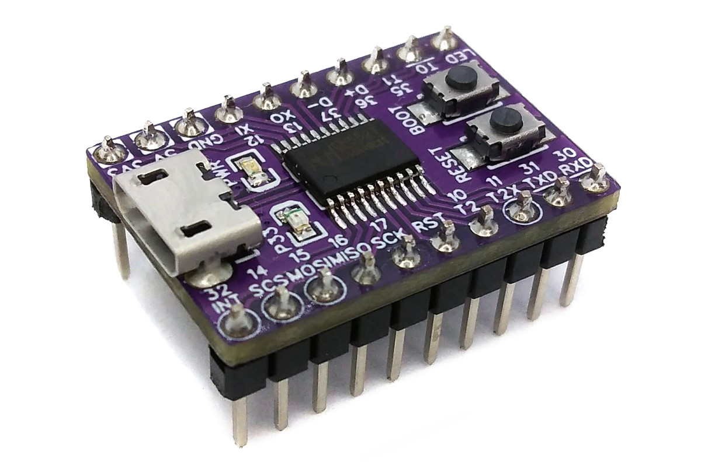
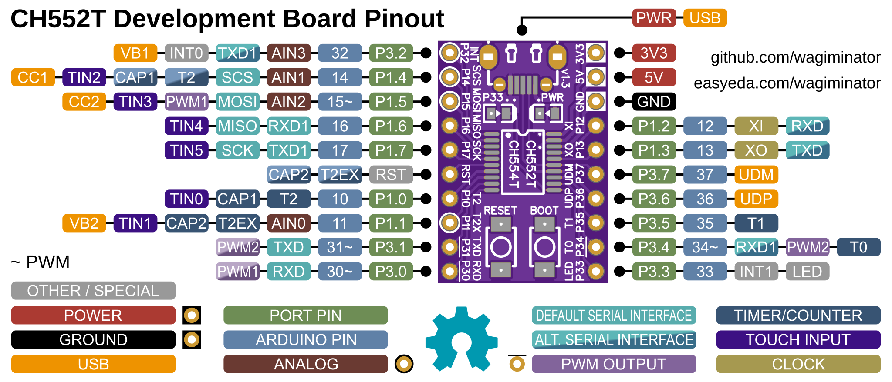
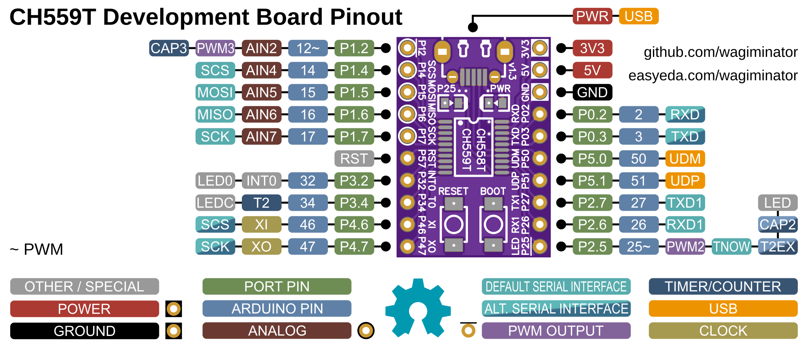
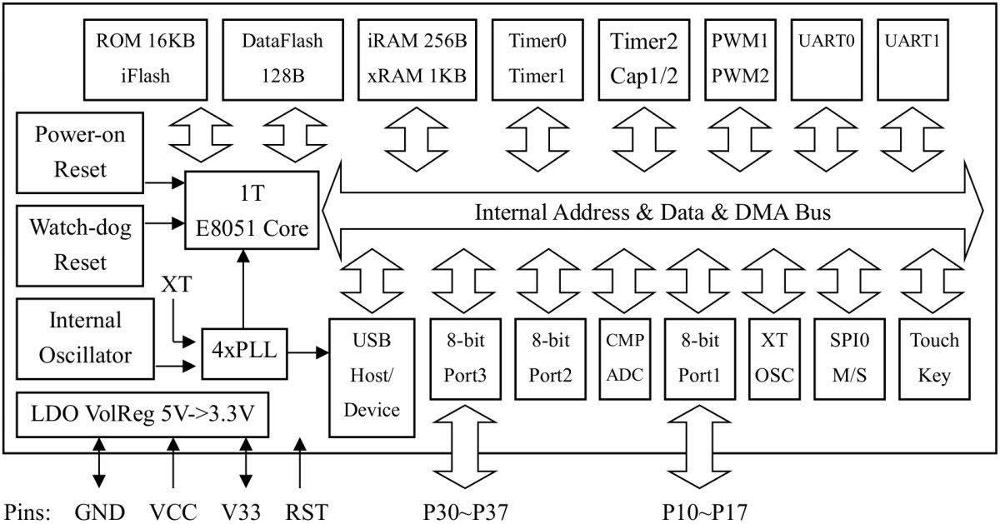
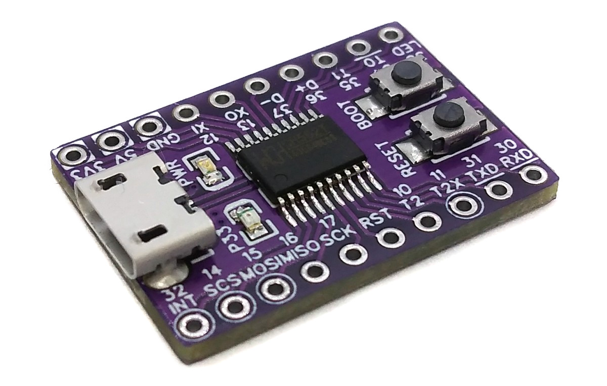
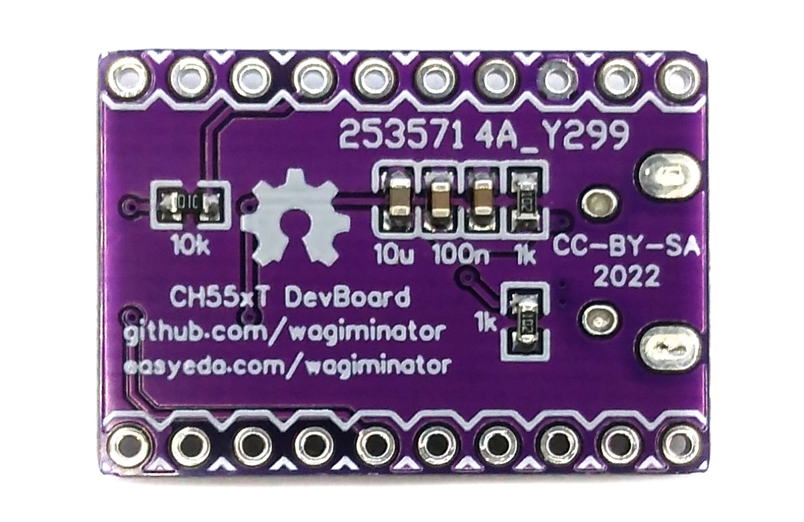

# CH55xT Development Board
Development board for the CH552T, CH554T, CH558T, and CH559T low-cost 8-bit microcontrollers with native USB 2.0 and Arduino IDE support.



# Pinout




# The CH55xT Family of 8-bit USB Microcontrollers
## Overview
The CH55x is an 8-bit enhanced E8051 core MCU compatible with the MCS51 instruction set. 79% of its instructions are single-byte single-cycle instructions, and the average instruction speed is 8 - 15 times faster than that of the standard MCS51. The special xRAM supports direct memory access (DMA), data fast copy command, and double DPTR pointers. The CH55x has a built-in USB controller and USB transceiver, it supports USB-Host mode (except CH552 and CH558) and USB-Device mode, USB Type-C master-slave detection (except CH558 and CH559), USB 2.0 full-speed (12Mbps) and low-speed (1.5Mbps) traffic, data packets of up to 64 bytes, and DMA. It has a factory built-in bootloader so firmware can be uploaded directly via USB without the need for an additional programming device.

## Block Diagram


## Features

 Specifications |  CH552T |  CH554T |  CH558T |  CH559T 
:-------------- | :------ | :------ | :------ | :------ 
Code Flash | 14 KB | 14 KB | 32 KB | 60 KB
Data Flash | 128 bytes | 128 bytes | 5 KB | 1 KB
Bootloader | 2 KB | 2 KB | 3 KB | 3 KB
iRAM | 256 bytes | 256 bytes | 256 bytes | 256 bytes 
xRAM | 1 KB | 1 KB | 4 KB | 6 KB
GPIO Pins | 16 (14 usable) | 16 (14 usable) | 16 (14 usable) | 16 (14 usable)
ADC Channels | 4x 8-bit | 4x 8-bit | 8x 10/11-bit | 8x 10/11-bit
PWM Channels | 2x 8-bit | 2x 8-bit | 2x 8-bit, 1x 16-bit | 2x 8-bit, 1x 16-bit
Timer/Counter | 3 | 3 | 4 | 4
Touch Key Channels | 6 | 6 | 0 | 0
USB Modes | Device | Host/Device | Device | Host/Device
USB Type-C | yes | yes | no | no
Interfaces | 2x UART, 1x SPI | 2x UART, 1x SPI | 2x UART, 1x SPI | 2x UART, 2x SPI 
Internal Clock | max 24 MHz | max 24 MHz | max 56 MHz | max 56 MHz

# Programming and Debugging
The CH55x has a factory built-in bootloader, so firmware can be uploaded directly via USB without the need for an additional programming device.

## Built-in USB Bootloader
### Installing Drivers for the Bootloader
On Linux you do not need to install a driver. However, by default Linux will not expose enough permission to upload your code with the USB bootloader. In order to fix this, open a terminal and run the following commands:

```
echo 'SUBSYSTEM=="usb", ATTR{idVendor}=="4348", ATTR{idProduct}=="55e0", MODE="666"' | sudo tee /etc/udev/rules.d/99-ch55x.rules
echo 'SUBSYSTEM=="usb", ATTR{idVendor}=="1a86", ATTR{idProduct}=="55e0", MODE="666"' | sudo tee -a /etc/udev/rules.d/99-ch55x.rules
sudo udevadm control --reload-rules
```

On Windows, you need the [CH372 driver](https://www.wch-ic.com/downloads/CH372DRV_EXE.html). Alternatively, you can also use the [Zadig](https://zadig.akeo.ie/) tool to install the correct driver. Here, click "Options" -> "List All Devices" and select the USB module. Then install the libusb-win32 driver. To do this, the board must be connected and the CH55x must be in bootloader mode.

### Entering Bootloader Mode
A brand new chip starts automatically in bootloader mode as soon as it is connected to the PC via USB. Once firmware has been uploaded, the bootloader must be started manually for new uploads. To do this, the board must first be disconnected from the USB port and all voltage sources. Now press the BOOT button and keep it pressed while reconnecting the board to the USB port of your PC. The chip now starts in bootloader mode, the BOOT button can be released and new firmware can be uploaded via USB within the next couple of seconds.

### Uploading Firmware with chprog
The open-source platform-independent Python tool [chprog](https://pypi.org/project/chprog/) from the [MCU Flash Tools](https://github.com/wagiminator/MCU-Flash-Tools) is used by the makefiles of the example software. In order for this tool to work, [Python3](https://www.python.org/downloads/) with [pip](https://pip.pypa.io/en/stable/getting-started/) must be installed on your system. On Linux (Debian-based), all of this can be done with the following commands:

```
sudo apt install python3 python3-pip
pip install chprog
```

Usage example:

```
chprog firmware.bin
```

Alternatively, you can use the [chprog web app](https://wagiminator.github.io/apps/chprog/) directly in your web browser (Chrome, Edge or Opera on a desktop computer) without installing any software.

### Alternative Software Tools
- [WCHISPTool](https://www.wch.cn/downloads/WCHISPTool_Setup_exe.html) - official closed-source tool by WCH (Windows only)
- [isp55e0](https://github.com/frank-zago/isp55e0)
- [wchisp](https://github.com/ch32-rs/wchisp)

# Software Development Tools
## Open-Source SDCC Toolchain
For compiling install the [SDCC](https://sdcc.sourceforge.net/) compiler. On Linux (Debian-based), this can be done with the following command:

```
sudo apt install build-essential sdcc
```

The [example software](#example-software) is based on the [MCU Templates](https://github.com/wagiminator/MCU-Templates/tree/main/CH552), a lightweight starting point for bare-metal firmware development in C without any IDE. Each example folder contains a makefile. Go into the folder of an example and use one of the following commands:

```
make all       compile and build firmware
make flash     compile and upload firmware to the MCU
make clean     remove all build files
make help      show all options
```

The [CH55x Software Development Kit](https://github.com/Blinkinlabs/ch554_sdcc) by Blinkinlabs is another option for SDCC. It does not support the CH559, use the [CH559 MCU Template](https://github.com/wagiminator/MCU-Templates/tree/main/CH559) instead.

## Arduino IDE Support
- [Install ch55xduino](https://github.com/DeqingSun/ch55xduino) (tested with version 0.0.16).
- Open the Arduino IDE.
- Go to **Tools -> Board -> CH55x Boards** and select your chip.
- Go to **Tools** and set the desired board options.
- Go to **File -> Examples -> Examples for CH55x Board** and select a sketch of your choice.
- If your board has never been used with ch55xduino before, you need to make the chip enter the bootloader mode (see above).
- Now you can upload your sketch.

# Example Software
The following examples are included. They use the [MCU Templates](https://github.com/wagiminator/MCU-Templates) and their libraries. The USB examples use shared VID/PID pairs for testing purposes only.

Some of the older examples (e.g. blink, capsblock, cdc_adc) are not yet based on the current MCU Templates. They contain their own copy of the flash tool in the *tools* folder, which is called via `python3` by the makefile. They can also be uploaded with the pip version of the tool. The examples with an *.ino* file can also be compiled and uploaded with the Arduino IDE (see the instructions in the *.ino* file).

| Example | Description |
|:-|:-|
| [blink](https://github.com/wagiminator/Development-Boards/tree/main/CH55xT_DevBoard/software/blink) | Blink an LED connected to pin 3.3 |
| [capsblock](https://github.com/wagiminator/Development-Boards/tree/main/CH55xT_DevBoard/software/capsblock) | Tired of accidentally hitting the CAPS-LOCK key? It doesn't have to be. CAPS bLOCK identifies itself as a USB HID keyboard and constantly monitors the state of CAPS LOCK. It immediately deactivates it if it has been activated. |
| [cdc_adc](https://github.com/wagiminator/Development-Boards/tree/main/CH55xT_DevBoard/software/cdc_adc) | Continuously transmits ADC sample values (pin P1.4) via USB-CDC. |
| [cdc_echo](https://github.com/wagiminator/Development-Boards/tree/main/CH55xT_DevBoard/software/cdc_echo) | Simple USB-CDC demo which echoes back all received messages. |
| [debug](https://github.com/wagiminator/Development-Boards/tree/main/CH55xT_DevBoard/software/debug) | Sends a message via UART1 once a second. Connect pin P1.7 (TXD1) to RX of a USB-to-serial converter (115200 BAUD, 8N1). |
| [flashdump](https://github.com/wagiminator/Development-Boards/tree/main/CH55xT_DevBoard/software/flashdump) | Transfers content of data flash via USB-CDC. |
| [millis](https://github.com/wagiminator/Development-Boards/tree/main/CH55xT_DevBoard/software/millis) | Blink built-in LED using millis counter (TIMER2). |
| [mousewiggler](https://github.com/wagiminator/Development-Boards/tree/main/CH55xT_DevBoard/software/mousewiggler) | Mouse Wiggler is a tool that simulates movements of the mouse pointer so that no screen saver is activated and the PC or notebook is not put to sleep. |
| [neopixel](https://github.com/wagiminator/Development-Boards/tree/main/CH55xT_DevBoard/software/neopixel) | Shows a colorful animation on a string of NeoPixels (WS2812). The number of pixels can be changed in config.h. Connect pin P1.5 to DIN of the pixels string (via a ~330 ohms resistor). |
| [pwm_fade](https://github.com/wagiminator/Development-Boards/tree/main/CH55xT_DevBoard/software/pwm_fade) | Fades an LED in and out using hardware PWM. Connect an LED with a series resistor (e.g. 470R) between pin P3.4 and GND. |
| [serial](https://github.com/wagiminator/Development-Boards/tree/main/CH55xT_DevBoard/software/serial) | Echoes data sent via UART0 (115200 BAUD, 8N1). Connect pins P3.1 (TXD) and P3.0 (RXD) to a USB-to-serial converter. Uses interrupts and a ring buffer for RX. |
| [touchkey](https://github.com/wagiminator/Development-Boards/tree/main/CH55xT_DevBoard/software/touchkey) | The built-in LED lights up as long as the touch key on pin P1.4 is touched. Connect a touch pad (e.g. a piece of copper foil) to pin P1.4. The thresholds can be adjusted in config.h. |
| [usb2oled](https://github.com/wagiminator/Development-Boards/tree/main/CH55xT_DevBoard/software/usb2oled) | This code implements a simple USB controlled 128x64 pixels I2C OLED display. The MCU builds a USB communication device class (CDC) for serial communication via USB. |
| [usb2serial](https://github.com/wagiminator/Development-Boards/tree/main/CH55xT_DevBoard/software/usb2serial) | Simple USB-to-serial converter. The MCU builds a USB communication device class (CDC) and forwards the data between USB and UART1 (TXD1: P1.7, RXD1: P1.6). The BAUD rate is set by the PC. The built-in LED flashes on data transfer. |
| [watchdog](https://github.com/wagiminator/Development-Boards/tree/main/CH55xT_DevBoard/software/watchdog) | Flashes the built-in LED by regular watchdog timer resets. Uses the RESET_KEEP register to retain LED status across reset. |

# References, Links and Notes
- [EasyEDA Design Files](https://oshwlab.com/wagiminator/ch55xt-development-board)
- [MCU Templates](https://github.com/wagiminator/MCU-Templates)
- [MCU Flash Tools](https://github.com/wagiminator/MCU-Flash-Tools)
- [CH55x SDK for SDCC by Blinkinlabs](https://github.com/Blinkinlabs/ch554_sdcc)
- [ch55xduino](https://github.com/DeqingSun/ch55xduino)
- [CH552 Datasheet](https://www.wch-ic.com/downloads/CH552DS1_PDF.html)
- [CH554 Datasheet](https://www.wch-ic.com/downloads/CH554DS1_PDF.html)
- [CH559 Datasheet](https://www.wch-ic.com/downloads/CH559DS1_PDF.html)
- [WCH Official Store on AliExpress](https://wchofficialstore.aliexpress.com)
- [chprog Web App](https://wagiminator.github.io/apps/chprog/)




# License


This work is licensed under Creative Commons Attribution-ShareAlike 3.0 Unported License.
(http://creativecommons.org/licenses/by-sa/3.0/)
