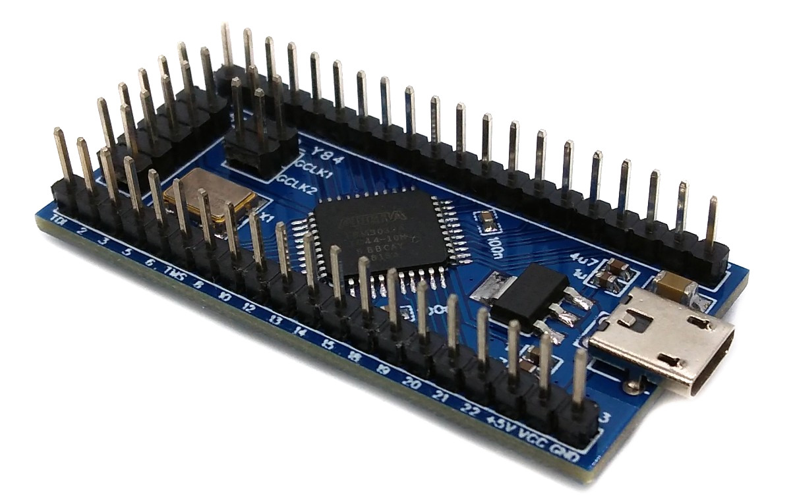
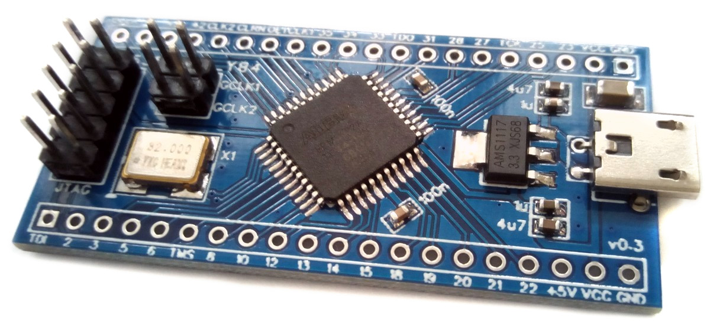

# MAX3000A CPLD Development Board
Development board for the Altera (Intel) MAX 3000A EPM3032A/EPM3064A CPLD in TQFP-44 package. The board provides a 3.3V voltage regulator, an on-board clock oscillator, a standard 10-pin JTAG header for programming and all I/O pins on two 20-pin headers, so it can be plugged directly into a breadboard.



# Pinout
All I/O pins of the CPLD are broken out to the two 20-pin headers P2 and P3. The pin names correspond to the pin numbers of the TQFP-44 package (e.g. P12 = pin 12).

|Pin|Header P2|Header P3|
|:-:|:-|:-|
|1|TDI|GND|
|2|P2|VCC (3.3V)|
|3|P3|P23|
|4|P5|P25|
|5|P6|TCK|
|6|TMS|P27|
|7|P8|P28|
|8|P10|P31|
|9|P12|TDO|
|10|P13|P33|
|11|P14|P34|
|12|P15|P35|
|13|P18|GCLK1 (P37)|
|14|P19|OE1 (P38)|
|15|P20|GCLRN (P39)|
|16|P21|GCLK2 (P40)|
|17|P22|P42|
|18|+5V|P43|
|19|VCC (3.3V)|P44|
|20|GND|QCLK (oscillator output)|

Please check the assignment against the [schematic](https://raw.githubusercontent.com/wagiminator/Development-Boards/main/MAX3000A_DevBoard/MAX3000A_DevBoard_schematic.pdf) before use.

## Board Features
- **CPLD:** EPM3032ATC44 (32 macrocells) or EPM3064ATC44 (64 macrocells), both pin-compatible.
- **Power supply:** via USB power connector (5V). The AMS1117-3.3 voltage regulator generates the 3.3V supply voltage (VCC) for the CPLD. Alternatively, the board can be supplied via the +5V or VCC pins of the headers.
- **Clock:** on-board clock oscillator (7050 package) with output QCLK. With jumper **J2** QCLK is connected to the global clock input GCLK1, with jumper **J3** to GCLK2. Remove the jumpers if you want to use these pins as normal inputs or feed an external clock.
- **JTAG:** standard 10-pin Altera JTAG header J1 (compatible with USB-Blaster) for in-system programming.

## JTAG Header J1
```
      +-----+
  TCK |1   2| GND
  TDO |3   4| VCC
  TMS |5   6| NC
   NC |7   8| NC
  TDI |9  10| GND
      +-----+
```

# The MAX 3000A Family of CPLDs
## Overview
The MAX 3000A family consists of low-cost, high-performance 3.3V CPLDs based on EEPROM technology. The configuration is stored non-volatile in the device, so the CPLD is ready to work immediately after power-up (instant-on). The devices support in-system programmability (ISP) via the IEEE Std. 1149.1 JTAG interface and are ideal for glue logic, interface conversion, address decoding, simple state machines and for getting started with programmable logic.

## Features of EPM3032A/EPM3064A
- 32 (EPM3032A) or 64 (EPM3064A) macrocells
- 600 (EPM3032A) or 1,250 (EPM3064A) usable gates
- Up to 34 user I/O pins in TQFP-44 package
- 3.3V supply voltage, 5V-tolerant I/O pins
- Pin-to-pin logic delays down to 4.5 ns, counter frequencies up to 227 MHz
- Non-volatile EEPROM configuration with at least 100 program/erase cycles
- In-system programmable via 4-pin JTAG interface
- Programmable power-saving mode, open-drain outputs and slew-rate control
- Global clock, global clear and output enable inputs

# Programming
## USB-Blaster
The CPLD is programmed via the JTAG header J1 using an Altera USB-Blaster or a compatible clone (available for a few dollars). Connect the 10-pin cable of the USB-Blaster to J1 and power the board via its USB power connector. The USB-Blaster does not supply the board!

## Quartus II Web Edition
MAX 3000A devices are supported by **Intel Quartus II Web Edition up to version 13.0sp1**, which is free of charge and runs on Windows and Linux. Newer Quartus Prime versions no longer support the MAX 3000A family. The software can be downloaded from the [Intel FPGA Software Download Center](https://www.intel.com/content/www/us/en/collections/products/fpga/software/downloads.html).

Workflow:
1. Create a new project with *File -> New Project Wizard* and select the device family *MAX3000A* and the device *EPM3032ATC44-10* or *EPM3064ATC44-10*.
2. Describe your design in VHDL, Verilog or as a schematic (block diagram file).
3. Assign the pins with the *Pin Planner* according to the pinout above.
4. Compile the design with *Processing -> Start Compilation*. This creates a *.pof* file.
5. Open the *Programmer* (*Tools -> Programmer*), select the USB-Blaster under *Hardware Setup*, add the *.pof* file, tick *Program/Configure* and click *Start*.

On Linux, grant access permissions for the USB-Blaster first:

```
echo 'SUBSYSTEM=="usb", ATTR{idVendor}=="09fb", ATTR{idProduct}=="6001", MODE="666"' | sudo tee /etc/udev/rules.d/51-usbblaster.rules
sudo udevadm control --reload-rules
```

## Alternative Software Tools
- [OpenOCD](https://openocd.org/) can play *.svf* files (can be generated by Quartus via *File -> Convert Programming Files*) with a USB-Blaster or other JTAG adapters.
- [UrJTAG](http://urjtag.org/) also supports SVF playback with many JTAG adapters.

# References, Links and Notes
- [MAX 3000A Programmable Logic Device Family Datasheet](https://www.intel.com/content/www/us/en/products/details/fpga/max/3000a.html)
- [Intel FPGA Software Download Center](https://www.intel.com/content/www/us/en/collections/products/fpga/software/downloads.html)
- [Schematic of the board](https://raw.githubusercontent.com/wagiminator/Development-Boards/main/MAX3000A_DevBoard/MAX3000A_DevBoard_schematic.pdf)
- [Bill of Materials](https://raw.githubusercontent.com/wagiminator/Development-Boards/main/MAX3000A_DevBoard/MAX3000A_DevBoard_BOM.tsv)



# License


This work is licensed under Creative Commons Attribution-ShareAlike 3.0 Unported License.
(http://creativecommons.org/licenses/by-sa/3.0/)
