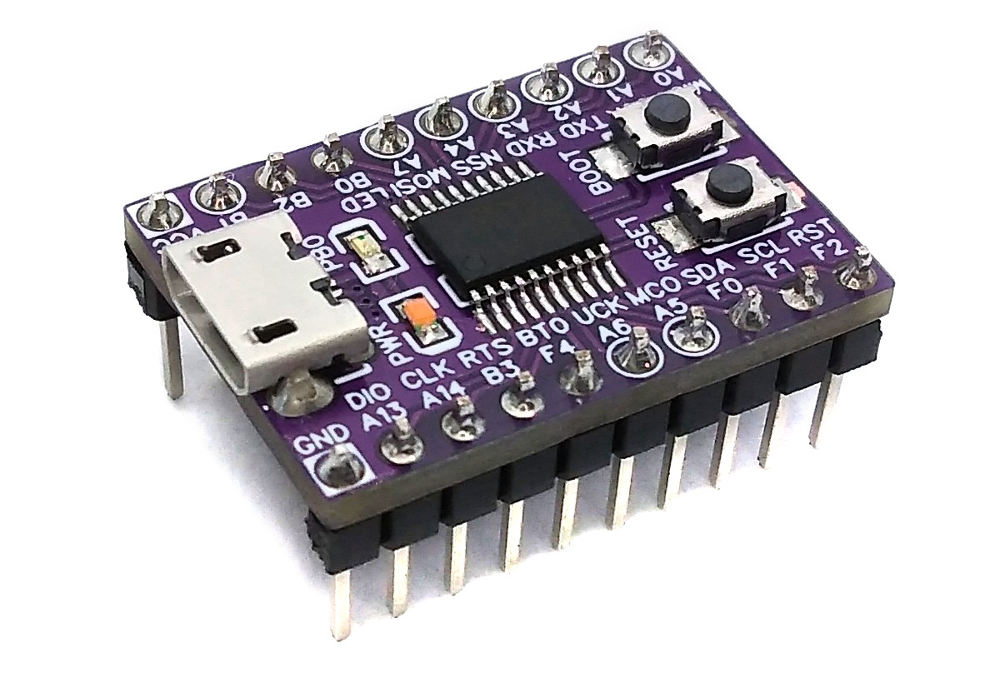
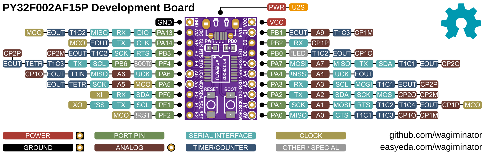
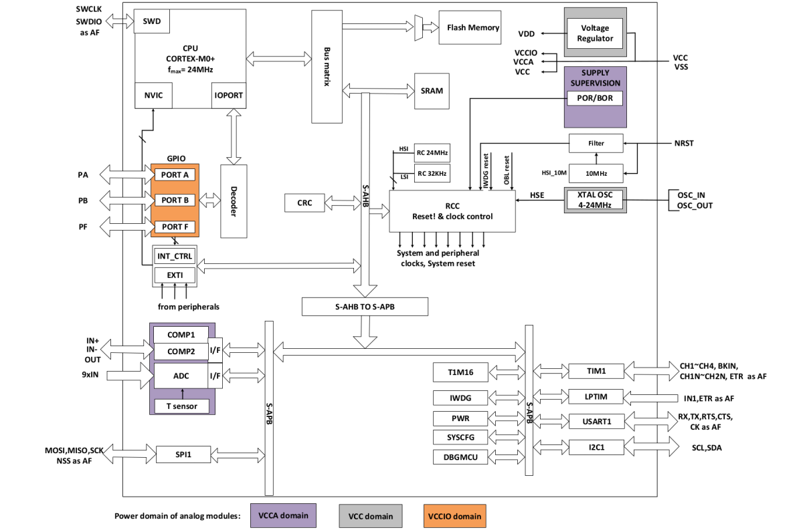
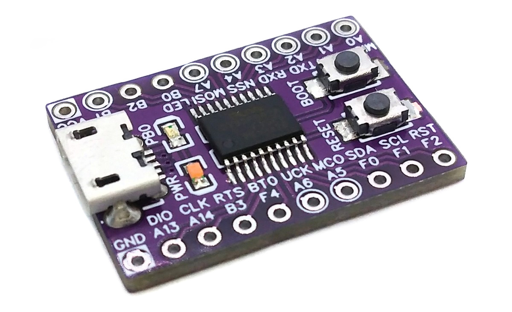
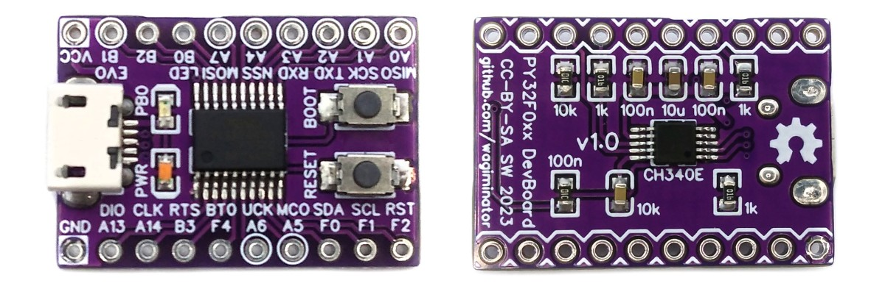

# PY32F002A F15P Development Board
Development board for the PY32F002AF15P ultra-cheap 32-bit ARM Cortex microcontroller with integrated USB-to-serial adapter which can also be used to upload firmware utilizing the factory built-in serial bootloader.



# Pinout


# The PY32F002A Family of 32-bit ARM Microcontrollers
## Overview
The PY32F002A series microcontrollers are cost-effective MCUs with a high performance 32-bit ARM® Cortex®-M0+ core. They feature a wide voltage operating range (1.7V - 5.5V), 20 Kbytes flash, 3 Kbytes SRAM memory, and a maximum operating frequency of 24 MHz. The chip integrates multi-channel I2C, SPI, USART, and other communication peripherals, one channel 12-bit ADC, two 16-bit timers, and two-channel comparators. The PY32F002A series contains various products in different package types.

## Block Diagram


## Features
- 32-bit ARM® Cortex®-M0+ CPU
- Maximum 24MHz system main frequency
- 3KB SRAM, 20KB Flash
- Operating voltage: 1.7V - 5.5V
- Internal 8/24MHz RC Oscillator (HSI)
- Internal 32.768kHz RC oscillator (LSI)
- External 4-24MHz crystal oscillator (HSE)
- Multiple low-power modes: Sleep, Stop
- Power on/off reset, programmable brownout detector
- Up to 18 I/Os, all available as external interrupts, 8mA drive current
- 1x 12-bit ADC, 2x comparators
- 1× 16-bit advanced control timer, 1× 16-bit general purpose timer
- 1x low-power timer, supports wake-up from stop mode
- 1x independend watchdog tmer, 1× SysTick timer
- 1x USART interface, 1x I2C interface, 1x SPI interface
- 18 I/O ports, mapping an external interrupt
- Hardware CRC-32 module
- 128-bit chip unique ID
- Serial wire debug interface (SWD)
- Factory built-in UART bootloader

## Unofficial Additional Features
The PY32F002A obviously has the same core as its larger sibling, PY32F030. Therefore, the following additional peripherals and capabilities are also available:
- Maximum 48MHz system frequency via PLL
- 4KB SRAM, 32KB flash
- 3-channel DMA controller
- 3x additional 16-bit general purpose timer
- 1x window watchdog timer
- 1x real-time clock (RTC)
- 1x infrared interface
- 1x additional USART, 1x additional SPI interface

While it cannot be guaranteed that this applies to all PY32F002A devices, at least in the case of mine, these features work very well.

# Programming and Debugging
There are two ways to program the microcontroller: via USB using the factory built-in UART bootloader and the integrated USB-to-serial converter, and via the serial wire debug interface (SWD) using an SWD programmer.

## Factory Built-in UART Bootloader
The MCU has an embedded bootloader with UART interface, which can be used to upload firmware using the USB-to-serial converter integrated into the board. If necessary, a driver for the [CH340](https://www.wch-ic.com/downloads/CH341SER_ZIP.html) USB-to-serial converter must be installed.

To upload firmware via the USB port, the MCU must first be put into boot mode using ONE of the following methods:
- Disconnect your board from all power supplies, press and hold the BOOT button, then connect the board to your USB port. The BOOT button can be released now.
- Connect your board to your USB port. Press and hold the BOOT button, then press and release the RESET button and then release the BOOT button.

### Uploading Firmware with puyaisp
The open-source platform-independent Python tool [puyaisp](https://pypi.org/project/puyaisp/) from the [MCU Flash Tools](https://github.com/wagiminator/MCU-Flash-Tools) is used by the makefiles of the example software. In order for this tool to work, [Python3](https://www.python.org/downloads/) with [pip](https://pip.pypa.io/en/stable/getting-started/) must be installed on your system. On Linux (Debian-based), all of this can be done with the following commands:

```
sudo apt install python3 python3-pip
pip install puyaisp
```

Usage example:

```
puyaisp -f firmware.bin
```

Alternatively, you can use the [PUYA ISP web app](https://wagiminator.github.io/apps/puyaisp/) directly in your web browser (Chrome, Edge or Opera on a desktop computer) without installing any software.

## Serial Wire Debug Interface (SWD)
The MCU can also be programmed and debugged via the SWD interface using an SWD programmer such as DAPLink/CMSIS-DAP, ST-Link V2, J-Link or the Raspberry Pi Debug Probe. Connect the programmer to the SWDIO (PA13) and SWCLK (PA14) pins of the board.

Suitable SWD programmers (CMSIS-DAP) can be found on my GitHub page:
- [CH552 DAPLink](https://github.com/wagiminator/CH552-DAPLink) - CMSIS-DAP compliant debug probe with SWD/JTAG and virtual COM port
- [CH552 picoDAP](https://github.com/wagiminator/CH552-picoDAP) - tiny CMSIS-DAP compliant debug probe with SWD
- [SWD Programmer Stick](https://github.com/wagiminator/SAMD-Development-Boards/tree/main/SWD_Programmer_Stick) - CMSIS-DAP programmer in USB stick format

### Uploading Firmware with tinyocd
The open-source platform-independent Python tool [tinyocd](https://pypi.org/project/tinyocd/) from the [MCU Flash Tools](https://github.com/wagiminator/MCU-Flash-Tools) is used by the makefiles of the example software. In order for this tool to work, [Python3](https://www.python.org/downloads/) with [pip](https://pip.pypa.io/en/stable/getting-started/) must be installed on your system. On Linux (Debian-based), all of this can be done with the following commands:

```
sudo apt install python3 python3-pip
pip install tinyocd
```

Usage example:

```
tinyocd -f firmware.bin
```

Programmer and chip are detected automatically. On Linux, grant access permissions for the programmer as described in the [tinyocd documentation](https://pypi.org/project/tinyocd/).

Alternatively, you can use the [SWD Programmer web app](https://wagiminator.github.io/apps/swdprog/) directly in your web browser (Chrome, Edge or Opera on a desktop computer) without installing any software.

### Alternative Software Tools
- [pyOCD](https://pyocd.io/) (`pyocd load firmware.bin -t py32f002ax5`)
- [OpenOCD](https://openocd.org/)

Note: pyOCD needs the Puya.PY32F0xx_DFP pack (`pyocd pack install PY32F002Ax5`). More information can be found [here](https://github.com/IOsetting/py32f0-template).

# Software Development Tools
## Open-Source GCC Toolchain
For compiling install the [ARM GNU toolchain](https://developer.arm.com/downloads/-/arm-gnu-toolchain-downloads). On Linux (Debian-based), this can be done with the following command:

```
sudo apt install build-essential gcc-arm-none-eabi
```

The [example software](#example-software) is based on the [MCU Templates](https://github.com/wagiminator/MCU-Templates/tree/main/PY32F002A), a lightweight starting point for bare-metal firmware development in C without any IDE. Each example folder contains a makefile. Go into the folder of an example and use one of the following commands:

```
make all       compile and build firmware
make flash     compile and upload firmware to the MCU
make clean     remove all build files
make help      show all options
```

## Arduino IDE Support
An Arduino core for the PY32F0 series can be found [here](https://github.com/py32duino/Arduino-PY32).

# Example Software
The following examples are included. They use the [MCU Templates](https://github.com/wagiminator/MCU-Templates) and their libraries. By default, the firmware is uploaded with `make flash` via the UART bootloader (puyaisp). The serial interface (UART) is connected to the integrated USB-to-serial converter.

| Example | Description |
|:-|:-|
| [blink](https://github.com/wagiminator/Development-Boards/tree/main/PY32F002AF15P_DevBoard/software/blink) | Blink built-in LED. |
| [crc](https://github.com/wagiminator/Development-Boards/tree/main/PY32F002AF15P_DevBoard/software/crc) | Send a message through UART with a newline at the end, and the CRC of the message will be sent back. We're checking if the CRC module works. |
| [debug](https://github.com/wagiminator/Development-Boards/tree/main/PY32F002AF15P_DevBoard/software/debug) | Sends a message via UART once a second. |
| [i2c_eeprom](https://github.com/wagiminator/Development-Boards/tree/main/PY32F002AF15P_DevBoard/software/i2c_eeprom) | Transfers content of 24Cxx I2C EEPROM via UART. |
| [max7219_segment](https://github.com/wagiminator/Development-Boards/tree/main/PY32F002AF15P_DevBoard/software/max7219_segment) | Print numbers on a MAX7219 8-digit 8-segment display. Connect PA4 (CS), PA1 (CLK), PA7 (DIN). |
| [neopixel_spi](https://github.com/wagiminator/Development-Boards/tree/main/PY32F002AF15P_DevBoard/software/neopixel_spi) | Shows a colorful animation on a string of 8 NeoPixels. The number of pixels can be changed in neo_spi.h. Connect pin PA7 (MOSI) to DIN of the pixels string. |
| [oled_conway](https://github.com/wagiminator/Development-Boards/tree/main/PY32F002AF15P_DevBoard/software/oled_conway) | The Game of Life is a cellular automaton, and was invented by Cambridge mathematician John Conway. This game became widely known when it was mentioned in an article published by Scientific American in 1970. |
| [oled_dma](https://github.com/wagiminator/Development-Boards/tree/main/PY32F002AF15P_DevBoard/software/oled_dma) | SSD1306 128x64 Pixels I2C OLED demo with constant screen refresh. This implementation utilizes DMA in circular mode for continuous data transfer of the screen buffer to the OLED. |
| [oled_gfx](https://github.com/wagiminator/Development-Boards/tree/main/PY32F002AF15P_DevBoard/software/oled_gfx) | SSD1306 128x64 Pixels I2C OLED graphics demo. Connect an SSD1306 128x64 Pixels I2C OLED to PF0 (SDA) and PF1 (SCL). |
| [oled_mandelbrot](https://github.com/wagiminator/Development-Boards/tree/main/PY32F002AF15P_DevBoard/software/oled_mandelbrot) | The Mandelbrot set is a complex set of points that forms a fractal, named after mathematician Benoît Mandelbrot. |
| [oled_sinewave](https://github.com/wagiminator/Development-Boards/tree/main/PY32F002AF15P_DevBoard/software/oled_sinewave) | Retro-style sine wave animated text scroller for SSD1306 128x32 pixels I2C OLED. Connect the OLED to PF0 (SDA) and PF1 (SCL). |
| [oled_terminal](https://github.com/wagiminator/Development-Boards/tree/main/PY32F002AF15P_DevBoard/software/oled_terminal) | Displays text sent via UART on an SSD1306 128x64 pixels OLED. |
| [oled_txt](https://github.com/wagiminator/Development-Boards/tree/main/PY32F002AF15P_DevBoard/software/oled_txt) | SSD1306 128x64 Pixels I2C OLED text demo. Connect an SSD1306 128x64 Pixels I2C OLED to PF0 (SDA) and PF1 (SCL). |
| [reset](https://github.com/wagiminator/Development-Boards/tree/main/PY32F002AF15P_DevBoard/software/reset) | Blink built-in LED using software resets. |
| [rtc](https://github.com/wagiminator/Development-Boards/tree/main/PY32F002AF15P_DevBoard/software/rtc) | Blink built-in LED using RTC interrupts. By the way, officially the PY32F002A has no RTC. |
| [serial](https://github.com/wagiminator/Development-Boards/tree/main/PY32F002AF15P_DevBoard/software/serial) | Echoes data sent via UART. |
| [serial2](https://github.com/wagiminator/Development-Boards/tree/main/PY32F002AF15P_DevBoard/software/serial2) | Echoes data sent via UART. Uses USART2, which should not exist on the PY32F002A. |
| [serial_dma](https://github.com/wagiminator/Development-Boards/tree/main/PY32F002AF15P_DevBoard/software/serial_dma) | Echoes data sent via UART. Uses DMA for RX, which should not exist on PY32F002A. |
| [sleep](https://github.com/wagiminator/Development-Boards/tree/main/PY32F002AF15P_DevBoard/software/sleep) | Blink built-in LED using deep sleep with LPTIM as wake-up timer. |
| [sram_test](https://github.com/wagiminator/Development-Boards/tree/main/PY32F002AF15P_DevBoard/software/sram_test) | Find out the real size of chip's SRAM. Chip will hang if trying to write to invalid SRAM address. I bet the PY32F002A actually has 4KB SRAM. |
| [tm1650_segment](https://github.com/wagiminator/Development-Boards/tree/main/PY32F002AF15P_DevBoard/software/tm1650_segment) | Displays supply voltage and chip temperature on a 4-digit 8-segment LED Display via TM1650 and I2C. Connections: pin PF0 (SDA) and PF1 (SCL). |
| [watchdog](https://github.com/wagiminator/Development-Boards/tree/main/PY32F002AF15P_DevBoard/software/watchdog) | Blink built-in LED using independent watchdog resets. |

# References, Links and Notes
- [EasyEDA Design Files](https://oshwlab.com/wagiminator)
- [PUYA Product Page](https://www.puyasemi.com/py32_xilie.html)
- [MCU Templates](https://github.com/wagiminator/MCU-Templates)
- [MCU Flash Tools](https://github.com/wagiminator/MCU-Flash-Tools)
- [Arduino Support](https://github.com/py32duino/Arduino-PY32)
- [IOsetting PY32F0 Template](https://github.com/IOsetting/py32f0-template)
- [Jay Carlson's Article](https://jaycarlson.net/2023/02/04/the-cheapest-flash-microcontroller-you-can-buy-is-actually-an-arm-cortex-m0/)
- [EEVblog PY32F002A](https://www.eevblog.com/forum/microcontrollers/$0-11-py32f002a-m0-24mhz-320kb-actually-324kb-more-peripherals/)
- [PUYA ISP Web App](https://wagiminator.github.io/apps/puyaisp/)
- [SWD Programmer Web App](https://wagiminator.github.io/apps/swdprog/)




# License


This work is licensed under Creative Commons Attribution-ShareAlike 3.0 Unported License.
(http://creativecommons.org/licenses/by-sa/3.0/)
