# Development Boards
Collection of various development boards for some entry-level microcontrollers and accompanying example software. Some additional tools can be found here:
- [MCU Templates](https://github.com/wagiminator/MCU-Templates)
- [MCU Flash Tools](https://github.com/wagiminator/MCU-Flash-Tools)

## [CH55xG Development Board](https://github.com/wagiminator/Development-Boards/tree/main/CH55xG_DevBoard)
Development board for the CH551G, CH552G and CH554G low-cost 8-bit 8051 core microcontrollers with native USB 2.0 and Arduino IDE support.

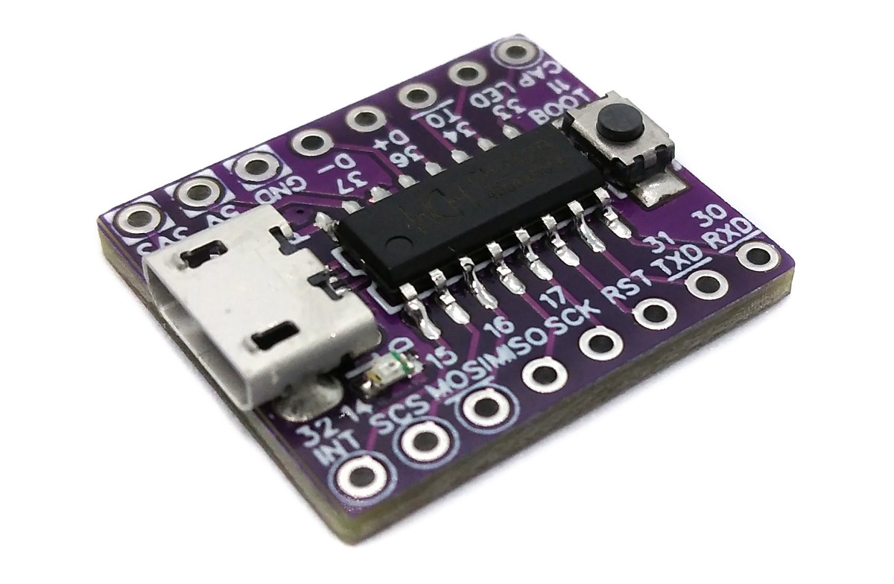

The CH55x is an 8-bit enhanced E8051 core MCU compatible with the MCS51 instruction set. 79% of its instructions are single-byte single-cycle instructions, and the average instruction speed is 8 - 15 times faster than that of the standard MCS51. The special xRAM supports DMA, data fast copy command, and double DPTR pointers. The CH55x has a built-in USB controller and USB transceiver, it supports USB-Host mode (CH554 only) and USB-Device mode (all), USB Type-C master-slave detection, USB 2.0 full-speed (12Mbps) and low-speed (1.5Mbps) traffic, data packets of up to 64 bytes, and DMA. It has a factory built-in bootloader so firmware can be uploaded directly via USB without the need for an additional programming device.

## [CH55xT Development Board](https://github.com/wagiminator/Development-Boards/tree/main/CH55xT_DevBoard)
Development board for the CH552T, CH554T, CH558T, and CH559T low-cost 8-bit 8051 core microcontrollers with native USB 2.0 and Arduino IDE support.

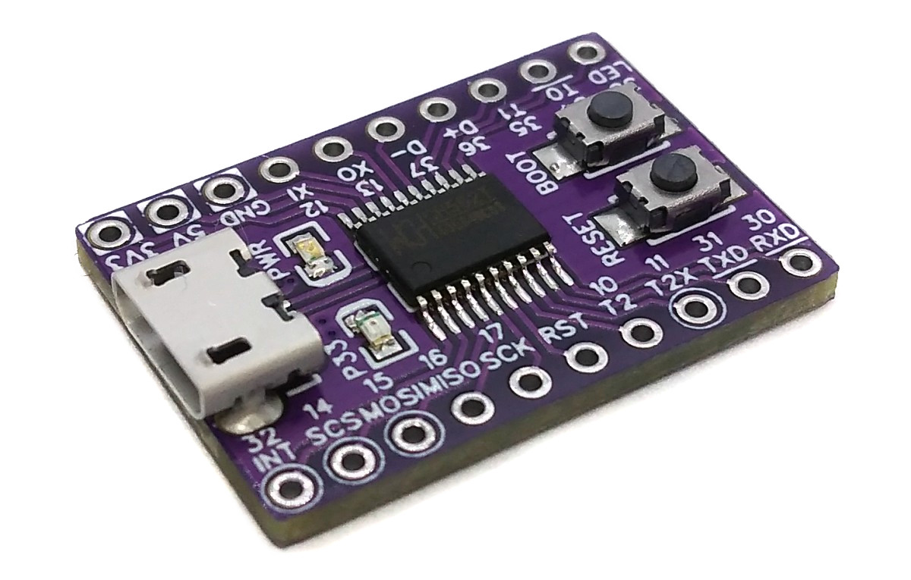

The CH55x is an 8-bit enhanced E8051 core MCU compatible with the MCS51 instruction set. 79% of its instructions are single-byte single-cycle instructions, and the average instruction speed is 8 - 15 times faster than that of the standard MCS51. The special xRAM supports DMA, data fast copy command, and double DPTR pointers. The CH55x has a built-in USB controller and USB transceiver, it supports USB-Host mode (CH554 only) and USB-Device mode (all), USB Type-C master-slave detection, USB 2.0 full-speed (12Mbps) and low-speed (1.5Mbps) traffic, data packets of up to 64 bytes, and DMA. It has a factory built-in bootloader so firmware can be uploaded directly via USB without the need for an additional programming device.

## [CH32V003 A4M6 Development Board](https://github.com/wagiminator/Development-Boards/tree/main/CH32V003A4M6_DevBoard)
Development board for the CH32V003A4M6 ultra-cheap (10 cents) 32-bit RISC-V microcontroller.

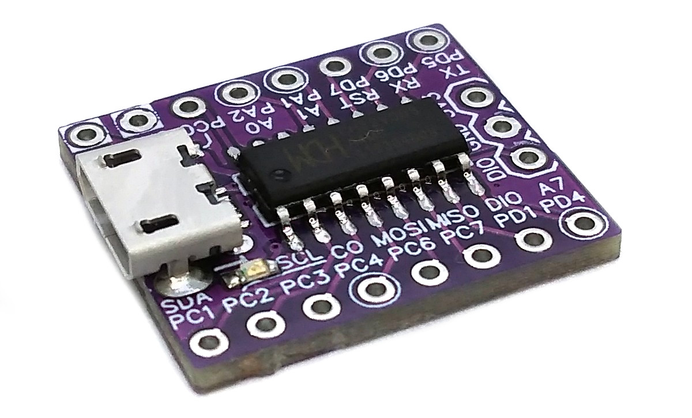

The CH32V003 utilizes the QingKe RISC-V2A core design supporting the RV32EC instruction set. This microcontroller is equipped with various features such as a 48MHz system main frequency, 16KB flash, 2KB SRAM, wide voltage support (2.7V - 5.5V), a single-wire serial debug interface, low power consumption, and an ultra-small package. Additionally, the CH32V003 includes a built-in set of components including a DMA controller, a 10-bit ADC, op-amp comparators, multiple timers, and standard communication interfaces such as USART, I²C, and SPI.

## [CH32V003 F4P6 Development Board](https://github.com/wagiminator/Development-Boards/tree/main/CH32V003F4P6_DevBoard)
Development board for the CH32V003F4P6 ultra-cheap (10 cents) 32-bit RISC-V microcontroller.

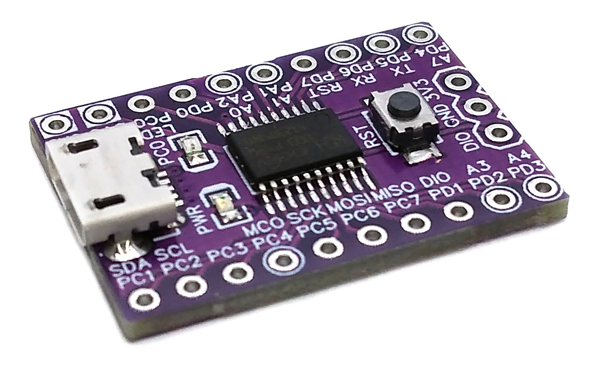

The CH32V003 utilizes the QingKe RISC-V2A core design supporting the RV32EC instruction set. This microcontroller is equipped with various features such as a 48MHz system main frequency, 16KB flash, 2KB SRAM, wide voltage support (2.7V - 5.5V), a single-wire serial debug interface, low power consumption, and an ultra-small package. Additionally, the CH32V003 includes a built-in set of components including a DMA controller, a 10-bit ADC, op-amp comparators, multiple timers, and standard communication interfaces such as USART, I²C, and SPI.

## [CH32V003 F4P6 Development Board V-USB](https://github.com/wagiminator/Development-Boards/tree/main/CH32V003F4P6_DevBoard_VUSB)
Development board for the CH32V003F4P6 ultra-low-cost (10 cents) 32-bit RISC-V microcontroller with support for software USB.

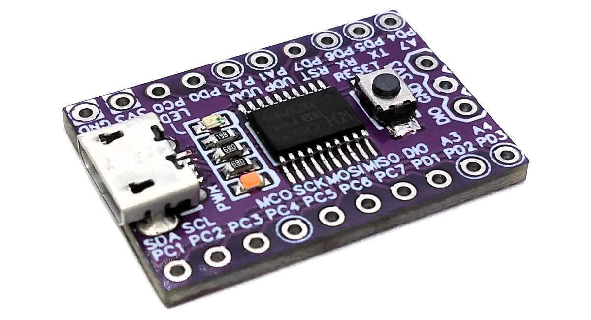

The CH32V003 utilizes the QingKe RISC-V2A core design supporting the RV32EC instruction set. This microcontroller is equipped with various features such as a 48MHz system main frequency, 16KB flash, 2KB SRAM, wide voltage support (2.7V - 5.5V), a single-wire serial debug interface, low power consumption, and an ultra-small package. Additionally, the CH32V003 includes a built-in set of components including a DMA controller, a 10-bit ADC, op-amp comparators, multiple timers, and standard communication interfaces such as USART, I²C, and SPI.

## [CH32V203 F6P6 Development Board](https://github.com/wagiminator/Development-Boards/tree/main/CH32V203F6P6_DevBoard)
Development board for the CH32V203F6P6 low-cost (50 cents) 32-bit RISC-V microcontroller with native USB 2.0 and Arduino IDE support.

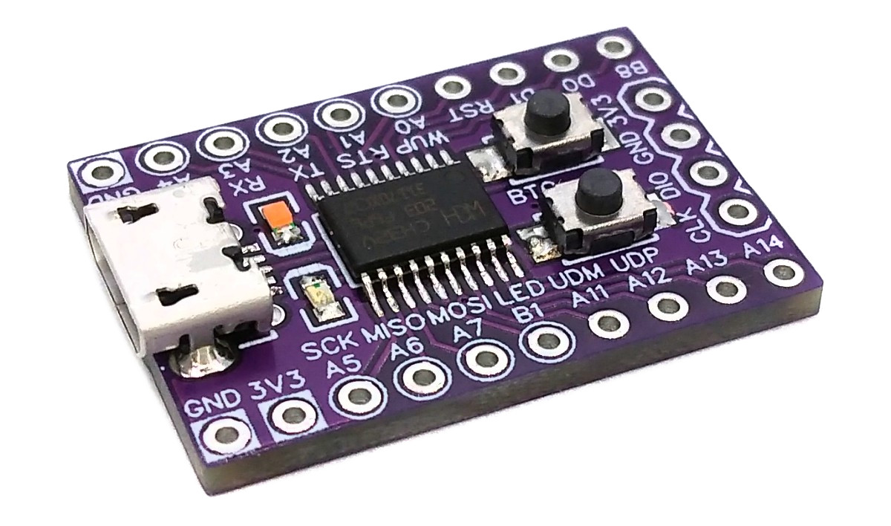

The CH32V203 is based on a 32-bit RISC-V core, supports the RV32IMAC instruction set, and can operate at a voltage range of 2.4V - 3.6V and at clock frequencies of up to 144MHz. The MCU's power consumption is highly efficient, reaching as low as 45uA per MHz. Additionally, the CH32V203 integrates a USB interface with two channels, enabling both USB Host and USB Device functionalities. It also provides a CAN interface (2.0B active) with one channel, up to two OPA channels, four UARTs, two I²Cs, a 12-bit ADC, a 10-channel TouchKey, and various other peripheral resources. The CH32V203 includes 64KB flash, 20KB SRAM, and an embedded USB bootloader.

## [CH32X033 F8P6 Development Board](https://github.com/wagiminator/Development-Boards/tree/main/CH32X033F8P6_DevBoard)
Development board for the CH32X033F8P6 low-cost (20 cents) 32-bit RISC-V microcontroller with native USB2.0 and Arduino IDE support.

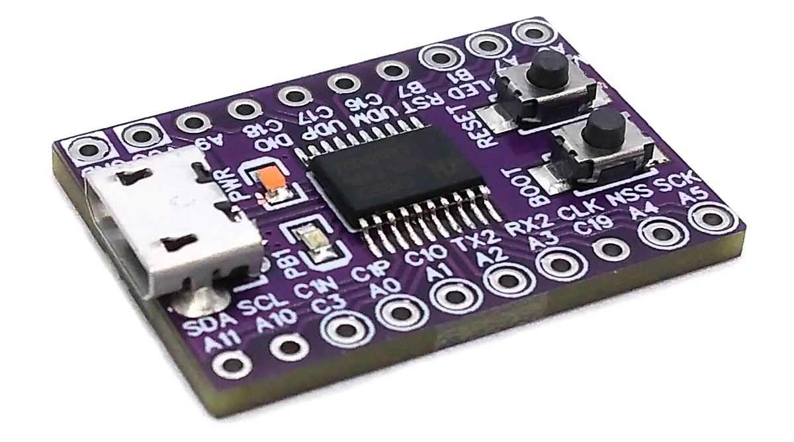

The CH32X033 utilizes the QingKe 32-bit RISC-V4C core, supporting the RV32IMAC instruction set along with self-extending instructions. This microcontroller comes with a built-in USB PHY and supports USB2.0 full-speed device functions. It features a programmable protocol I/O controller (PIOC), 2 groups of operational amplifiers (OPA) with programmable gain (PGA), 2 groups of analog comparators (CMP), a 12-bit analog-to-digital converter (ADC), a 10-channel touch-key controller, 4 groups of USART, I²C, SPI, multiple timers, and various other peripheral resources. The device can operate at clock frequencies of up to 48MHz and is compatible with a supply voltage range of 2.0V to 5.5V. The CH32X033 includes 62KB flash, 20KB SRAM, and an embedded USB bootloader.

## [CH32X035 F7P6 Development Board](https://github.com/wagiminator/Development-Boards/tree/main/CH32X035F7P6_DevBoard)
Development board for the CH32X035F7P6 low-cost (30 cents) 32-bit RISC-V microcontroller with native USB2.0, USB Power Delivery, and Arduino IDE support.

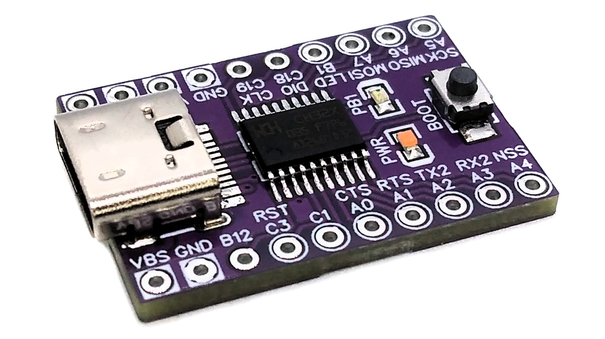

CH32X035F7P6 utilizes the QingKe 32-bit RISC-V4C core, supporting the RV32IMAC instruction set along with self-extending instructions. This microcontroller comes with a built-in USB PHY, supporting USB2.0 full-speed device functions and a USB PD PHY with source and sink capabilities. It features a programmable protocol I/O controller (PIOC), an operational amplifier (OPA) with programmable gain (PGA), an analog comparator (CMP), a 12-bit analog-to-digital converter (ADC), an 11-channel touch-key controller, 3 groups of USART, I²C, SPI, multiple timers, and various other peripheral resources. The device can operate at clock frequencies of up to 48MHz and is compatible with a supply voltage range of 2.0V to 5.5V. The CH32X035F7P6 includes 48KB flash, 20KB SRAM, and an embedded USB bootloader.

## [PY32F002A F15P Development Board](https://github.com/wagiminator/Development-Boards/tree/main/PY32F002AF15P_DevBoard)
Development board for the PY32F002AF15P ultra-cheap (10 cents) 32-bit ARM Cortex M0+ microcontroller with integrated USB-to-serial adapter which can also be used to upload firmware utilizing the factory built-in serial bootloader.

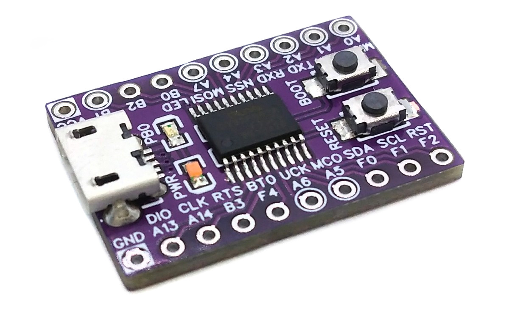

The PY32F002A utilizes a high performance 32-bit ARM® Cortex®-M0+ core. It features a wide voltage operating range (1.7V - 5.5V), 32KB flash, 4KB SRAM, and a maximum operating frequency of 48MHz. The chip integrates multi-channel I²C, SPI, USART, and other communication peripherals, one channel 12-bit ADC, two 16-bit timers, two-channel comparators, and an embedded UART bootloader.

## [STC8H1K08 Development Board](https://github.com/wagiminator/Development-Boards/tree/main/STC8H1K08_DevBoard)
Development board for the STC8H1K08 ultra-cheap (20 cents) 8-bit 8051 core microcontroller with integrated USB-to-serial adapter which can also be used to upload firmware utilizing the factory built-in serial bootloader.

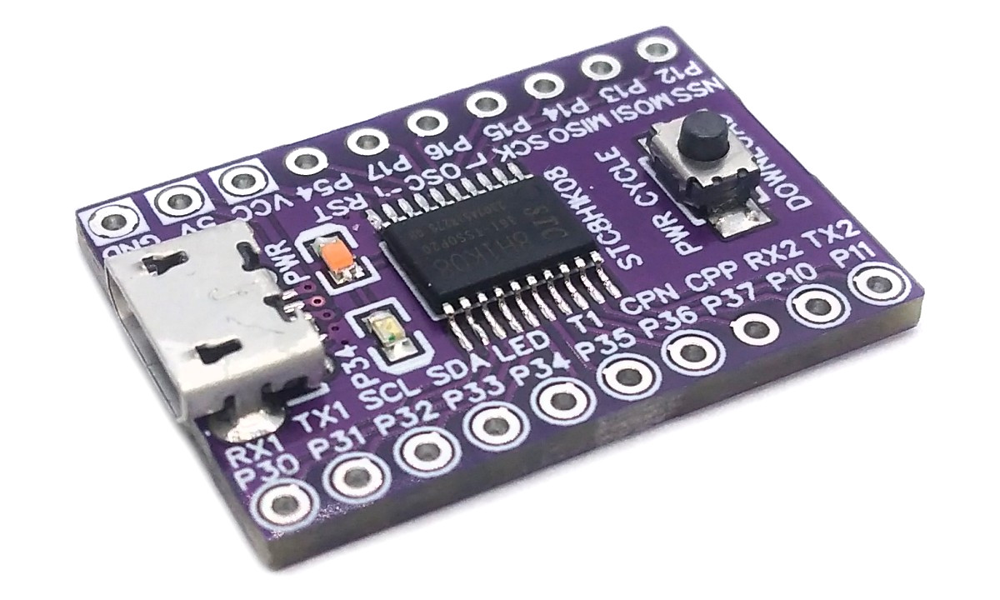

The STC8H1K08 utilizes an ultra-high speed 8051 core that is compatible with the MCS51 instruction set and offers an average instruction speed that is approximately 12 times faster than the traditional 8051, with most instructions requiring only one clock cycle for execution. It supports clock frequencies of up to 36MHz, operates within a voltage range of 1.9V to 5.5V, and comes equipped with standard peripherals such as a 10-bit ADC, analog comparator, multiple timers, PWM, UART, SPI, and I²C. It includes 17KB flash, 1.2KB SRAM, and 4KB EEPROM. Additionally, this microcontroller features a built-in bootloader, allowing firmware to be uploaded directly via UART without the need for an extra programming device.

## [STC8H8K64U Development Board](https://github.com/wagiminator/Development-Boards/tree/main/STC8H8K64U_DevBoard)
Development board for the STC8H8K64U low-cost (30 cents) 8-bit 8051 core microcontroller with native full-speed USB 2.0 and factory built-in USB bootloader.

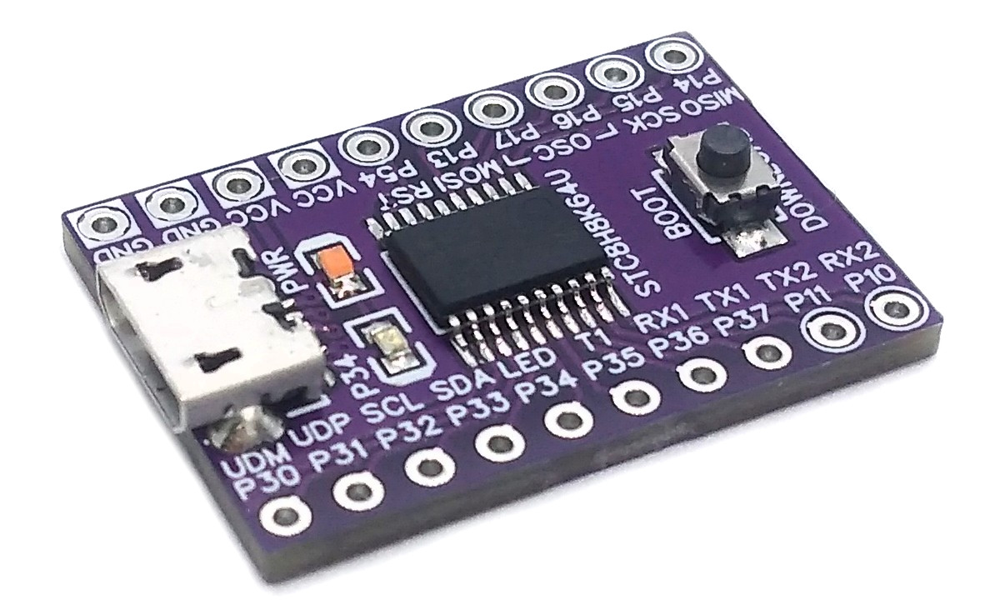

The STC8H8K64U utilizes an ultra-high speed 8051 core that is compatible with the MCS51 instruction set and offers an average instruction speed that is approximately 12 times faster than the traditional 8051, with most instructions requiring only one clock cycle for execution. It supports clock frequencies of up to 40MHz, operates within a voltage range of 1.9V to 5.5V, and comes equipped with standard peripherals such as a 12-bit ADC, analog comparator, multiple timers, PWM, DMA, UART, SPI, and I²C. It includes 64KB flash, 9.4KB SRAM, and 32KB EEPROM. Additionally, this microcontroller features a built-in bootloader, allowing firmware to be uploaded directly via the native full-speed USB 2.0 interface without the need for an extra programming device.

## [STM32C011 F4P6 Development Board](https://github.com/wagiminator/Development-Boards/tree/main/STM32C011F4P6_DevBoard)
Development board for the STM32C0x1FxP cost-effective (40 cents) 32-bit ARM Cortex M0+ microcontroller with integrated USB-to-serial adapter which can also be used to upload firmware utilizing the factory built-in serial bootloader.

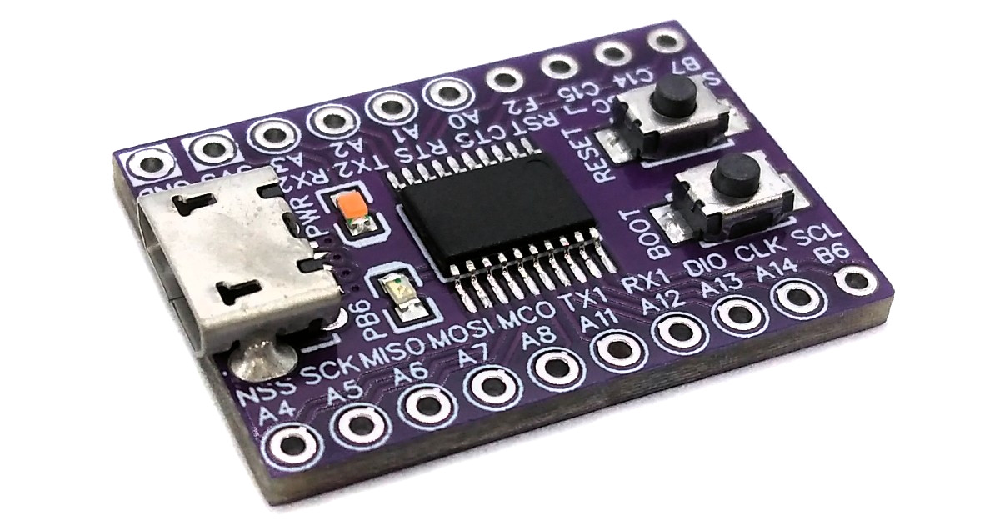

The STM32C011 utilizes an Arm® Cortex®-M0+ core and runs up to 48 MHz at a voltage range of 2.0V - 3.6V. It features a fast 12-bit ADC with hardware resolution up to 16-bit, flexible mapping on the DMA channels, timers with advanced control capability, and several communication peripherals, including 2 UARTs, I²C, and SPI. The STM32C011 includes 32KB flash, 12KB SRAM, and an embedded UART bootloader.

## [STM32F030 F4P6 Development Board](https://github.com/wagiminator/Development-Boards/tree/main/STM32F030F4P6_DevBoard)
Development board for the STM32F030F4P6 cost-effective (40 cents) 32-bit ARM Cortex M0 microcontroller with integrated USB-to-serial adapter which can also be used to upload firmware utilizing the factory built-in serial bootloader. Due to the comparable pinouts, this board can also be used with other microcontrollers from the STM32F0 and STM32L0 series that come in the same TSSOP20 package.

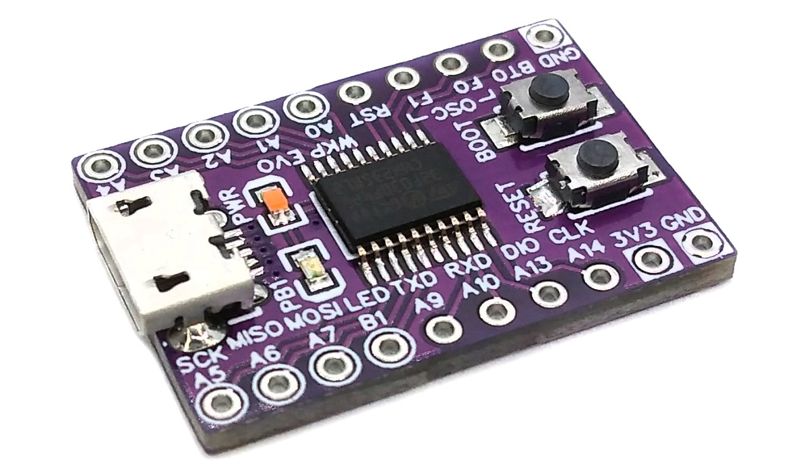

The STM32F030 features an Arm® Cortex®-M0 core and runs up to 48 MHz at a voltage range of 2.4V - 3.6V. It features a full set of performing peripherals, such as fast 12-bit ADC, advanced and flexible timers, calendar RTC and communication peripherals such as the I²C, USART and SPI. The STM32F030 includes 16KB flash, 4KB SRAM, and an embedded UART bootloader.

## [STM32G030 F6P6 Development Board](https://github.com/wagiminator/Development-Boards/tree/main/STM32G030F6P6_DevBoard)
Development board for the STM32G030F6P6 cost-effective (50 cents) 32-bit ARM Cortex M0+ microcontroller with integrated USB-to-serial adapter which can also be used to upload firmware utilizing the factory built-in serial bootloader.

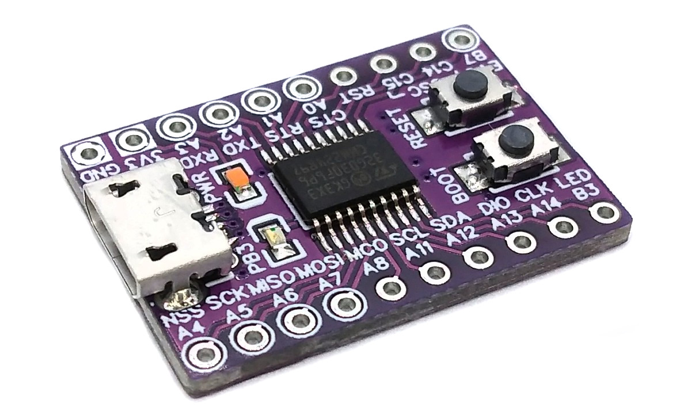

The STM32G030 is based on high-performance Arm® Cortex®-M0+ 32-bit RISC core operating at up to 64 MHz frequency and at a voltage range of 2.0V - 3.6V. The device incorporates 8KB SRAM and 32KB flash, DMA, an extensive range of system functions, enhanced I/Os, one 12-bit ADC (2.5 MSps) with up to 19 channels, a low-power RTC, an advanced control PWM timer, four general-purpose 16-bit timers, two watchdog timers, a SysTick timer, standard communication interfaces (two I²Cs, two SPIs/one I2S, and two USARTs), and an embedded UART bootloader.

## [ATSAMD11C14A Development Board](https://github.com/wagiminator/Development-Boards/tree/main/ATSAMD11C14A_DevBoard)
Development board for the ATSAMD11C14A (SO14) low-cost 32-bit ARM Cortex M0+ microcontroller with native USB 2.0, USB bootloader support, and Arduino IDE support.

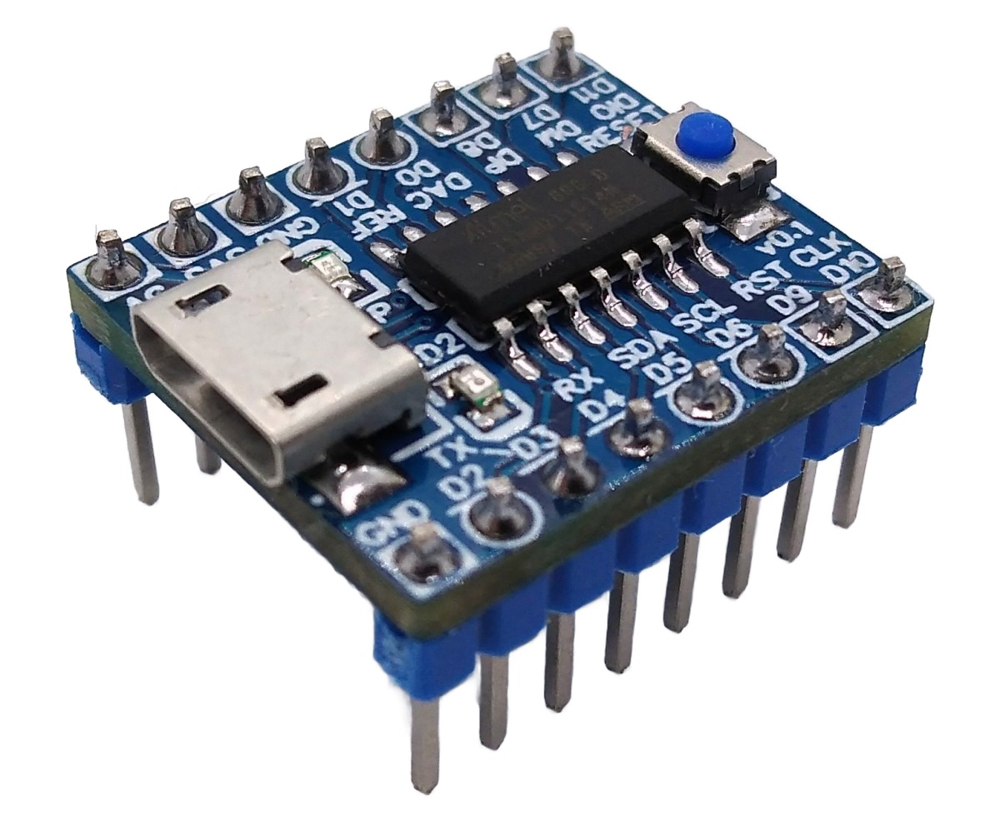

The ATSAMD11C14A is a low-power microcontroller using the 32-bit ARM® Cortex®-M0+ processor running at up to 48MHz at a voltage range of 1.62V - 3.63V. It features 16KB flash, 4KB SRAM, a full-speed USB 2.0 device interface that works without an external crystal, two serial communication interfaces (SERCOM) configurable as USART, I²C or SPI, a 12-bit ADC, a 10-bit DAC, two analog comparators, a 24-bit timer/counter for control, two 16-bit timer/counters, a 32-bit RTC, a 6-channel DMA controller, an event system and a peripheral touch controller.

## [ATSAMD11D14A Development Board](https://github.com/wagiminator/Development-Boards/tree/main/ATSAMD11D14A_DevBoard)
Development board for the ATSAMD11D14A (SO20) low-cost 32-bit ARM Cortex M0+ microcontroller with native USB 2.0, USB bootloader support, and Arduino IDE support.

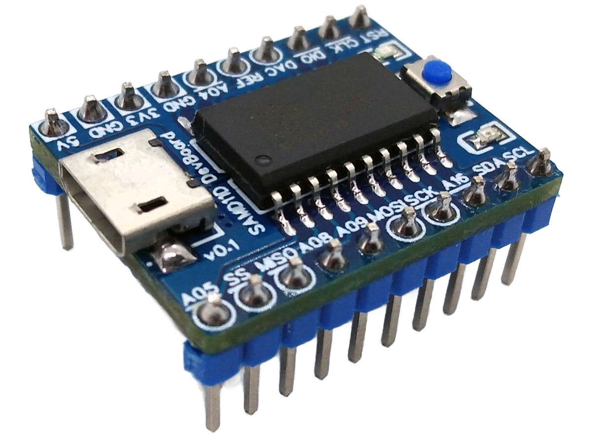

The ATSAMD11D14A is a low-power microcontroller using the 32-bit ARM® Cortex®-M0+ processor running at up to 48MHz at a voltage range of 1.62V - 3.63V. It features 16KB flash, 4KB SRAM, a full-speed USB 2.0 device interface that works without an external crystal, three serial communication interfaces (SERCOM) configurable as USART, I²C or SPI, a 12-bit ADC with up to 10 channels, a 10-bit DAC, two analog comparators, a 24-bit timer/counter for control, two 16-bit timer/counters, a 32-bit RTC, a 6-channel DMA controller, an event system and a peripheral touch controller.

## [ATSAMD21E Development Board](https://github.com/wagiminator/Development-Boards/tree/main/ATSAMD21E_DevBoard)
Development board for the ATSAMD21E (TQFP32) 32-bit ARM Cortex M0+ microcontroller with native USB 2.0, 32.768kHz crystal, USB bootloader support, and Arduino IDE support.

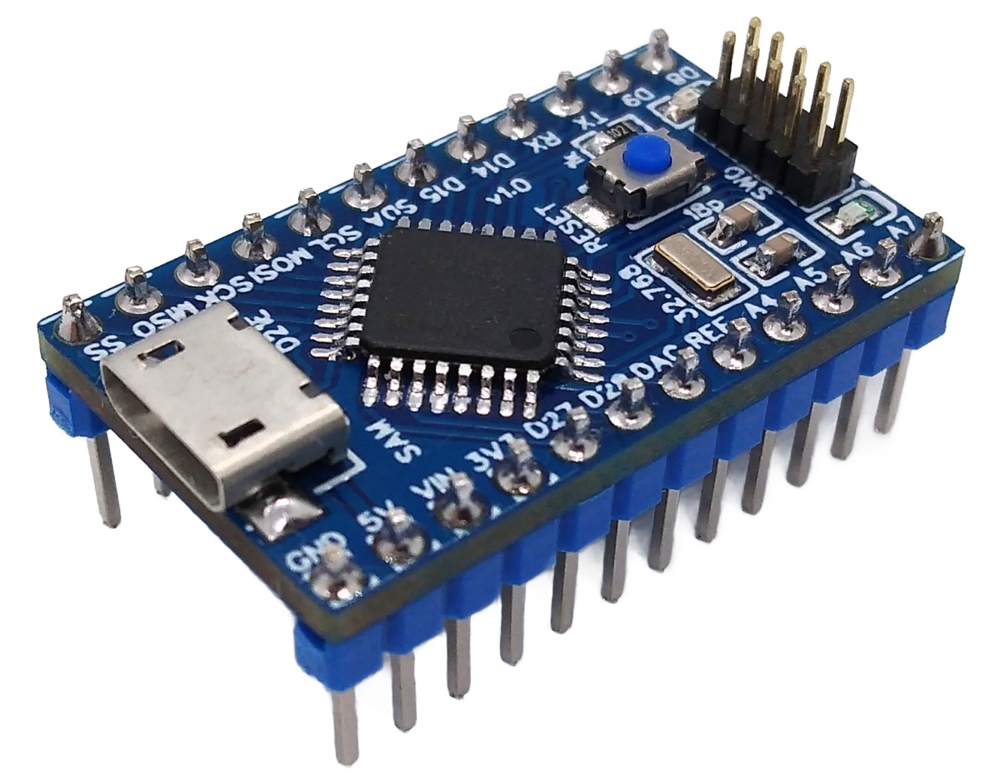

The ATSAMD21E is a low-power microcontroller using the 32-bit ARM® Cortex®-M0+ processor running at up to 48MHz at a voltage range of 1.62V - 3.63V. It features up to 256KB flash, 32KB SRAM, a full-speed USB 2.0 device/host interface that works without an external crystal, four serial communication interfaces (SERCOM) configurable as USART, I²C or SPI, an I²S interface, a 12-bit ADC, a 10-bit DAC, two analog comparators, three timer/counters for control, three 16-bit timer/counters, a 32-bit RTC, a 12-channel DMA controller, an event system and a peripheral touch controller.

## [ATmega4808 Development Board](https://github.com/wagiminator/Development-Boards/tree/main/ATmega4808_DevBoard)
Development board for the ATmega4808 series 8-bit AVR microcontrollers with integrated USB-to-serial converter, 32.768kHz crystal for the RTC, bootloader support, and Arduino IDE support.

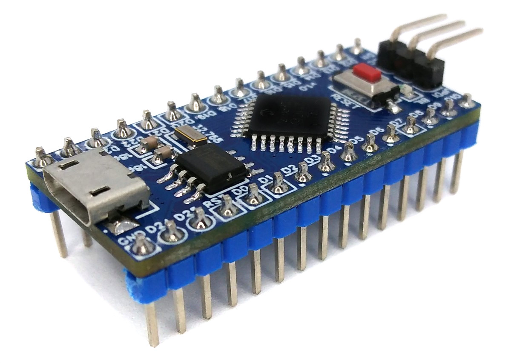

The ATmega4808 is part of the megaAVR 0-series, which uses the AVR processor with hardware multiplier running at up to 20MHz from the internal calibrated oscillator at a voltage range of 1.8V - 5.5V. It features 48KB flash, 6KB SRAM, 256 bytes EEPROM, a 10-bit ADC, an analog comparator, one 16-bit timer/counter type A, three 16-bit timer/counters type B, a real-time counter, three USARTs, SPI, I²C, configurable custom logic, an event system, and a 1-wire UPDI programming and debugging interface.

## [ATtiny814 Development Board](https://github.com/wagiminator/Development-Boards/tree/main/ATtiny814_DevBoard)
Development board for the ATtiny814 and other tinyAVR 14-pin 8-bit microcontrollers with integrated USB-to-serial converter, which can also be used as a SerialUPDI programmer to upload firmware, and Arduino IDE support.

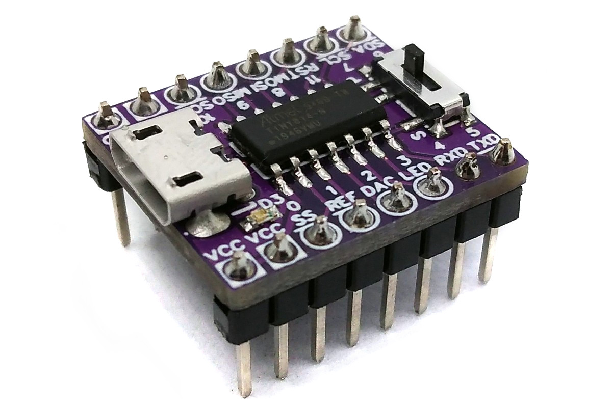

The ATtiny814 is part of the tinyAVR 1-series, which uses the AVR processor with hardware multiplier running at up to 20MHz from the internal oscillator at a voltage range of 1.8V - 5.5V. It features 8KB flash, 512 bytes SRAM, 128 bytes EEPROM, a 10-bit ADC, an 8-bit DAC, an analog comparator, a 16-bit timer/counter type A, a 16-bit timer/counter type B, a 12-bit timer/counter type D, a real-time counter, USART, SPI, I²C, configurable custom logic, an event system, a peripheral touch controller, and a 1-wire UPDI programming and debugging interface.

## [ATtiny3216 Development Board](https://github.com/wagiminator/Development-Boards/tree/main/ATtiny3216_DevBoard)
Development board for the ATtiny3216 and other tinyAVR 20-pin 8-bit microcontrollers with integrated USB-to-serial converter, which can also be used as a SerialUPDI programmer to upload firmware, and Arduino IDE support.

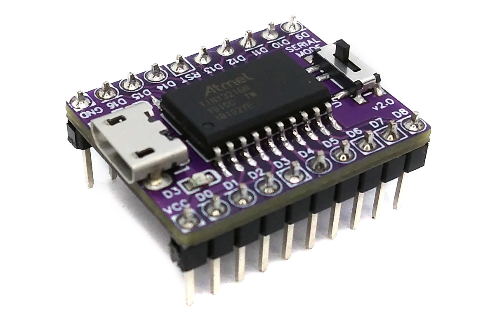

The ATtiny3216 is part of the tinyAVR 1-series, which uses the AVR processor with hardware multiplier running at up to 20MHz from the internal oscillator at a voltage range of 1.8V - 5.5V. It features 32KB flash, 2KB SRAM, 256 bytes EEPROM, two 10-bit ADCs, three 8-bit DACs, three analog comparators, a 16-bit timer/counter type A, two 16-bit timer/counters type B, a 12-bit timer/counter type D, a real-time counter, USART, SPI, I²C, configurable custom logic, an event system, a peripheral touch controller, and a 1-wire UPDI programming and debugging interface.

## [Development Board Adapter](https://github.com/wagiminator/Development-Boards/tree/main/DevBoard_Adapter)
The development adapter simplifies experimenting with the various development boards. Simply plug in the board, connect the desired components using jumper cables, and you're good to go.

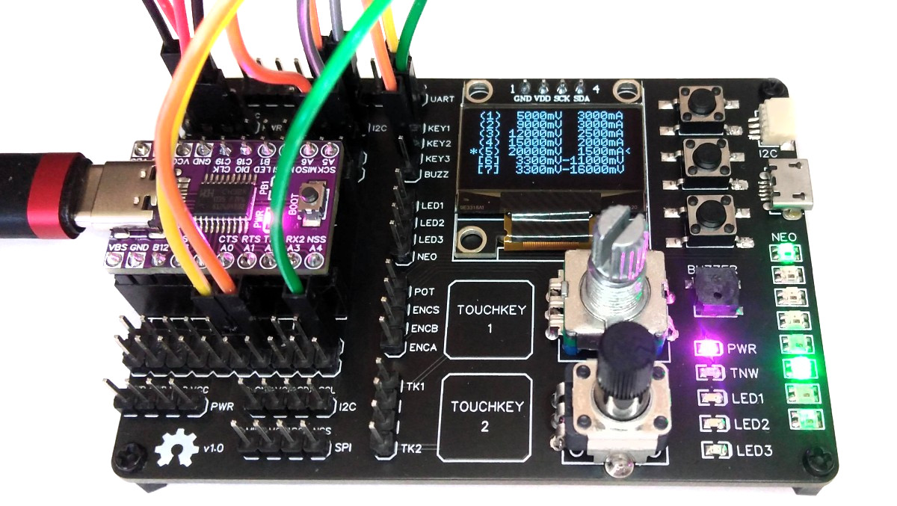

## [CH55xE Development Stick](https://github.com/wagiminator/Development-Boards/tree/main/CH55xE_DevStick)
Development stick for the CH552E and CH554E 8-bit 8051 core USB microcontrollers with a built-in LED on a PWM-capable pin, a WS2812 programmable LED (NeoPixel), a physical and a touch key, native USB 2.0, and Arduino IDE support. Explore the features of this cheap microcontroller without hooking up any wires!

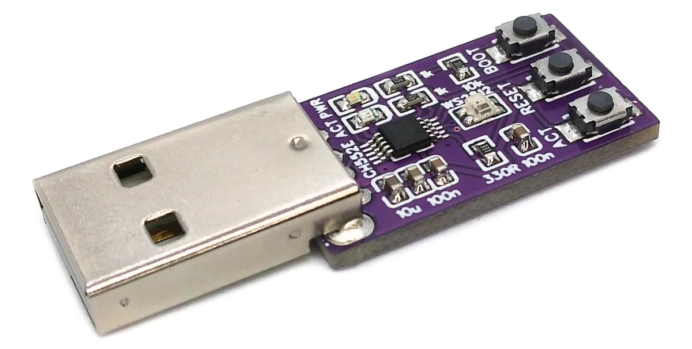

## [CH554E USB Host Development Stick](https://github.com/wagiminator/Development-Boards/tree/main/CH554E_HostDevBoard)
Development board for the USB host capabilities of the CH554E microcontroller with an integrated USB-A female connector for connecting USB devices like keyboards, mice, printers, hubs, etc. and a USB-A male connector for providing a serial interface for analysis and debugging on the PC.

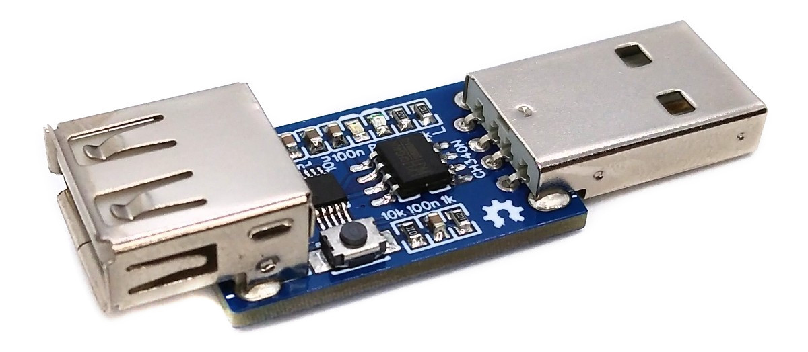

## [MAX3000A Development Board](https://github.com/wagiminator/Development-Boards/tree/main/MAX3000A_DevBoard)
CPLD Development Board for Altera EPM3032A/3064A.

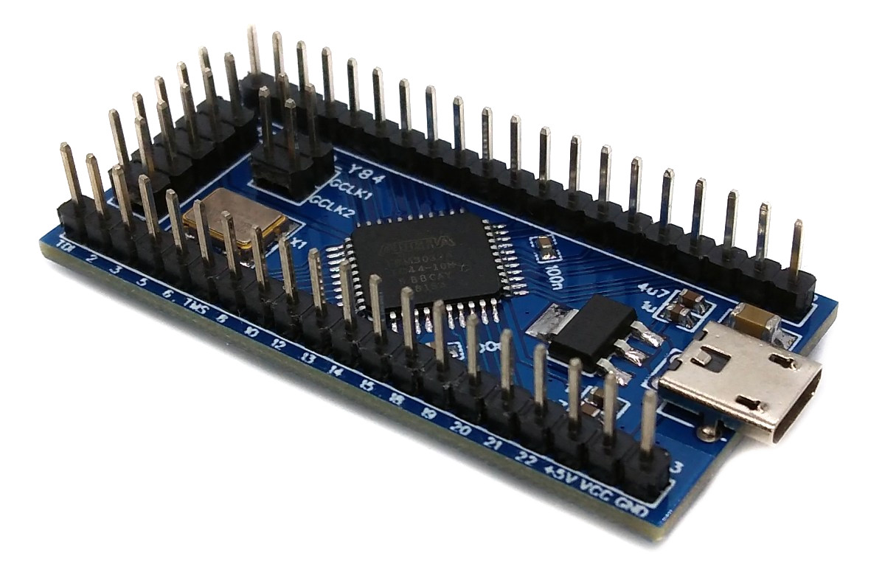
