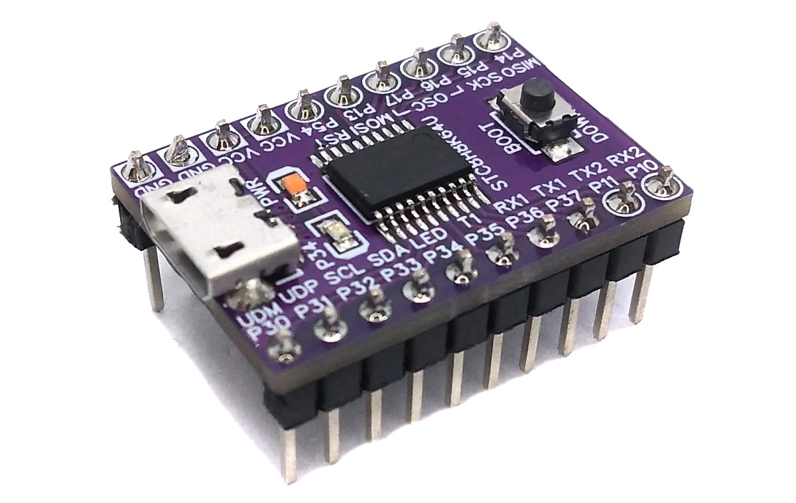
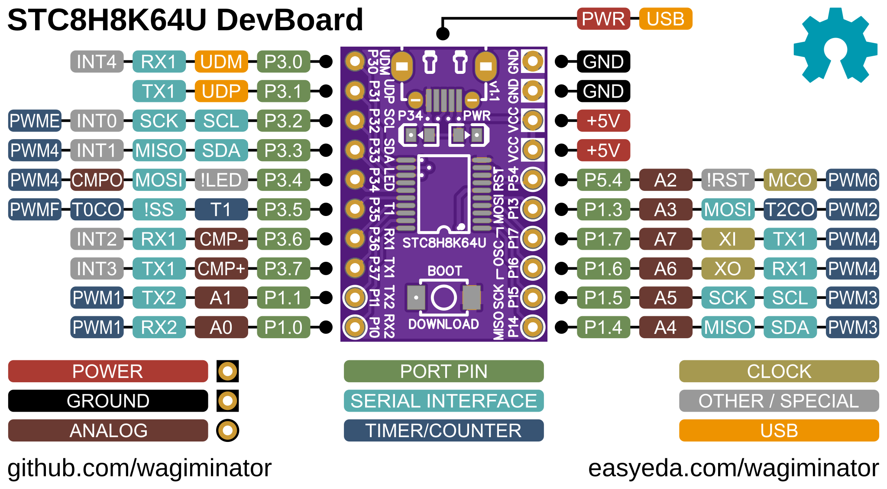
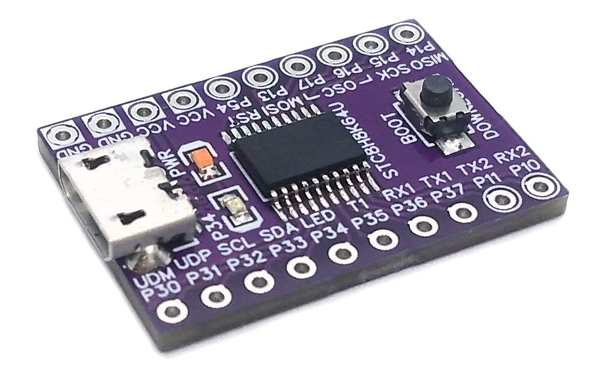
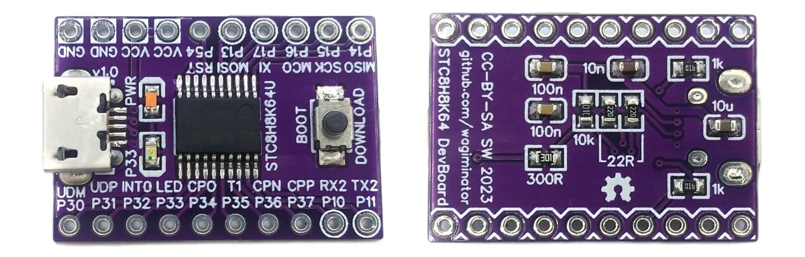

# STC8H8K64U-45I-TSSOP20 Development Board
Development board for the STC8H8K64U low-cost 8-bit 8051 core microcontroller with native full-speed USB 2.0 and factory built-in USB bootloader.



# Pinout


# The STC8H8K64U Family of 8-bit 8051 USB2.0 Microcontrollers
## Overview
The STC8H8K64U series is a cost-effective family of 8-bit microcontrollers with an ultra-high speed 8051 core that is compatible with the MCS51 instruction set. These microcontrollers offer an average instruction speed that is approximately 12 times faster than the traditional 8051, with most instructions requiring only one clock cycle for execution. They support clock frequencies of up to 40MHz, operate within a voltage range of 1.9V to 5.5V, and come equipped with standard peripherals such as a 12-bit ADC, analog comparator, multiple timers, PWM, DMA, UART, SPI, and I2C. Additionally, these microcontrollers feature a built-in bootloader, allowing firmware to be uploaded directly via the native full-speed USB 2.0 interface without the need for an extra programming device.

## Features
- Ultra-high-speed 8051 core with single clock per machine cycle (1T)
- Fully compatible instruction set with the traditional 8051
- Maximum 40MHz system main frequency
- 64KB Flash for user code (CODE)
- 128 bytes internal direct access SRAM (DATA)
- 128 bytes internal indirect access SRAM (IDATA)
- 8192 bytes internal extended SRAM (XDATA)
- 1280 bytes USB data RAM (FIFO)
- Up to 32KB EEPROM (size configurable), can be erased more than 100,000 times
- Operating voltage: 1.9V - 5.5V
- Internal high-precision RC clock (IRC), adjustable to a max of 45MHz, error ±0.3%
- Internal high-precision 48MHz clock (IRC48M) for USB module
- Internal 32KHz low-speed oscillator (LSI) with a large error
- External 4MHz - 33MHz oscillator or external clock (HSE)
- Hardware 16-bit multiplier and divider (MDU16)
- Enhanced dual 16-bit data pointer with auto-increment/auto-decrement and auto-switch
- Direct memory access (DMA) controller, supports MEM-to-MEM, UART, SPI, ADC, LCM
- Power-on reset, programmable low-voltage detector
- 22 interrupt sources and 4 interrupt priority levels
- Multiple low-power modes: Idle, Stop
- Up to 61 GPIOs
- 4 modes for all GPIOs: quasi-bidirectional, push-pull output, open-drain, high-impedance input
- 8 channels enhanced 16-bit PWM, complementary output with dead time, external pulse width measurement
- 5x 16-bit timers with multiple operating modes
- 1x watchdog timer
- 1x real-time clock (RTC) with calendar and alarm functions
- 1x USB2.0/USB1.1 full-speed device interface, 6 two-way endpoints with 64 byte FIFO each
- 4x UART interface, max baud rate F_CPU/4
- 1x SPI interface, master and slave mode
- 1x I2C interface, master and slave mode
- 1x 12-bit ADC, 14 channels + internal 1.19V reference voltage, 800ksps
- 1x set of comparators
- LCM (TFT color screen) driver, supports 8080 and 6800 interface, 8-bit and 16-bit data width
- Factory-built-in USB bootloader

# Programming and Debugging
## Factory Built-in USB Bootloader
The MCU has an embedded bootloader with USB interface (HID), which can be used to upload firmware without the need for an additional programming device. Because the USB bootloader functions as a Human Interface Device (HID), there's no need to install drivers. However, Linux doesn't initially grant sufficient permissions to access the bootloader. To resolve this issue, open a terminal and execute the following commands:

```
echo 'SUBSYSTEM=="usb", ATTR{idVendor}=="34bf", ATTR{idProduct}=="1001", MODE="666"' | sudo tee /etc/udev/rules.d/99-STC-ISP.rules
echo 'KERNEL=="hidraw*", ATTRS{idVendor}=="34bf", ATTRS{idProduct}=="1001", MODE="666"' | sudo tee -a /etc/udev/rules.d/99-STC-ISP.rules
sudo udevadm control --reload-rules
```

### Entering Bootloader Mode
To initiate new uploads, the bootloader needs to be manually started. Begin by unplugging the board from the USB port and disconnecting all power sources. Then, press and hold the BOOT button while reconnecting the board to your PC's USB port. This action triggers the chip to enter bootloader mode. Once in this mode, you can release the BOOT button and proceed to upload new firmware via USB.

### Uploading Firmware with stc8usb
The open-source platform-independent Python tool [stc8usb](https://pypi.org/project/stc8usb/) from the [MCU Flash Tools](https://github.com/wagiminator/MCU-Flash-Tools) is used by the makefiles of the example software. In order for this tool to work, [Python3](https://www.python.org/downloads/) with [pip](https://pip.pypa.io/en/stable/getting-started/) must be installed on your system. On Linux (Debian-based), all of this can be done with the following commands:

```
sudo apt install python3 python3-pip
pip install stc8usb
```

Usage example:

```
stc8usb -t 24000000 -f firmware.bin
```

The `-t` option trims the internal oscillator to the given frequency.

### Alternative Software Tools
- [STC-ISP](https://www.stcmicro.com/rjxz.html) - official closed-source tool by STC (Windows only)

# Software Development Tools
## Open-Source SDCC Toolchain
For compiling install the [SDCC](https://sdcc.sourceforge.net/) compiler. On Linux (Debian-based), this can be done with the following command:

```
sudo apt install build-essential sdcc
```

The [example software](#example-software) is based on the [MCU Templates](https://github.com/wagiminator/MCU-Templates/tree/main/STC8H8K64U), a lightweight starting point for bare-metal firmware development in C without any IDE. Each example folder contains a makefile. Go into the folder of an example and use one of the following commands:

```
make all       compile and build firmware
make flash     compile and upload firmware to the MCU
make clean     remove all build files
make help      show all options
```

## Arduino IDE Support
An unofficial Arduino core for STC8 microcontrollers can be found [here](https://github.com/chayanforyou/Arduino-STC8).

# Example Software
The following examples are included. They use the [MCU Templates](https://github.com/wagiminator/MCU-Templates) and their libraries. By default, the firmware is uploaded with `make flash` via the USB bootloader (stc8usb). The USB examples use shared VID/PID pairs for testing purposes only.

Some of the older examples (e.g. blink, pwm_fade, reset) are not yet based on the current MCU Templates. They contain their own copy of the flash tool in the *tools* folder, which is called via `python3` by the makefile. They can also be uploaded with the pip version of the tool.

| Example | Description |
|:-|:-|
| [adc](https://github.com/wagiminator/Development-Boards/tree/main/STC8H8K64U_DevBoard/software/adc) | Reads the supply voltage and the analog value on pin P1.1 (A1) once a second and sends the results via USB CDC (virtual serial port). |
| [blink](https://github.com/wagiminator/Development-Boards/tree/main/STC8H8K64U_DevBoard/software/blink) | Blink example. |
| [capsblock](https://github.com/wagiminator/Development-Boards/tree/main/STC8H8K64U_DevBoard/software/capsblock) | Tired of accidentally hitting the CAPS-LOCK key? It doesn't have to be. CAPS bLOCK identifies itself as a USB HID keyboard and constantly monitors the state of CAPS LOCK. It immediately deactivates it if it has been activated. |
| [cdc_echo](https://github.com/wagiminator/Development-Boards/tree/main/STC8H8K64U_DevBoard/software/cdc_echo) | Simple USB-CDC serial demo which echoes back all received messages. |
| [debug](https://github.com/wagiminator/Development-Boards/tree/main/STC8H8K64U_DevBoard/software/debug) | Sends a message via UART1 once a second. Connect pin P1.7 (TX) to RX of a USB-to-serial converter (115200 BAUD, 8N1). |
| [eeprom](https://github.com/wagiminator/Development-Boards/tree/main/STC8H8K64U_DevBoard/software/eeprom) | Increments a boot counter in the EEPROM (IAP area) at each start and sends a hex dump of the first 128 bytes of the EEPROM via USB CDC (virtual serial port). |
| [mousewiggler](https://github.com/wagiminator/Development-Boards/tree/main/STC8H8K64U_DevBoard/software/mousewiggler) | Keeps the PC awake: the device identifies itself as a USB HID mouse and moves the mouse pointer a tiny bit every 30 seconds. |
| [neopixel](https://github.com/wagiminator/Development-Boards/tree/main/STC8H8K64U_DevBoard/software/neopixel) | Shows a colorful animation on a string of NeoPixels (WS2812). The number of pixels can be changed in config.h. Connect pin P1.0 to DIN of the pixels string (via a ~330 ohms resistor). |
| [pwm_fade](https://github.com/wagiminator/Development-Boards/tree/main/STC8H8K64U_DevBoard/software/pwm_fade) | Fades built-in LED using PWM. |
| [reset](https://github.com/wagiminator/Development-Boards/tree/main/STC8H8K64U_DevBoard/software/reset) | Blinks built-in LED using continuous software resets. |
| [serial](https://github.com/wagiminator/Development-Boards/tree/main/STC8H8K64U_DevBoard/software/serial) | Echoes data sent via UART1 (115200 BAUD, 8N1). Connect pins P3.7 (TX) and P3.6 (RX) to a USB-to-serial converter. Uses interrupts and a ring buffer for RX. |
| [sleep](https://github.com/wagiminator/Development-Boards/tree/main/STC8H8K64U_DevBoard/software/sleep) | Blinks built-in LED using deep sleep and wake-up timer. |
| [spi_max7219](https://github.com/wagiminator/Development-Boards/tree/main/STC8H8K64U_DevBoard/software/spi_max7219) | Counts on a MAX7219 8-digit 7-segment display using hardware SPI. Connect DIN to P1.3 (MOSI), CLK to P1.5 (SCK) and LOAD/CS to P1.1. |
| [usb2oled](https://github.com/wagiminator/Development-Boards/tree/main/STC8H8K64U_DevBoard/software/usb2oled) | This code implements a simple USB controlled 128x64 pixels I2C OLED display. The MCU builds a USB communication device class (CDC) for serial communication via USB. |
| [watchdog](https://github.com/wagiminator/Development-Boards/tree/main/STC8H8K64U_DevBoard/software/watchdog) | Blink built-in LED using watchdog resets. |

# References, Links and Notes
- [EasyEDA Design Files](https://oshwlab.com/wagiminator)
- [STC Product Page](https://stcmicro.com/stc/stc8h8k64u.html)
- [STC-ISP Software](https://www.stcmicro.com/rjxz.html)
- [MCU Templates](https://github.com/wagiminator/MCU-Templates)
- [MCU Flash Tools](https://github.com/wagiminator/MCU-Flash-Tools)
- [Arduino Support](https://github.com/chayanforyou/Arduino-STC8)




# License


This work is licensed under Creative Commons Attribution-ShareAlike 3.0 Unported License.
(http://creativecommons.org/licenses/by-sa/3.0/)
