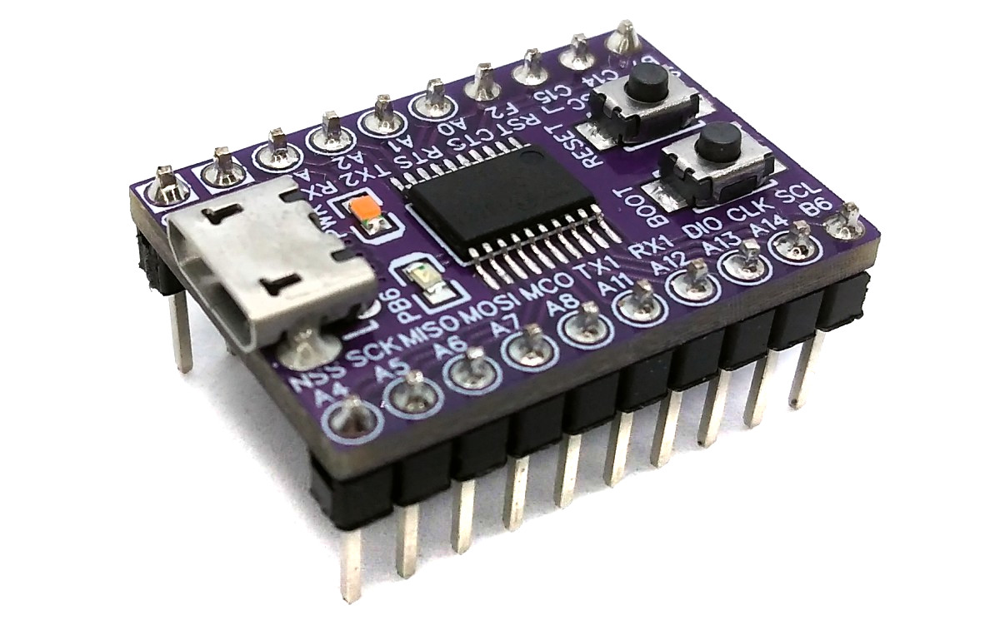
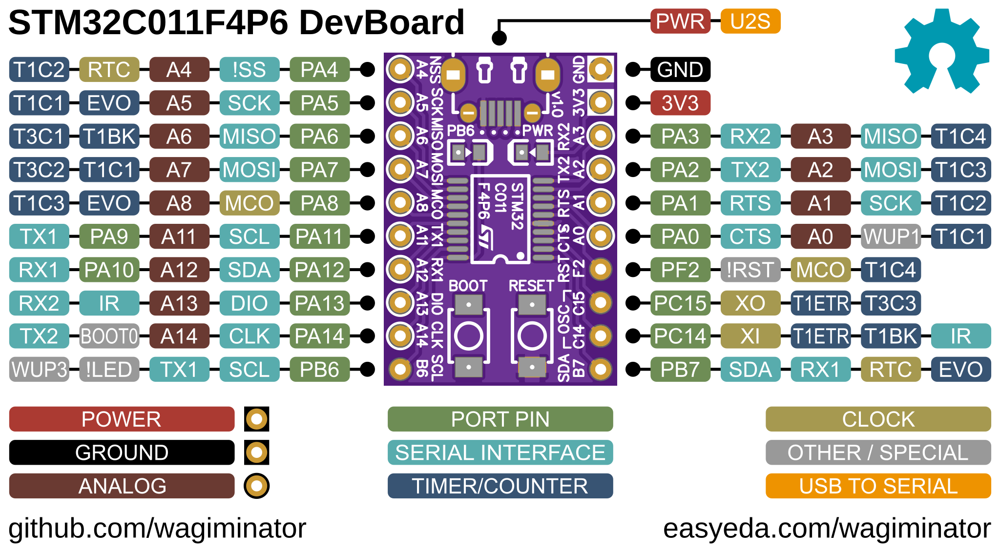
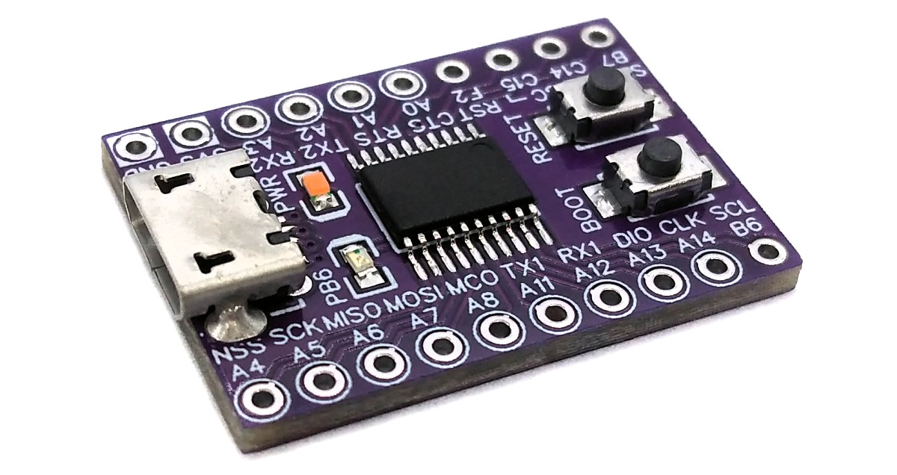
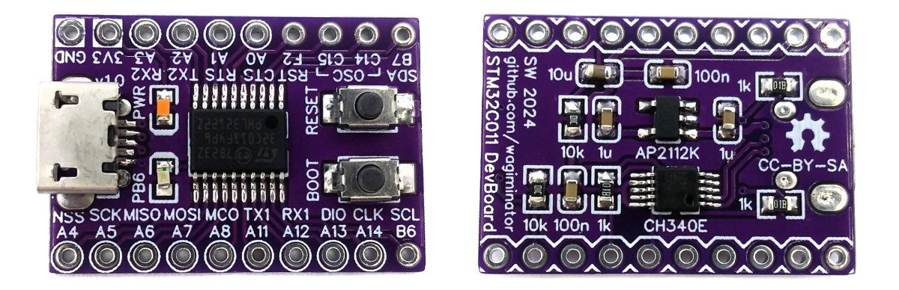

# STM32C011 F4P6 Development Board
Development board for the STM32C0x1FxP cost-effective 32-bit ARM Cortex M0+ microcontroller with integrated USB-to-serial adapter which can also be used to upload firmware utilizing the factory built-in serial bootloader.



# Pinout


# The STM32C0x1 Family of 32-bit ARM Microcontrollers
## Overview
The STM32C0x1 product line features an Arm® Cortex®-M0+ core and runs up to 48 MHz. Setting the lowest STM32 price point ever, the STM32C0x1 line makes no compromise on design quality and delivers a performance far beyond the existing 8-bit architectures. Compact, affordable, and reliable, the STM32C0x1 line features a fast 12-bit ADC with hardware resolution up to 16-bit, flexible mapping on the DMA channels, timers with advanced control capability, and several communication peripherals, always including 2 UARTs, even on the smallest microcontroller of the STM32C0x1 line. With STM32C0x1, application designers can start with an entry-level 32-bit MCU that leaves room for future product upgrades, thanks to the broad STM32 portfolio and ecosystem. The STM32C0x1 shares the same technological and design platform as the STM32G0, and benefits from a consistent pinout mapping. The portfolio supports from 16 to 32 Kbytes of on-chip flash memory.

## Compatible Microcontrollers in TSSOP-20 Package
 MCU|Flash|SRAM
:---|----:|---:
STM32C011F4P|16KB|6KB
STM32C011F6P|32KB|6KB
STM32C031F4P|16KB|12KB
STM32C031F6P|32KB|12KB

## Features of STM32C0x1FxP
- 32-bit ARM® Cortex®-M0+ CPU
- Maximum 48MHz system main frequency
- Up to 32KB Flash with memory protection
- Up to 12KB SRAM with hardware parity check
- Operating voltage: 2.0V - 3.6V
- Internal 48MHz (±1%) RC oscillator (HSI)
- Internal 32kHz (±5%) RC oscillator (LSI)
- External 4-48MHz crystal oscillator (HSE)
- External 32kHz crystal oscillator (LSE) with calibration
- Multiple low-power modes: Sleep, Stop, Standby, Shutdown
- Power on/down reset
- 18 I/Os, all available as external interrupts, all 5V-tolerant
- 1x 3-channel DMA controller with flexible mapping
- 1x 12-bit ADC, up to 19 channels, 16-bit oversampling, 0V - 3.6V
- 1× 16-bit advanced control timer
- 4× 16-bit general-purpose timer
- 2x watchdog timer (IWDG, WWDG)
- 1x SysTick timer
- 1x real-time clock (RTC) with calendar, alarm and periodic wake-up
- 2x USART interface, one with LIN, IrDA, auto baud and wake-up feature
- 1x I²C interface supporting Fast-mode Plus (1Mbit/s), wake-up feature
- 1x SPI interface, 24Mbit/s, multiplexed with I²S interface
- Hardware CRC-32 calculation unit
- Serial wire debug interface (SWD)
- Factory built-in embedded UART bootloader

# Programming and Debugging
There are two ways to program the microcontroller: via USB using the factory built-in UART bootloader and the integrated USB-to-serial converter, and via the serial wire debug interface (SWD) using an SWD programmer.

## Factory Built-in UART Bootloader
The MCU has an embedded bootloader with UART interface, which can be used to upload firmware using the USB-to-serial converter integrated into the board. If necessary, a driver for the [CH340](https://www.wch-ic.com/downloads/CH341SER_ZIP.html) USB-to-serial converter must be installed.

To upload firmware via the USB port, the MCU must first be put into boot mode using ONE of the following methods:
- Disconnect your board from all power supplies, press and hold the BOOT button, then connect the board to your USB port. The BOOT button can be released now.
- Connect your board to your USB port. Press and hold the BOOT button, then press and release the RESET button and then release the BOOT button.

### Uploading Firmware with stm32isp
The open-source platform-independent Python tool [stm32isp](https://pypi.org/project/stm32isp/) from the [MCU Flash Tools](https://github.com/wagiminator/MCU-Flash-Tools) is used by the makefiles of the example software. In order for this tool to work, [Python3](https://www.python.org/downloads/) with [pip](https://pip.pypa.io/en/stable/getting-started/) must be installed on your system. On Linux (Debian-based), all of this can be done with the following commands:

```
sudo apt install python3 python3-pip
pip install stm32isp
```

Usage example:

```
stm32isp -f firmware.bin
```

On STM32C0x1 microcontrollers, the BOOT0 pin is initially disabled. When the chip is brand new or the main flash memory is erased, this isn't an issue as the embedded bootloader automatically kicks in. By using stm32isp, the BOOT0 pin will then be activated for subsequent use. However, if the chip has been previously programmed using a different software tool, the bootloader might not be accessible through the BOOT0 pin (or BOOT button) anymore. In such cases, the nBOOT_SEL bit in the User Option Bytes must be cleared (set to 0) using an SWD programmer, e.g. with tinyocd.

Alternatively, you can use the [STM32 ISP web app](https://wagiminator.github.io/apps/stm32isp/) directly in your web browser (Chrome, Edge or Opera on a desktop computer) without installing any software.

## Serial Wire Debug Interface (SWD)
The MCU can also be programmed and debugged via the SWD interface using an SWD programmer such as DAPLink/CMSIS-DAP, ST-Link V2, J-Link or the Raspberry Pi Debug Probe. Connect the programmer to the SWDIO (PA13) and SWCLK (PA14) pins of the board.

Suitable SWD programmers (CMSIS-DAP) can be found on my GitHub page:
- [CH552 DAPLink](https://github.com/wagiminator/CH552-DAPLink) - CMSIS-DAP compliant debug probe with SWD/JTAG and virtual COM port
- [CH552 picoDAP](https://github.com/wagiminator/CH552-picoDAP) - tiny CMSIS-DAP compliant debug probe with SWD
- [SWD Programmer Stick](https://github.com/wagiminator/SAMD-Development-Boards/tree/main/SWD_Programmer_Stick) - CMSIS-DAP programmer in USB stick format

### Uploading Firmware with tinyocd
The open-source platform-independent Python tool [tinyocd](https://pypi.org/project/tinyocd/) from the [MCU Flash Tools](https://github.com/wagiminator/MCU-Flash-Tools) is used by the makefiles of the example software. In order for this tool to work, [Python3](https://www.python.org/downloads/) with [pip](https://pip.pypa.io/en/stable/getting-started/) must be installed on your system. On Linux (Debian-based), all of this can be done with the following commands:

```
sudo apt install python3 python3-pip
pip install tinyocd
```

Usage example:

```
tinyocd -f firmware.bin
```

Programmer and chip are detected automatically. On Linux, grant access permissions for the programmer as described in the [tinyocd documentation](https://pypi.org/project/tinyocd/).

Alternatively, you can use the [SWD Programmer web app](https://wagiminator.github.io/apps/swdprog/) directly in your web browser (Chrome, Edge or Opera on a desktop computer) without installing any software.

### Alternative Software Tools
- [pyOCD](https://pyocd.io/) (`pyocd load firmware.bin -t stm32c011f4px`)
- [OpenOCD](https://openocd.org/)
- [STM32CubeProgrammer](https://www.st.com/en/development-tools/stm32cubeprog.html) - official tool by ST

# Software Development Tools
## Open-Source GCC Toolchain
For compiling install the [ARM GNU toolchain](https://developer.arm.com/downloads/-/arm-gnu-toolchain-downloads). On Linux (Debian-based), this can be done with the following command:

```
sudo apt install build-essential gcc-arm-none-eabi
```

The [example software](#example-software) is based on the [MCU Templates](https://github.com/wagiminator/MCU-Templates/tree/main/STM32C011), a lightweight starting point for bare-metal firmware development in C without any IDE. Each example folder contains a makefile. Go into the folder of an example and use one of the following commands:

```
make all       compile and build firmware
make flash     compile and upload firmware to the MCU
make clean     remove all build files
make help      show all options
```

## Arduino IDE and PlatformIO Support
You can use [STM32duino](https://github.com/stm32duino/Arduino_Core_STM32) as an Arduino IDE core for several STM32 microcontrollers. There is also support for [PlatformIO](https://docs.platformio.org/en/latest/platforms/ststm32.html).

# Example Software
The following examples are included. They use the [MCU Templates](https://github.com/wagiminator/MCU-Templates) and their libraries. By default, the firmware is uploaded with `make flash` via the UART bootloader (stm32isp). The serial interface (UART) is connected to the integrated USB-to-serial converter.

Some of the older examples (e.g. adc, backup, blink) are not yet based on the current MCU Templates. They contain their own copy of the flash tool in the *tools* folder, which is called via `python3` by the makefile. They can also be uploaded with the pip version of the tool.

| Example | Description |
|:-|:-|
| [adc](https://github.com/wagiminator/Development-Boards/tree/main/STM32C011F4P6_DevBoard/software/adc) | ADC example including supply voltage and temperature measurement. |
| [backup](https://github.com/wagiminator/Development-Boards/tree/main/STM32C011F4P6_DevBoard/software/backup) | Blink LED using backup registers to retain LED state after reset. |
| [blink](https://github.com/wagiminator/Development-Boards/tree/main/STM32C011F4P6_DevBoard/software/blink) | Blink example. |
| [crc](https://github.com/wagiminator/Development-Boards/tree/main/STM32C011F4P6_DevBoard/software/crc) | Send a message through UART with a newline at the end, and the CRC of the message will be sent back. We're checking if the CRC module works. |
| [debug](https://github.com/wagiminator/Development-Boards/tree/main/STM32C011F4P6_DevBoard/software/debug) | Sends a message via UART once a second. |
| [i2c_eeprom](https://github.com/wagiminator/Development-Boards/tree/main/STM32C011F4P6_DevBoard/software/i2c_eeprom) | Writes a test pattern to a 24Cxx I2C EEPROM, reads it back and sends a hex dump via the USB-to-serial converter (115200 BAUD, 8N1). Connect the EEPROM to PA12 (SDA) and PA11 (SCL). |
| [max7219_segment](https://github.com/wagiminator/Development-Boards/tree/main/STM32C011F4P6_DevBoard/software/max7219_segment) | Counts on a MAX7219 8-digit 7-segment display using hardware SPI. Connect DIN to PA7 (MOSI), CLK to PA5 (SCK) and LOAD/CS to PA4. |
| [neopixel](https://github.com/wagiminator/Development-Boards/tree/main/STM32C011F4P6_DevBoard/software/neopixel) | Shows a colorful animation on a string of 8 NeoPixels. The number of pixels can be changed in neo_spi.h. Connect pin PA7 (MOSI) to DIN of the pixels string. |
| [oled_terminal](https://github.com/wagiminator/Development-Boards/tree/main/STM32C011F4P6_DevBoard/software/oled_terminal) | Displays text sent via UART on an SSD1306 128x64 pixels OLED. |
| [oled_txt](https://github.com/wagiminator/Development-Boards/tree/main/STM32C011F4P6_DevBoard/software/oled_txt) | SSD1306 128x64 pixels I2C OLED text demo (text sizes, segment digits and bitmaps). Connect the OLED to PA12 (SDA) and PA11 (SCL). |
| [reset](https://github.com/wagiminator/Development-Boards/tree/main/STM32C011F4P6_DevBoard/software/reset) | Blink built-in LED using software resets. |
| [rtc](https://github.com/wagiminator/Development-Boards/tree/main/STM32C011F4P6_DevBoard/software/rtc) | Blink built-in LED and print RTC time register via serial interface every second. |
| [serial](https://github.com/wagiminator/Development-Boards/tree/main/STM32C011F4P6_DevBoard/software/serial) | Echoes data sent via USART1. |
| [serial_dma](https://github.com/wagiminator/Development-Boards/tree/main/STM32C011F4P6_DevBoard/software/serial_dma) | Echoes data sent via USART1. Uses DMA for RX. |
| [watchdog](https://github.com/wagiminator/Development-Boards/tree/main/STM32C011F4P6_DevBoard/software/watchdog) | Blink built-in LED using independent watchdog resets. |

# References, Links and Notes
- [EasyEDA Design Files](https://oshwlab.com/wagiminator)
- [STM Product Page](https://www.st.com/en/microcontrollers-microprocessors/stm32c0x1.html)
- [MCU Templates](https://github.com/wagiminator/MCU-Templates)
- [MCU Flash Tools](https://github.com/wagiminator/MCU-Flash-Tools)
- [STM32duino](https://github.com/stm32duino/Arduino_Core_STM32)
- [ST-Link Software](https://www.st.com/en/development-tools/st-link-v2.html#tools-software)
- [STM32 ISP Web App](https://wagiminator.github.io/apps/stm32isp/)
- [SWD Programmer Web App](https://wagiminator.github.io/apps/swdprog/)




# License


This work is licensed under Creative Commons Attribution-ShareAlike 3.0 Unported License.
(http://creativecommons.org/licenses/by-sa/3.0/)
