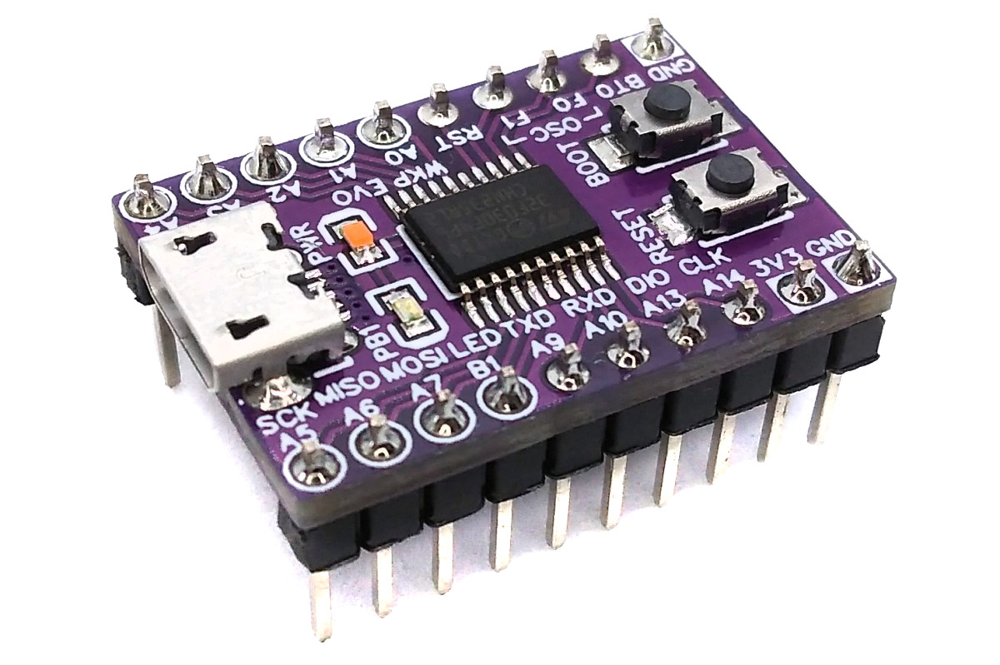
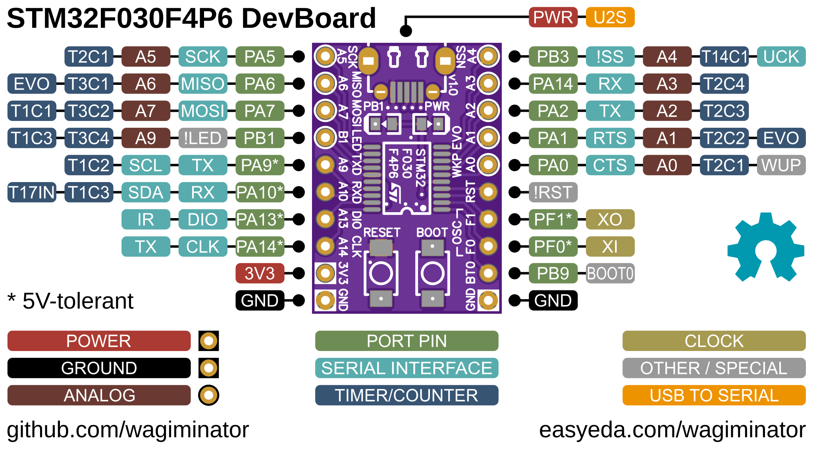
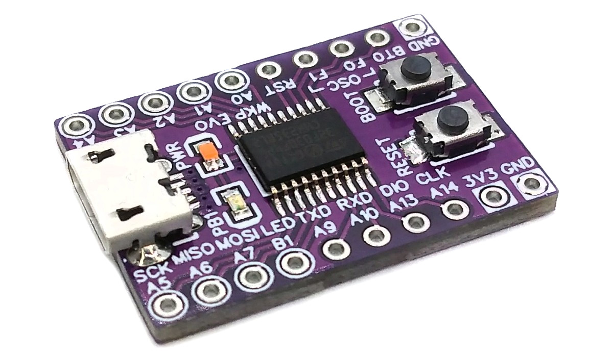
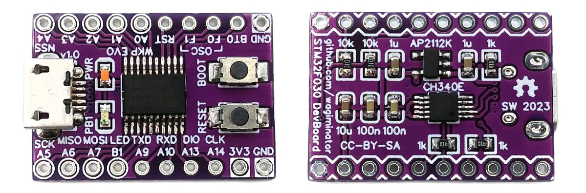

# STM32F030 F4P6 Development Board
Development board for the STM32F030F4P6 cost-effective 32-bit ARM Cortex M0 microcontroller with integrated USB-to-serial adapter which can also be used to upload firmware utilizing the factory built-in serial bootloader. Due to the comparable pinouts, this board can also be used with other microcontrollers from the STM32F0 and STM32L0 series that come in the same TSSOP20 package.



# Pinout


# The STM32F030 Family of 32-bit ARM Microcontrollers
## Overview
The STM32F030 microcontrollers feature an Arm® Cortex®-M0 core and run at speeds up to 48 MHz. While achieving the STM32’s lowest ever price point, the STM32F030 line comes with a full set of performing peripherals, such as fast 12-bit ADC, advanced and flexible timers, calendar RTC and communication peripherals such as the I²C, USART and SPI. This combination easily outperforms existing 8-bit architectures and allows all application designers to benefit from the simplicity and efficiency of a state-of-the-art 32-bit core. The STM32F030 line covers many memory and pin count combinations with only few competitive devices and thus further enhances the overall cost efficiency of your projects. Application designers starting with the STM32F030 benefit from being able to upgrade to any of the devices in the powerful STM32 portfolio at any time with an extraordinary degree of reusability of tools and application software.

## Features of STM32F030F4P6
- 32-bit ARM® Cortex®-M0 CPU
- Maximum 48MHz system main frequency
- 4KB SRAM with hardware parity check
- 16KB Flash
- Operating voltage: 2.4V - 3.6V
- Internal 8MHz RC oscillator (HSI) with PLL option
- Internal 40kHz RC oscillator (LSI)
- External 4-32MHz crystal oscillator (HSE)
- Multiple low-power modes: Sleep, Stop, Standby
- Power on/down reset
- 15 I/Os, all available as external interrupts, many 5V-tolerant
- 1x 5-channel DMA controller with flexible mapping
- 1x 12-bit ADC, up to 9+2 channels, 0V - 3.6V
- 1× 16-bit advanced-control timer wit 6 PWM-channels
- 4× 16-bit general-purpose timer
- 2x watchdog timer
- 1x SysTick timer
- 1x real-time clock (RTC) with calendar, alarm and periodic wakeup
- 1x USART interface with auto baud rate detection
- 1x I²C interface supporting Fast-mode Plus (1Mbit/s)
- 1x SPI interface with up to 18Mbit/s
- Hardware CRC-32 calculation unit
- Serial wire debug interface (SWD)
- Factory built-in embedded UART bootloader

# Programming and Debugging
There are two ways to program the microcontroller: via USB using the factory built-in UART bootloader and the integrated USB-to-serial converter, and via the serial wire debug interface (SWD) using an SWD programmer.

## Factory Built-in UART Bootloader
The MCU has an embedded bootloader with UART interface, which can be used to upload firmware using the USB-to-serial converter integrated into the board. If necessary, a driver for the [CH340](https://www.wch-ic.com/downloads/CH341SER_ZIP.html) USB-to-serial converter must be installed.

To upload firmware via the USB port, the MCU must first be put into boot mode using ONE of the following methods:
- Disconnect your board from all power supplies, press and hold the BOOT button, then connect the board to your USB port. The BOOT button can be released now.
- Connect your board to your USB port. Press and hold the BOOT button, then press and release the RESET button and then release the BOOT button.

### Uploading Firmware with stm32isp
The open-source platform-independent Python tool [stm32isp](https://pypi.org/project/stm32isp/) from the [MCU Flash Tools](https://github.com/wagiminator/MCU-Flash-Tools) is used by the makefiles of the example software. In order for this tool to work, [Python3](https://www.python.org/downloads/) with [pip](https://pip.pypa.io/en/stable/getting-started/) must be installed on your system. On Linux (Debian-based), all of this can be done with the following commands:

```
sudo apt install python3 python3-pip
pip install stm32isp
```

Usage example:

```
stm32isp -f firmware.bin
```

Alternatively, you can use the [STM32 ISP web app](https://wagiminator.github.io/apps/stm32isp/) directly in your web browser (Chrome, Edge or Opera on a desktop computer) without installing any software.

## Serial Wire Debug Interface (SWD)
The MCU can also be programmed and debugged via the SWD interface using an SWD programmer such as DAPLink/CMSIS-DAP, ST-Link V2, J-Link or the Raspberry Pi Debug Probe. Connect the programmer to the SWDIO (PA13) and SWCLK (PA14) pins of the board.

Suitable SWD programmers (CMSIS-DAP) can be found on my GitHub page:
- [CH552 DAPLink](https://github.com/wagiminator/CH552-DAPLink) - CMSIS-DAP compliant debug probe with SWD/JTAG and virtual COM port
- [CH552 picoDAP](https://github.com/wagiminator/CH552-picoDAP) - tiny CMSIS-DAP compliant debug probe with SWD
- [SWD Programmer Stick](https://github.com/wagiminator/SAMD-Development-Boards/tree/main/SWD_Programmer_Stick) - CMSIS-DAP programmer in USB stick format

### Uploading Firmware with tinyocd
The open-source platform-independent Python tool [tinyocd](https://pypi.org/project/tinyocd/) from the [MCU Flash Tools](https://github.com/wagiminator/MCU-Flash-Tools) is used by the makefiles of the example software. In order for this tool to work, [Python3](https://www.python.org/downloads/) with [pip](https://pip.pypa.io/en/stable/getting-started/) must be installed on your system. On Linux (Debian-based), all of this can be done with the following commands:

```
sudo apt install python3 python3-pip
pip install tinyocd
```

Usage example:

```
tinyocd -f firmware.bin
```

Programmer and chip are detected automatically. On Linux, grant access permissions for the programmer as described in the [tinyocd documentation](https://pypi.org/project/tinyocd/).

Alternatively, you can use the [SWD Programmer web app](https://wagiminator.github.io/apps/swdprog/) directly in your web browser (Chrome, Edge or Opera on a desktop computer) without installing any software.

### Alternative Software Tools
- [pyOCD](https://pyocd.io/) (`pyocd load firmware.bin -t stm32f030f4px`)
- [OpenOCD](https://openocd.org/)
- [STM32CubeProgrammer](https://www.st.com/en/development-tools/stm32cubeprog.html) - official tool by ST

# Software Development Tools
## Open-Source GCC Toolchain
For compiling install the [ARM GNU toolchain](https://developer.arm.com/downloads/-/arm-gnu-toolchain-downloads). On Linux (Debian-based), this can be done with the following command:

```
sudo apt install build-essential gcc-arm-none-eabi
```

The [example software](#example-software) is based on the [MCU Templates](https://github.com/wagiminator/MCU-Templates/tree/main/STM32F030), a lightweight starting point for bare-metal firmware development in C without any IDE. Each example folder contains a makefile. Go into the folder of an example and use one of the following commands:

```
make all       compile and build firmware
make flash     compile and upload firmware to the MCU
make clean     remove all build files
make help      show all options
```

## Arduino IDE and PlatformIO Support
You can use [STM32duino](https://github.com/stm32duino/Arduino_Core_STM32) as an Arduino IDE core for several STM32 microcontrollers. There is also support for [PlatformIO](https://docs.platformio.org/en/latest/platforms/ststm32.html).

# Example Software
The following examples are included in the folders *stm32f030* (for STM32F030F4P6) and *stm32l010* (for STM32L010F4P6). They use the [MCU Templates](https://github.com/wagiminator/MCU-Templates) and their libraries. By default, the firmware is uploaded with `make flash` via the UART bootloader (stm32isp). The serial interface (UART) is connected to the integrated USB-to-serial converter.

| Example | Description |
|:-|:-|
| [stm32f030/adc](https://github.com/wagiminator/Development-Boards/tree/main/STM32F030F4P6_DevBoard/software/stm32f030/adc) | ADC example including temperature and supply voltage measurement. |
| [stm32f030/blink](https://github.com/wagiminator/Development-Boards/tree/main/STM32F030F4P6_DevBoard/software/stm32f030/blink) | Blink example. |
| [stm32f030/crc](https://github.com/wagiminator/Development-Boards/tree/main/STM32F030F4P6_DevBoard/software/stm32f030/crc) | Send a message through UART with a newline at the end, and the CRC of the message will be sent back. |
| [stm32f030/debug](https://github.com/wagiminator/Development-Boards/tree/main/STM32F030F4P6_DevBoard/software/stm32f030/debug) | Sends a message via UART once a second. |
| [stm32f030/reset](https://github.com/wagiminator/Development-Boards/tree/main/STM32F030F4P6_DevBoard/software/stm32f030/reset) | Blink built-in LED using software resets. |
| [stm32f030/rtc](https://github.com/wagiminator/Development-Boards/tree/main/STM32F030F4P6_DevBoard/software/stm32f030/rtc) | Blink built-in LED and print RTC time register via serial interface every second. |
| [stm32f030/serial](https://github.com/wagiminator/Development-Boards/tree/main/STM32F030F4P6_DevBoard/software/stm32f030/serial) | Echoes data sent via UART. |
| [stm32f030/serial_dma](https://github.com/wagiminator/Development-Boards/tree/main/STM32F030F4P6_DevBoard/software/stm32f030/serial_dma) | Echoes data sent via UART. Uses DMA for RX. |
| [stm32f030/watchdog](https://github.com/wagiminator/Development-Boards/tree/main/STM32F030F4P6_DevBoard/software/stm32f030/watchdog) | Blink built-in LED using independent watchdog resets. |
| [stm32l010/adc](https://github.com/wagiminator/Development-Boards/tree/main/STM32F030F4P6_DevBoard/software/stm32l010/adc) | ADC example including temperature and supply voltage measurement. |
| [stm32l010/blink](https://github.com/wagiminator/Development-Boards/tree/main/STM32F030F4P6_DevBoard/software/stm32l010/blink) | Blink example. |
| [stm32l010/crc](https://github.com/wagiminator/Development-Boards/tree/main/STM32F030F4P6_DevBoard/software/stm32l010/crc) | Send a message through UART with a newline at the end, and the CRC of the message will be sent back. |
| [stm32l010/debug](https://github.com/wagiminator/Development-Boards/tree/main/STM32F030F4P6_DevBoard/software/stm32l010/debug) | Sends a message via UART once a second. |
| [stm32l010/eeprom](https://github.com/wagiminator/Development-Boards/tree/main/STM32F030F4P6_DevBoard/software/stm32l010/eeprom) | Transfers content of data EEPROM via UART. |
| [stm32l010/lptim](https://github.com/wagiminator/Development-Boards/tree/main/STM32F030F4P6_DevBoard/software/stm32l010/lptim) | Blink built-in LED using low-power timer. |
| [stm32l010/reset](https://github.com/wagiminator/Development-Boards/tree/main/STM32F030F4P6_DevBoard/software/stm32l010/reset) | Blink built-in LED using software resets. |
| [stm32l010/rtc](https://github.com/wagiminator/Development-Boards/tree/main/STM32F030F4P6_DevBoard/software/stm32l010/rtc) | Blink built-in LED and print RTC time register via serial interface every second. |
| [stm32l010/serial](https://github.com/wagiminator/Development-Boards/tree/main/STM32F030F4P6_DevBoard/software/stm32l010/serial) | Echoes data sent via UART. |
| [stm32l010/watchdog](https://github.com/wagiminator/Development-Boards/tree/main/STM32F030F4P6_DevBoard/software/stm32l010/watchdog) | Blink built-in LED using independent watchdog resets. |

# References, Links and Notes
- [EasyEDA Design Files](https://oshwlab.com/wagiminator)
- [STM Product Page](https://www.st.com/en/microcontrollers-microprocessors/stm32f030f4.html)
- [MCU Templates](https://github.com/wagiminator/MCU-Templates)
- [MCU Flash Tools](https://github.com/wagiminator/MCU-Flash-Tools)
- [STM32duino](https://github.com/stm32duino/Arduino_Core_STM32)
- [ST-Link Software](https://www.st.com/en/development-tools/st-link-v2.html#tools-software)
- [STM32 ISP Web App](https://wagiminator.github.io/apps/stm32isp/)
- [SWD Programmer Web App](https://wagiminator.github.io/apps/swdprog/)




# License


This work is licensed under Creative Commons Attribution-ShareAlike 3.0 Unported License.
(http://creativecommons.org/licenses/by-sa/3.0/)
